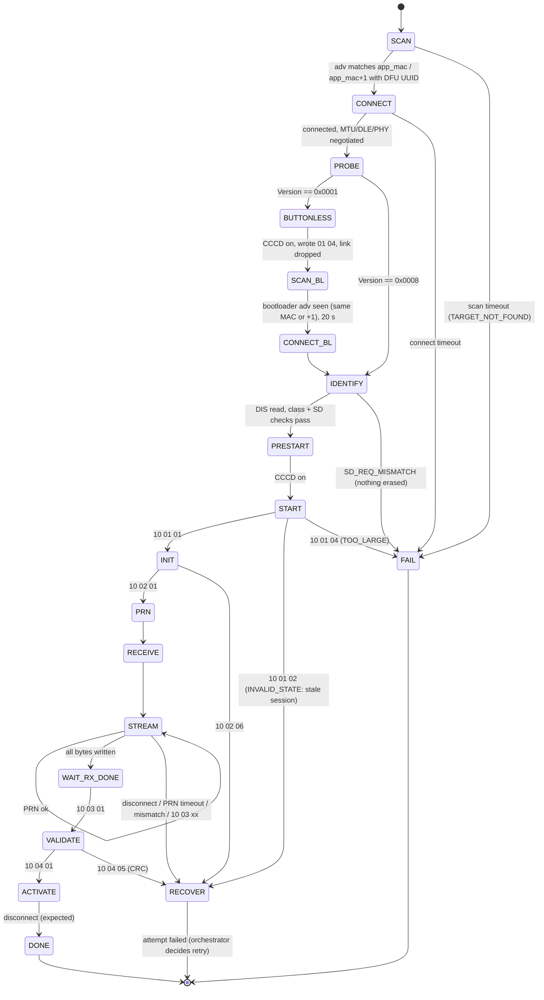
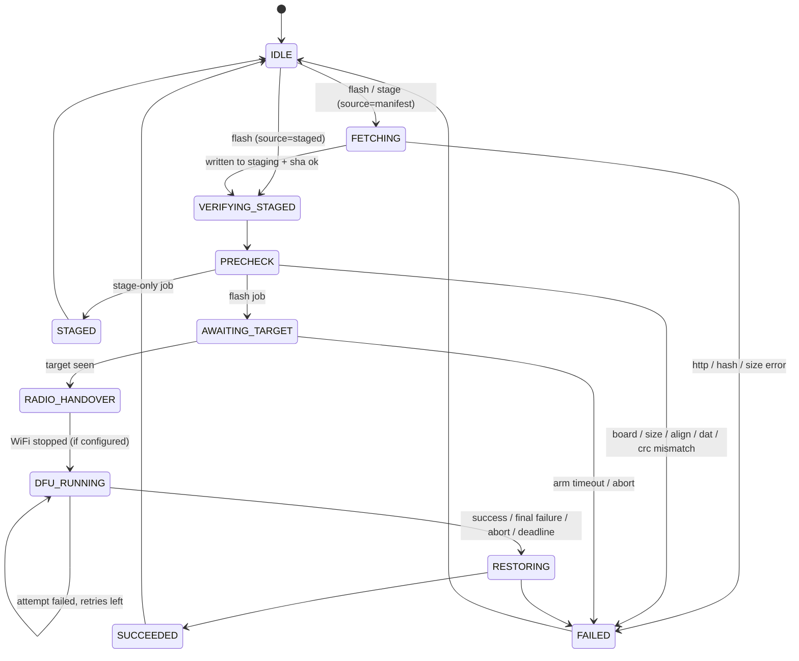

# DFU32 — Specification

**Status:** Draft v0.1 (2026-11-04). No implementation exists yet.
**License:** MIT
**Companion docs:** [`docs/OPEN_QUESTIONS.md`](docs/OPEN_QUESTIONS.md), [`docs/MILESTONES.md`](docs/MILESTONES.md), [`docs/PROTOCOL_NOTES.md`](docs/PROTOCOL_NOTES.md)

DFU32 is ESP-IDF firmware for a small ESP32 device that sits near an nRF52 board. It pulls an application image from a server you control and flashes it into the nRF52 over BLE, using Nordic's **legacy** DFU protocol as implemented by the **Adafruit nRF52 bootloader** and its OTAFIX fork. It replaces the "phone running nRF Device Firmware Update standing next to the repeater" workflow.

The motivating use is MeshCore LoRa repeaters (RAK4631, RAK3401, XIAO nRF52840, Ikoka). DFU32 itself is **firmware-agnostic**: it works with any application on a legacy-DFU Adafruit bootloader. Anything specific to a firmware is either configuration or tooling outside the device.

Statements marked **[verified]** were checked against the source of the reference implementations. Pinned commits and citations are in [`docs/PROTOCOL_NOTES.md`](docs/PROTOCOL_NOTES.md). Statements marked **[bench]** must be confirmed on hardware.

---

## 1. Goals

1. **G1:** Flash an nRF52 application over legacy BLE DFU from an ESP32, with no phone and no PC in the loop.
2. **G2:** Pull artifacts (`firmware.bin`, `firmware.dat`, `manifest.json`) over HTTP, verify them, and stage them in ESP32 flash *before* touching the target.
3. **G3:** Never erase the target's app unless every check that can run before START has passed. These checks are: board match, hashes, size limit, word alignment, `.dat` device type, and the `.dat` CRC16 against the `.bin`.
4. **G4:** Survive failure. A failed or interrupted flash can be retried from the staged image without the network, including after the ESP32 reboots.
5. **G5:** Never leave the network permanently down. Layered timeouts and watchdogs restore WiFi or reboot the ESP32.
6. **G6:** Make it observable. Structured logs, a persisted record per run, live state and progress, and a full browser UI plus a JSON API.
7. **G7:** Make it portable. Run on any ESP32-S3, ESP32-C5 or classic ESP32 with ≥4 MB flash and **≥2 MB PSRAM**. Boards without PSRAM are not supported.
8. **G8:** Keep it firmware-agnostic. Nothing in the device depends on MeshCore.

## 2. Non-goals (v1)

- Secure DFU (service `FE59`) targets.
- Flashing a SoftDevice or bootloader. DFU32 is application-only: START type `0x04`, with SD and BL sizes both 0.
- ESP32-based MeshCore nodes. They use WiFi OTA.
- Putting the target into OTA mode automatically. The operator runs `start ota` over USB serial or remotely over the mesh. See §5.1.
- MQTT / Home Assistant discovery. This is a later milestone; v1 is HTTP only.
- Accepting the raw DFU `.zip` on the device (miniz extraction). This is a later milestone; `tools/` handles zip extraction server-side.
- On-device Tailscale (MicroLink). Dropped. Reach the device over the LAN or an existing subnet router.
- HTTPS for artifact fetch and TLS for the API. v1 uses plain HTTP with SHA-256 integrity, which is sufficient on a trusted LAN. See §11.
- Resuming a partial transfer. Every attempt restarts from START; the bootloader has no supported resume **[verified]**.
- Fleet management. DFU32 remembers several targets (up to `DFU32_MAX_TARGETS`, default 5, §9.1), one of them the default, but it flashes one at a time, from one staging slot that all of them share (§8).

## 3. System overview

```
┌────────────┐   HTTP (LAN)   ┌──────────────────────────── DFU32 (ESP32) ──────────────────────────┐   BLE (legacy DFU)  ┌──────────────┐
│ Artifact   │◀──────────────│ fetcher ─▶ staging partition ─▶ prechecks ─▶ dfu_client (NimBLE)    │────────────────────▶│ nRF52840     │
│ server     │  manifest.json │                                                                     │                     │ Adafruit BL  │
│ (yours)    │  firmware.bin  │ api/web UI ◀─▶ orchestrator ◀─▶ ble_mgr (scan, Improv BLE, central) │                     │ (+ app with  │
└────────────┘  firmware.dat  │ net_mgr (WiFi, Improv, mDNS, SNTP) · config (NVS) · runlog          │                     │  BLEDfu)     │
       ▲                      └─────────────────────────────────────────────────────────────────────┘                     └──────────────┘
       │ HTTP API / UI                         ▲  Improv Serial (USB) / Improv BLE (provisioning)                                   ▲
   Operator / HA ─────────────────────────────┘                                                     Operator: `start ota` (serial / remote over mesh)
```

### 3.1 End-to-end flow ("arm, then wait")

1. Operator: `POST /api/v1/targets/{id}/flash`. The UI has a **Flash** button for the selected target (§10.2).
2. DFU32 fetches `manifest.json`. If its image matches what is already staged (same sha256), DFU32 reuses the staging partition. Otherwise it downloads `.bin`/`.dat` straight into the staging partition, streaming the SHA-256 as it goes, and verifies. With `source=staged`, DFU32 skips the fetch and uses the staged image after re-verifying it (works with no network, e.g. after a failed run).
3. Prechecks run (§7.2). Any failure aborts. Nothing on the target has been touched.
4. State becomes **AWAITING_TARGET**. The UI says "Ready, run `start ota` on the target now". DFU32 scans for up to `arm_timeout_s`, which defaults to 600 s. WiFi stays up during the scan.
5. The operator runs `start ota` on the repeater, over USB serial or remotely over LoRa as admin **[verified: no serial-only guard]**. The app starts advertising buttonless DFU at its own MAC.
6. DFU32 sees the target, **stops WiFi** (configurable), connects, enters the bootloader (§5.2), runs the transfer (§6), and validates/activates.
7. WiFi is restored and a run record is written. State becomes **SUCCEEDED** or **FAILED**. On failure, the staged image stays in place and the target is usually still in BLE DFU mode, so **Flash** can be pressed again offline.

DFU32 can also stage without arming: `POST /targets/{id}/stage`. This lets the operator confirm the image is good on the device before taking the repeater down.

---

## 4. Platform

| Item | Decision |
|---|---|
| Framework | ESP-IDF **v6.1** (in service until about Feb 2029). C++ at IDF's default standard (gnu++2b); C where libraries are C. No exceptions, no RTTI. |
| BLE | NimBLE via `h2zero/esp-nimble-cpp` **pinned `2.6.0`** (master is 3.0.0-dev). Central for DFU, observer for scanning, peripheral only for Improv BLE while unprovisioned. |
| JSON | `espressif/cjson` managed component (IDF 6 removed the built-in `json` component), behind `dfu32_core/json.hpp`. |
| Hashing | mbedTLS / PSA SHA-256 (built in). CRC16-CCITT implemented locally. |
| Supported SoCs | ESP32-S3 and ESP32-C5 (BLE 5: 2M PHY, DLE) and classic ESP32 (BLE 4.2: DLE, no 2M PHY). |
| Min flash / PSRAM | 4 MB flash, **2 MB PSRAM required**. PSRAM holds the 64 KB log ring, HTTP and JSON buffers, and WiFi/LWIP buffers (`CONFIG_SPIRAM_TRY_ALLOCATE_WIFI_LWIP`). That leaves internal RAM for NimBLE, which stays on internal allocation. Staging stays in flash, for offline retry after a reboot. |
| Bench boards | **Adafruit Feather ESP32-S3** (primary: native USB, NeoPixel, BOOT button) and **Adafruit Feather ESP32 V2** (secondary target, or the fake-bootloader test fixture, §14.3). |
| Also supported | Generic ESP32-S3 N16R8 DevKitC (8/16 MB layout). |

### 4.1 Third-party components (prefer these over writing our own)

Registry components are declared in the `idf_component.yml` of the component that uses them, so CI fetches them. Versions are the latest at the time of writing; pin with `^` when adding.

| Component | Version | Used for | Milestone |
|---|---|---|---|
| `h2zero/esp-nimble-cpp` | 2.6.0 (pinned) | BLE central, scanning, Improv BLE peripheral | M1 (in use) |
| `espressif/mdns` | ^1.10 | `dfu32-xxxx.local` | M3a (in use) |
| `espressif/cjson` | ^1.7.19 | Manifest, API bodies, target record | M3a (in use) |
| `espressif/button` (esp-iot-solution) | 4.2.x | Debounce and press timing for the 2 s / 5 s / 15 s holds (§9.3) | M4a (in use) |
| `espressif/led_indicator` (esp-iot-solution) on `espressif/led_strip` | 2.1.x / 3.1.x | NeoPixel and red-LED blink patterns (§13.4) | M4a (in use) |
| `improv-wifi/sdk-cpp` (not in the registry; vendored in `components/improv/third_party/sdk-cpp`, 1.2.7) | 1.2.x | Improv packet parsing and RPC results; DFU32 supplies the serial and BLE transports (§9.2) | M4a (BLE), M5 (Serial); both in use |
| `espressif/mqtt` (esp-mqtt) | 1.x | MQTT + Home Assistant discovery (§10.3) | post-v1 |
| `espressif/libsodium` | 1.0.x | Ed25519 verification for signed manifests (§11); PSA in IDF 6 has no Ed25519 | post-v1 |

Considered and not used:
- `espressif/network_provisioning`: Espressif's protobuf/protocomm provisioning, tied to the ESP provisioning apps. Improv fits the ESP Web Tools / Home Assistant flow and is much smaller.
- ROM `esp_rom_crc16`/`esp_rom_crc32`: `dfu_proto` must also build on the host, and the local versions are a few lines each.
- A filesystem (e.g. LittleFS) for run records: one 4 KB slot write per run doesn't need one.
- URL resolution stays local: `esp_http_client` parses URLs but can't resolve a relative reference against a base.

Board profiles live in `boards/<name>/sdkconfig.defaults` and are layered on top of the root `sdkconfig.defaults`. Each profile sets flash size, the partition CSV, the console transport, PSRAM, and pins (LED, button).

| Profile | Flash / PSRAM | Partition CSV | Console | NeoPixel (data / power, active-high) | Red LED | Button |
|---|---|---|---|---|---|---|
| `feather_esp32s3` (Adafruit #5477, **primary bench board**) | 4 MB / 2 MB quad PSRAM | `partitions/4mb.csv` | USB-Serial-JTAG | GPIO33 / GPIO21 | GPIO13 | BOOT GPIO0 |
| `feather_esp32_v2` | 8 MB / 2 MB | `partitions/8mb.csv` | UART0 via USB bridge | GPIO0 / GPIO2 (shared with STEMMA I2C power) | GPIO13 | SW GPIO38 (input-only) |
| `esp32s3_n16r8` | 16 MB / 8 MB | `partitions/8mb.csv` (8 MB is plenty) | USB-Serial-JTAG | GPIO48 / none *(varies by clone, verify)* | none | BOOT GPIO0 |
| `rak11200_rak19007` (WisBlock RAK11200 core on a RAK19007 base) | 4 MB / 8 MB (ESP32-WROVER-B; 4 MB mapped) | `partitions/4mb.csv` | UART0 via the base board's USB-C | none | blue LED2 GPIO2 *(not red)* | none (reset only) |
| `quinled_esp32` (QuinLED ESP32 **v4** only) | 8 MB / 2 MB (ESP32-PICO-MINI-02-N8R2) | `partitions/8mb.csv` | UART0 via the on-board CH340X | none | blue GPIO LED GPIO2 *(not red; polarity [bench])* | Boot GPIO0 |
| `xiao_esp32s3` (Seeed Studio XIAO ESP32S3; also the Sense) | 8 MB / 8 MB octal PSRAM (ESP32-S3R8) | `partitions/8mb.csv` | USB-Serial-JTAG | none | orange user LED GPIO21, active low *(not red)* | BOOT GPIO0 |
| `xiao_esp32c5` (Seeed Studio XIAO ESP32C5) | 8 MB / 8 MB quad PSRAM (ESP32-C5-WROOM-1) | `partitions/8mb.csv` | USB-Serial-JTAG | none | yellow user LED GPIO27, active low *(not red)* | BOOT GPIO28 |

The Feather pins are verified against Adafruit's board definitions: arduino-esp32 `variants/adafruit_feather_esp32s3/pins_arduino.h` and `variants/adafruit_feather_esp32_v2/pins_arduino.h`, plus CircuitPython `ports/espressif/boards/adafruit_feather_esp32s3_4mbflash_2mbpsram/`. The NeoPixel power pin must be driven HIGH before the LED is used.

The RAK11200 pins come from RAK's `WisCore_RAK11200_Board` variant (as carried in meshtastic/firmware `variants/esp32/rak11200/pins_arduino.h`): LED1 green on GPIO12, LED2 blue on GPIO2. The attention LED is LED2: GPIO2 is a strapping pin only in combination with GPIO0 low (download mode), so driving it high can't affect a normal boot. GPIO12 is the MTDI strapping pin that selects the flash voltage; if it were still driven high when the chip samples it across a reset, the WROVER-B's 3.3 V flash could get 1.8 V, so the firmware never drives it. The board has no auto-reset circuit, so flashing needs BOOT0 held low at reset. It has no NeoPixel, so its only indicator is the attention LED (§13.4). With no button, a lost token is cleared with `token clear` on the USB console or by reflashing with an NVS erase; `token/clear` and `token/rotate` over HTTP need the current token (§9.3).

The QuinLED ESP32 v4 details come from QuinLED's v4 specifications (ESP32-PICO-MINI-02-N8R2, 8 MB flash, 2 MB PSRAM; CH340X with auto-programming; a blue LED for GPIO; the Boot & Reset button on GPIO0, pulled high, usable as a button once booted) and the QuinLED-ESP32 revision history (the blue LED is on GPIO2 since v2r1). The SiP is in the same family as the Feather V2's ESP32-PICO-V3-02, so the PSRAM setup is the same. GPIO2 has the same strapping caveat as on the RAK11200 (it only matters with GPIO0 low), and the Boot button has the Feather S3 BOOT quirk below. The LED's polarity isn't documented: the profile assumes active high **[bench]**; if it is lit when it should be off, set `DFU32_STATUS_LED_ACTIVE_LOW`. On a Dig-Uno or Dig-Quad v4 carrier GPIO2 is also LED output 1, so a strip there sees the attention LED's level; a level without a data stream doesn't light WS281x pixels. The v1/v2 boards (same name, same form factor) carry an ESP32-WROOM-32D/E, which in its usual `-N4` variant has no PSRAM, so they aren't supported; a v2 that turns out to have a WROOM-32E `-N4R2` (2 MB PSRAM, reported by `esptool chip-id` as ESP32-D0WDR2-V3) would need a 4 MB profile of its own. The board has no NeoPixel, so its only indicator is the attention LED (§13.4).

The XIAO ESP32S3 pins come from arduino-esp32 `variants/XIAO_ESP32S3/pins_arduino.h` (`LED_BUILTIN` 21) and Zephyr `boards/seeed/xiao_esp32s3` (GPIO21 `GPIO_ACTIVE_LOW`); flash size and octal PSRAM from the arduino-esp32 `XIAO_ESP32S3` board entry. The user LED is lit when GPIO21 is low, so the profile sets `DFU32_STATUS_LED_ACTIVE_LOW`. GPIO21 is not a strapping pin on the S3. The board has no NeoPixel, so its only indicator is the attention LED (§13.4). The BOOT button (GPIO0) has the same strapping-pin caveat as the Feather S3's (see the button quirks below). The radio needs the external U.FL antenna; without one, WiFi and BLE range is very short.

The XIAO ESP32C5 pins come from arduino-esp32 `variants/XIAO_ESP32C5/pins_arduino.h` (`LED_BUILTIN` 27) and Zephyr `boards/seeed/xiao_esp32c5` (GPIO27 `GPIO_ACTIVE_LOW`, boot button GPIO28); the module (ESP32-C5-WROOM-1, 8 MB flash, 8 MB PSRAM) from the same Zephyr board. The C5 has quad PSRAM only. GPIO27 and GPIO28 are both strapping pins: GPIO28 low at reset selects download mode (the BOOT button, as on the S3), and GPIO27 is only read in that case, so the LED can't affect a normal boot. The ROM loads the C5's bootloader from `0x2000` (not `0x0` as on the S3, or `0x1000` as on the classic ESP32); the partition table stays at `0x8000`, so the bootloader must fit in 24 KB (0x6000). Measured on IDF v6.1: 0x5720 B, which leaves 0x8E0 B (about 2.2 KB, 9%). The build fails if it outgrows the window, so this can only break CI, never a device; if an IDF update or a new bootloader option does that, set `CONFIG_BOOTLOADER_LOG_LEVEL_WARN=y` in this profile. It is left at INFO for now so the bootloader still logs which slot it boots and any rollback, as on the other boards. It has no NeoPixel and needs the external U.FL antenna, like the XIAO ESP32S3. The radio is dual-band, so DFU32 can join a 5 GHz network on this board. **[bench]** Not yet run on hardware: CI builds it, but nobody has flashed a repeater from one. To check there: how long the Improv network scan takes. `net::scan()` scans every channel with the driver's default dwell times, which on this chip includes the 5 GHz channels (passive on the DFS ones), so it will run several times longer than the roughly 2 s of a 2.4 GHz chip, with the Improv task blocked and, on a provisioned device, the station away from its channel between home-channel dwells. If that makes the installer page's network list time out or the web UI stall, cap the per-channel scan time on dual-band chips.

Both button pins have quirks:
- Feather S3 BOOT (GPIO0) is a strapping pin. A long-press is only interpreted once the app is running; holding it at reset enters the ROM download mode, as normal.
- Feather V2 GPIO38 is input-only and has no internal pull-up, so the firmware must not rely on one. Whether the board has an external pull-up, and the button polarity, are **[bench]**.

---

## 5. Target model & entering DFU

### 5.1 How the target gets into OTA mode (decided: manual)

DFU32 never triggers OTA itself. The operator does, with whatever mechanism the target firmware provides. For MeshCore that is `start ota`, sent:
- over USB CDC serial (CR line ending, no password), or
- **remotely over LoRa** after an admin login from a companion app. This keeps the flow fully remote: you don't need to be near the repeater, which was the point of the project.

`start ota` replies `OK - mac: XX:XX:XX:XX:XX:XX`, most significant byte first. That address is the one DFU32 needs.

A UART/USB-host trigger may come later as an optional `trigger` plugin. The data model leaves room for it (`target.trigger = "manual"`).

### 5.2 Two entry paths into the bootloader [verified]

| Path | How the target got there | Advertises as | Address | Bootloader GATT | DFU32 action |
|---|---|---|---|---|---|
| **A. Buttonless (app)** | App started Bluefruit `BLEDfu` (MeshCore `start ota`) | `<BOARD>_OTA` (`RAK4631_OTA`, `RAK3401_OTA`, `XIAO_NRF52_OTA`) | **App MAC** | DFU service in the app; Version char = `0x0001` | Connect, enable CP CCCD, write `01 04`, expect disconnect. The app saves peer data, sets GPREGRET=`0xB1`, and **jumps** to the bootloader with no reset. |
| **B1. Bootloader after app jump** | Path A completed | `AdaDFU` (upstream) or `4631_DFU`/`3401_DFU`/`XIAO_DFU`/`T096_DFU` (OTAFIX) | **App MAC if the peer data is accepted, else MAC+1.** Bench: OTAFIX on a Heltec T096 came up at **MAC+1**; the nRF54 port on a XIAO nRF54LM20A at the same MAC. | Version = `0x0008` | Legacy DFU transfer (§6). |
| **B2. Bootloader after reset** | GPREGRET=`0xA8` reset, e.g. OTAFIX after a failed transfer or `SYS_RESET`, or another firmware's own OTA command | as B1 | **App MAC with LSB + 1** (uint8 wrap, no carry) | Version = `0x0008` | Legacy DFU transfer (§6). |

What this means for discovery:
- The configured identity is the **app MAC** plus its address type. Usually that is random static; it is captured from the scan.
- When looking for a target, DFU32 accepts an advertiser **by address alone**: the app MAC, or app MAC LSB + 1. What the advertising contains is informational only:
  - the MeshCore app's `start ota` advertising carries only flags, TX power and the name **[verified: `NRF52Board::startOTAUpdate`]**;
  - on the bench, a Heltec T096's bootloader was not found when the DFU UUID was required.

  After connecting, the DFU service is confirmed by GATT discovery, and the Version characteristic proves which stage it is: `0x0001` is the app, `0x0008` the bootloader. If the re-scan after a buttonless jump fails, DFU32 logs any DFU-looking advertisers it did see: a name containing "DFU", the legacy UUID, or the Secure DFU UUID `FE59`, which is unsupported. Names are never used for matching, because they differ by bootloader variant and board.
- After connecting, DFU32 reads the Version char (`0x1534`). `0x0001` means take path A. `0x0008` means skip straight to the transfer.
- **Bonded-peer whitelist:** if the app handed over a non-zero IRK, the bootloader whitelists only that peer **[verified]**. DFU32 never bonds, so this doesn't arise. If DFU32 sees the target advertising but can't connect, it reports `TARGET_WHITELISTED?` as a hint.

### 5.3 Bootloader identification & policy

After connecting to the bootloader and **before START**, DFU32 reads the Device Information Service:
- **Firmware Revision**, e.g. `"0.9.2-OTAFIX2.3 s140 6.1.1"` or `"0.11.0 s140 7.3.0"`
- **Model Number**, e.g. `"WisBlock RAK4631"`

It then classifies the bootloader:

| Class | Detected by | Failure behaviour [verified] | Policy (decided: warn only) |
|---|---|---|---|
| `otafix` | `OTAFIX` in the firmware revision | After a failure or power cut with no app, it comes back in **BLE OTA indefinitely** at MAC+1. This is the reference target: the operator's repeater reports `0.9.2-OTAFIX2.2-BP1.3`, which has MTU 247, DLE and lazy erase. | proceed |
| `upstream_ge_0_10` | semver ≥ 0.10.0 | `SYS_RESET` mid-transfer returns to BLE OTA. 360 s inactivity timeout. A power cut with no app gives **USB DFU** (BLE lost). | proceed, warn on power-cut risk |
| `upstream_le_0_9` | semver ≤ 0.9.x, no OTAFIX | Any reset with no app gives **USB-only DFU**. A failed transfer needs a cable to recover. | **warn** (`BOOTLOADER_RECOVERY_REQUIRES_USB`) and proceed |
| `unknown` | DIS missing or unparsable | unknown | warn and proceed |
| `nrf54` | SoftDevice `s145` in the firmware revision ([meshtastic/nRF54_Bootloader](https://github.com/meshtastic/nRF54_Bootloader), e.g. `v0.5.0-dev2 s145 10.0.1` on a XIAO nRF54LM20A) | Same legacy DFU, MTU 247, 244-byte packets. The `.dat` **device type must be 0x0054**. RRAM is written without erasing, so the old app **stays bootable until the init packet is accepted**. MAC+1 after a reset. | proceed |

The SoftDevice version is parsed from the same string. If `.dat` `sd_req` contains neither `0xFFFE` nor the FWID of the installed SoftDevice (6.1.1 → `0x00B6`, 7.3.0 → `0x0123`, from a built-in table), DFU32 **aborts before START** with `SD_REQ_MISMATCH`. Otherwise the bootloader would reject INIT *after* erasing the app **[verified]**.

The classification also sets transfer parameters: `upstream_le_0_9` has a 20-byte Packet characteristic and MTU 23 **[verified]**.

It also sets the `.dat` device type the bootloader requires: 0x0052 for every nRF52 variant, 0x0054 for `nrf54`.
- At staging time DFU32 accepts either known type.
- Once the bootloader is identified, still before START, a mismatch aborts with `DEVICE_TYPE_MISMATCH` and sends SYS_RESET.
- The nRF52840 size ceiling (§7.2) applies only to 0x0052 images. The nRF54 bootloader checks the size at START itself.

---

## 6. Legacy DFU client

The byte-level details are in [`docs/PROTOCOL_NOTES.md`](docs/PROTOCOL_NOTES.md). This section is normative.

### 6.1 GATT

| Char | UUID | Props used | Notes |
|---|---|---|---|
| Control Point (CP) | `00001531-1212-EFDE-1523-785FEABCD123` | write **with response**, notify | The CCCD **must** be enabled before any CP write, or the write fails with ATT error `0xFD`. |
| Packet | `00001532-…` | write **without response** | OTAFIX exposes WNR only. |
| Version | `00001534-…` | read | `01 00` = app (buttonless), `08 00` = bootloader |
| DIS (0x180A) | 0x2A26 FW rev, 0x2A24 model | read | Optional. Absence gives class `unknown`. |

### 6.2 Opcodes

| Op | CP write | Payload / follow-up | Expected response | Timeout (default) |
|---|---|---|---|---|
| START_DFU | `01 04` | Wait `start_settle_ms`, default 500 ms (a Packet write before START is processed is **silently dropped**). Then write Packet `00000000 00000000 <app_size u32 LE>` (exactly 12 bytes). | `10 01 01`. Upstream erases the whole image size before replying; OTAFIX erases lazily. | **60 s** |
| INIT_DFU | `02 00`, Packet = entire `.dat` in **one** write (≤ chunk size), then `02 01` | — | `10 02 01` (only after `02 01`) | 30 s |
| PRN_REQ | `08 NN NN` (u16 LE N) | — | none | — |
| RECEIVE_FW | `03` | stream the image (§6.3) | `10 03 01` after the last byte | 60 s after the last byte. The `prn_timeout_ms` window paces streaming. |
| VALIDATE | `04` | — | `10 04 01`. `05` = CRC error. | 30 s |
| ACTIVATE_RESET | `05` | — | none. The link drops. A disconnect within 10 s counts as **success**. | 10 s |
| SYS_RESET | `06` | used for recovery (§6.5) | none | — |
| REPORT_SIZE | `07` | diagnostics only | `10 07 01 <u32>` | 5 s |

Status codes: `01` SUCCESS, `02` INVALID_STATE, `03` NOT_SUPPORTED, `04` DATA_SIZE_EXCEEDS_LIMIT, `05` CRC_ERROR, `06` OPERATION_FAILED. A response whose request opcode doesn't match is a protocol error.

### 6.3 Streaming, PRN and flow control

- **MTU:** request 247 (`CONFIG_BT_NIMBLE_ATT_PREFERRED_MTU=247`). The bootloader never starts the exchange itself.
  - On S3 and C5, also request DLE 251 and 2M PHY. On a classic ESP32, request DLE only.
- **Chunk size** = `min(244, floor((mtu − 3) / 4) * 4)`, forced to **20** for `upstream_le_0_9`.
  - Every data write **must be a multiple of 4**, or the bootloader returns `10 03 03` **[verified]**. A non-4n+3 MTU such as 185 must be rounded down.
  - Never pass `len > mtu−3` to esp-nimble-cpp `writeValue(…, false)`. It **silently turns into a long write with response** **[verified]**. The client asserts this.
- **App size** must be a multiple of 4. This is a precheck; DFU32 never pads, because padding would change the CRC.
- **Connection interval:** DFU32 requests a fixed **30 ms** by default (the target's `interval_ms`, 15–100, rounded down to a 1.25 ms step; `--interval` on the console takes any value).
  - Bench throughput on OTAFIX with ~1 packet per event: 30 ms 9.2 kB/s, 20 ms 12.4 kB/s, 15 ms 14.8 kB/s.
  - 11.25 ms and 7.5 ms overran the bootloader's lazy-erase buffering.
- **PRN:** default **4** (the target's `prn`, 1–8). **Bench (OTAFIX 2.3, 7.5 ms interval): PRN 16 overran the bootloader's 8-packet pending-write buffer and failed with `10 03 06`.** Receipts acknowledge arrival, not flash completion. DFU32 caps PRN at 8 for every bootloader (`--force-prn` overrides). A stream-phase `06` or link loss makes the next attempt more conservative (§6.5).
  - ESPHome documents that the bootloader runs out of memory beyond 8 unacknowledged packets.
  - The bootloader RX pool is 16 buffers (OTAFIX/upstream ≥0.10) or 8 (older).
- Flow:
  1. Write N packets without response.
  2. Wait for `11 <u32 bytes>`, within `prn_timeout_ms`, default 5000.
  3. **Check that the reported byte count equals bytes sent.** The reference hosts ignore it; DFU32 treats a mismatch as `PRN_MISMATCH`, which fails the attempt.
  4. The last partial window doesn't wait for a PRN; the RECEIVE response stands in for it.
- **Local back-pressure:** `writeValue` returns `false` on `BLE_HS_ENOMEM` (mbuf pool exhausted) and does **not** set `getLastError()`. On `false`, DFU32 yields 2 ms and retries, up to 50 times, then fails with `BLE_TX_STALL`. The msys pool is sized for PRN × chunk (§12).
- **Expected throughput** (to be measured **[bench]**):
  - 244 B, PRN 8, 15–30 ms interval: about 15–40 kB/s, so about 20–60 s for a 800 kB image.
  - 20 B: about 2–5 kB/s, so 3–7 min.
- Progress is reported as bytes acknowledged (PRN), not bytes written.

### 6.4 Client state machine (one attempt)



### 6.5 Recovery & retries (decided: configurable, default 3 attempts)

The bootloader keeps its half-finished state across a disconnect and keeps re-advertising. A fresh START then returns INVALID_STATE **[verified]**. Recovery for each attempt:

1. If still connected, write `SYS_RESET` (`06`). If disconnected, reconnect first (scan app MAC and MAC+1, 20 s), then write `06`.
2. What happens next depends on the bootloader:
   - OTAFIX and upstream ≥0.10 reboot back into BLE OTA. The address may now be **MAC+1** (path B2).
   - `upstream_le_0_9` with no app lands in **USB DFU** and disappears from BLE. DFU32 records `TARGET_LOST_USB_RECOVERY_REQUIRED` and stops retrying.
3. Back off 3 s → 6 s → 12 s, then go back to SCAN. A retry scans for 30 s, not the full arm timeout, because the target is already in its bootloader.

How each failure is classified (`dfu::classify_transfer_failure`, host-tested):

| Failure | Kind | Next attempt |
|---|---|---|
| Link lost, `06`, receipt timeout or mismatch **while streaming** | LinkOrOverrun | Backoff, then **one step more conservative**: interval up to 30 ms, then PRN halved (min 2). This answers the bench finding that fast intervals overrun OTAFIX's lazy-erase buffer. |
| START → `02` INVALID_STATE (stale session) | StaleSession | SYS_RESET already sent; retry after 1 s. |
| Connect or discovery failure; timeout outside the stream; CRC error at VALIDATE | Transient | Backoff, same parameters. |
| START → `04` too large, INIT → `06` (init packet rejected), stream → `03` (bad length), image read error, device-type or SD mismatch | Fatal | Stop; nothing gets better by retrying. |
| Target not found on attempt 1 (arm timeout) | Fatal | Stop. |
| Target not found on a retry | TargetGone | Stop. With an `upstream_le_0_9` bootloader after START: `TARGET_LOST_USB_RECOVERY_REQUIRED`. |

After `max_attempts` (default 3, range 1–10) the run is **FAILED**. The staged image is kept and WiFi is restored. The record names the last phase reached and the last error. If the target was erased, the UI shows **"target has no application — retry flash"** prominently.

A failure *before* START (scan, connect, buttonless, identify) doesn't touch the target app, and the record says so (`target_erased: false`).

---

## 7. Orchestrator (job state machine)

There is one job at a time, globally. While a job is active, scan, stage and flash requests get `409 Busy`, and so do target `PUT`/`DELETE`, `POST /targets/{id}/default` and the console's BLE and staging commands (they share one device-wide lease, `components/job`). The live BLE monitor (§10.4) is the exception: it holds the lease as a preemptible holder and hands it over instead of causing a `409`.



Also: VERIFYING_STAGED → FAILED (nothing staged, re-hash fails), and RADIO_HANDOVER → RESTORING (abort or deadline during the handover). Before the handover any failure or abort goes straight to FAILED; from RADIO_HANDOVER on, every exit goes through RESTORING so WiFi comes back. A finished job's state stays visible in `/status` until the next job starts. The state machine is pure and host-tested (`dfu32_core/job.hpp`); `components/job` drives it on its own task.

### 7.1 Radio handover

- WiFi stays up during FETCHING and AWAITING_TARGET; scanning coexists through software coex.
- **WiFi-off during the transfer is an option.** The device-level default is the `wifi_off_dfu` config value. Any flash request can override it with `"wifi_off": true|false`, and the UI has a checkbox next to **Flash**.
  - The value used is recorded in each run record (`wifi_off`) so that on/off runs can be compared.
  - **Default: WiFi stays on.** Bench, 2026-11-07, Feather V2 → Heltec T096 (OTAFIX), 413,680 B image, 5 runs each: WiFi off 12.3 kB/s, 39 s total; WiFi on 10.2 kB/s, 47 s total; no failures or retries either way. Under a minute either way, and keeping WiFi up keeps live progress in `/status`.
- When the option is on and the target is found, DFU32 calls `esp_wifi_stop()` before connecting. The driver stays initialised, so restoring is just `esp_wifi_start()` plus reconnect. This also takes down DFU32's own access point (§9.5) and drops the phones on it; they rejoin after the transfer. AP settings changed while WiFi is stopped apply at `restore()`.
- While WiFi is off, the HTTP API can't be reached, on the LAN or on the access point. The LED shows progress, and the run record captures it afterwards.
- With the option off, WiFi stays up for live progress, and the §7.3 deadline/restore layers still apply. On S3 this relies on software coexistence; on a classic ESP32 it's expected to be slower.
- NimBLE stays initialised for the life of the app. `NimBLEDevice::deinit()` is used only for Improv BLE teardown if needed. **`esp_bt_controller_mem_release` is never called**, because it is irreversible.

### 7.2 Prechecks (all run before the target is touched)

| Check | Error |
|---|---|
| `manifest.boards` contains `target.board` (exact, case-insensitive). Skipped when the target has no board set; the staged header then records the manifest's board if it lists exactly one | `BOARD_MISMATCH` |
| `.bin`/`.dat` SHA-256 and size match the manifest | `HASH_MISMATCH` / `SIZE_MISMATCH` |
| `bin.size % 4 == 0` | `IMAGE_NOT_WORD_ALIGNED` |
| `bin.size ≤ target.max_app_size`. Default 798 720 (S140 7.3.0, the smaller case). Configurable per target, e.g. 802 816 for S140 6.1.1. | `IMAGE_TOO_LARGE` |
| `.dat` parses: `device_type == 0x0052`, `sd_req` non-empty, length 14 + 2·(N−1) | `DAT_INVALID` |
| CRC16-CCITT (init 0xFFFF) of the `.bin` == CRC in the `.dat` | `DAT_CRC_MISMATCH` |
| `.dat` length ≤ chunk size (always true for dfu-ver 0.5; 0.8 signed packets are out of scope) | `DAT_TOO_LONG` |
| Improv BLE is not active (§9.3) | `BLE_BUSY` |
| *(at IDENTIFY, still before START)* SoftDevice FWID ∈ `sd_req` or `0xFFFE` ∈ `sd_req` | `SD_REQ_MISMATCH` |

### 7.3 Never leave the network down (layered)

1. **Per-operation timeouts** in the DFU client (§6.2).
2. **Run deadline:** an `esp_timer` armed when WiFi stops. Deadline = `120 s + attempts × (60 s + bin.size / 2 kB·s)`, capped at `dfu_deadline_max_s` (default 1200 s). When it fires, DFU32 aborts the BLE link, restores WiFi, and records `DEADLINE_EXCEEDED`.
3. **Stall watchdog:** every blocking wait inside the BLE code (scan, notification, disconnect, back-off, retry sleep) records a heartbeat at least every 250 ms. While a flash runs, an `esp_timer` checks it every 5 s; after 30 s of silence it calls `esp_system_abort()` (core dump, reboot, then `ABORTED_BY_REBOOT` at boot). This replaces subscribing the task to the 10 s TWDT, which a legitimate blocking NimBLE call (the 10 s connect timeout, service discovery) could trip.
4. **Restore verification:** if WiFi was connected (the station had an IP) at the handover and isn't connected within 60 s of restore, DFU32 retries once. If the second try also ends without an IP, it calls `esp_restart()` only when the radio shows no sign of life (decided 2026-11):
   - **Radio alive:** since the restore the station reported a disconnect or a failed connect (the reconnect count or the disconnect reason changed), or DFU32's access point is up (§9.5). Then the driver works and only the home network is gone, which a reboot wouldn't fix. DFU32 logs a warning and keeps running, so phones on its access point stay connected. The station keeps retrying in the background and the §9.5 rules apply.
   - **No sign of life:** neither of those. DFU32 reboots.
   - The `restore_fail` fault injection (§14.2) counts as a dead radio, so the bench can still exercise the reboot.

   While it verifies, a phone that rejoined DFU32's access point doesn't pause the station (the join window, §9.5). With the home network already down at the handover (an offline re-flash, or a device running only its access point), restore just restarts the driver (with the access point, if it was up) and returns at once: no wait, and never a reboot because the home network is missing. The run record is written before the restore. The choice is pure (`dfu32_core/job.hpp`, `restore_step`).
5. **Boot invariants:** WiFi always starts at boot. An NVS flag `job_active` is set when a job begins and cleared when it ends. If it's set at boot, the previous run is recorded as `ABORTED_BY_REBOOT`, along with whether START had been reached. With AP mode enabled and no network stored, the access point also starts at boot (§9.5).

---

## 8. Staging partition

A raw data partition (`type=data, subtype=0x40, label=staging`) accessed with `esp_partition_*`. There is no filesystem. It holds exactly one image.

| Offset | Size | Content |
|---|---|---|
| `0x0000` | 4096 | Header (below). It is written **last**, after the data is verified, so a valid header means a valid image. |
| `0x1000` | `bin.size` | Application image |

Header, little-endian, all fixed-size:

```
0x000  char[8]   magic "DF32STG1"
0x008  u32       header_version = 1
0x00C  u32       bin_size
0x010  u8[32]    bin_sha256
0x030  u16       dat_size (≤ 64)
0x032  u8[64]    dat bytes (the .dat is stored inline)
0x072  u8[32]    dat_sha256
0x092  u16       crc16 (from .dat, cross-checked)
0x094  char[32]  target_id
0x0B4  char[32]  board
0x0D4  char[64]  version (from manifest)
0x114  u8[32]    manifest_sha256
0x134  u64       staged_at (unix s, 0 if no SNTP)
0x13C  char[256] manifest_url
0x23C  u32       header_crc32 (over 0x000..0x23B)
```

Write sequence:
0. Fetch the manifest and the `.dat` and run every §7.2 check that needs only them. A failure here leaves the old image untouched.
1. Erase the header sector, which invalidates the old image. This happens only once the `.bin` request has returned `200` with the expected `Content-Length`, so a 404 doesn't cost the staged image either.
2. Stream the HTTP body into `0x1000+`, erasing each 4 KB sector just before it is written and hashing as it goes. Erasing as it goes keeps the connection from idling through a multi-second bulk erase.
3. Read back and re-hash, plus CRC16 against the `.dat`. This catches flash write errors and costs about 1 s for 800 kB.
4. Write the header, then read it back.

If the manifest's `.bin` and `.dat` hashes equal the staged header's, the download is skipped: the staged image is re-checked against the target (board, size) and re-hashed instead (`stage --force` downloads anyway).

Implemented as `dfu32::StagingWriter` (`components/dfu32_core`, host-tested against a NOR-flash model) over the partition and PSA SHA-256 adapters in `components/staging`.

**Uploaded images.** The image can also be uploaded to DFU32 rather than fetched: `POST /api/v1/staging` (§10.1), which the web UI's **Image** view and `tools/dfu32_stage_image.py --upload` use. There is no manifest, so `StagingWriter::begin_upload` runs the checks that need only the `.dat` and the announced size (version 1–63 bytes, `.dat` layout and device type, word alignment, the size against the nRF52 limit — the `max_app_size` of the target the upload is checked against (§10.1), when there is one — and the staging capacity) before it erases anything. Steps 1–4 are the same. The `.bin`'s SHA-256 is optional (when the uploader gives one, a mismatch is `HASH_MISMATCH`); the `.dat`'s CRC16 over the `.bin` is the end-to-end check, and the header records the SHA-256 of what arrived. The header names no target, the board only if the uploader gave one, `manifest_url` = `upload:<file name>`, and `manifest_sha256` stays zero. Like an image staged over USB (§9.4), it isn't tied to a target, so any target can flash it with `source=staged`.

Before use (flash with `source=staged`), DFU32 re-verifies `header_crc32` and the bin SHA-256, checks the size against the `max_app_size` of the target being flashed (`IMAGE_TOO_LARGE`), and checks the header's `board` against that target's (ASCII case-insensitive, `BOARD_MISMATCH`). That check applies only when both are set: an image staged over USB from the installer page (§9.4) carries no board, and a target with no board accepts any image (`dfu32::staged_board_ok`).

There is one staging partition for all targets. Staging an image for one target replaces whatever was staged for another; the header's `target_id` only records who staged it. Whichever target flashes the image, these checks run against that target.

Sizes: **832 KB** on the 4 MB layout (header + 802 816 B max app + slack); **1 MB** on 8 MB+.

---

## 9. Configuration & provisioning

### 9.1 Storage

All configuration lives in NVS namespace `dfu32`, with a `schema_ver` key for migrations. WiFi credentials are held by the IDF WiFi NVS storage, written through Improv.

| Key | Type | Notes |
|---|---|---|
| `hostname` | str | Default `dfu32-XXXX` (last 2 bytes of MAC). Also the mDNS name. |
| `token_sha256` | blob[32] | Only the **hash** of the API token is stored. Empty means no token is set, so the API is open (§9.3). |
| `ntp_server` | str | Default `pool.ntp.org` |
| `wifi_off_dfu` | u8 | Default WiFi-off behaviour during the transfer. Default 0 (WiFi stays on; bench comparison in §7.1). Per-request override: `wifi_off`. |
| `dfu_deadline` | u32 | Cap on the §7.3 run deadline (`dfu_deadline_max_s`), default 1200, 120–7200. |
| `ap_enabled` | u8 | Access-point fallback (§9.5). Default 0 (off). |
| `ap_password` | str | WPA2 passphrase for the access point, 8–63 printable ASCII; absent = open. Plaintext, write-only over the API. An invalid stored value turns AP mode off (never open); `ap on` is needed again once a valid password is stored. |
| `ap_delay` | u32 | Station-down time before the access point comes up, default 120, 30–1800 s. |
| `ap_idle` | u32 | Idle limit (API `ap_idle_s`): the access point goes down after this long up with no client while the station has no IP. Default 1800 (30 min), 0 = never, else 300–86400 s; out of range loads as 1800 with a warning. |
| `console_log` | u8 | Live log output on the console at the prompt (§13.1), set with the console's `logs on` and `logs off`. Absent = `CONFIG_DFU32_CONSOLE_LOG` (off; on in `sdkconfig.debug`). Console only: not in the API's device config. |
| `tgt0` … `tgt9` | str (JSON) | One target per slot, up to `DFU32_MAX_TARGETS` of them (§12.3). Each is one JSON record (`components/config`), so saving a target is a single atomic NVS write. Keys missing from an older record take their defaults: |
| ↳ `id` | str ≤ 31 | slug, e.g. `attic-repeater` |
| ↳ `name` | str | display name |
| ↳ `board` | str ≤ 31 | free-form; the web UI's one **ID** field. Compared with the image's (`manifest.boards`, the staged header's `board`) when both are set; blank on either side means no comparison |
| ↳ `mac`, `addr_type` | 6 B, u8 | **app** MAC (§5.2) and address type |
| ↳ `manifest_url` | str ≤ 255 | |
| ↳ `max_app_size` | u32 | default 798 720 |
| ↳ `prn`, `interval_ms`, `max_attempts`, `arm_timeout_s`, `start_settle_ms`, `prn_timeout_ms` | u16 | tuning knobs: 4 (1–8), 30 (15–100), 3 (1–10), 600 (10–3600), 500 (0–5000), 5000 (500–60000) |
| ↳ `last_ok_version`, `last_ok_at` | str, u64 | updated on success |
| `tgt_def` | str | id of the default target. When it is missing or names no stored target, the first target in slot order is the default. |

**Targets.** The logic is `dfu32::TargetTable` (`components/dfu32_core`, host-tested); `components/config` only reads and writes NVS.
- A new target takes the lowest free slot. Lists (`GET /targets`, `/status`, `target list`) are in slot order, so a new target can come before an older one.
- The first target created becomes the default. Deleting the default makes the first remaining target the default. Renaming the default keeps it the default.
- A change writes or erases one record, then `tgt_def` if the default changed. A power cut between the two leaves a usable default, because a stale `tgt_def` falls back to the first target. That fallback can name a different target than intended (after renaming the default, the default can move to the first target); `target`, the UI and `GET /targets` show which one is the default, so check it after an interrupted rename. A stale `tgt_def` is pinned to the current default before a new or renamed target could take its id.
- Loading reads all ten slots, whatever the cap. Lowering `DFU32_MAX_TARGETS` in a later build hides nothing; it only stops new targets being added. A record with nothing set, a corrupt record and a second record with the same id are skipped with a log line.
- Migration: a single-target build's `tgt0` loads as slot 0 unchanged and, with no `tgt_def`, is the default. An M1 target (`tgt0_mac`, `tgt0_type`) is read as slot 0 until slot 0 is first written or erased. A record with no id has the id `target`.
- Size: a record is about 360 B (about 710 B with every string at its limit). Ten worst-case records take less than two of the six 4 KB pages of the 4 MB boards' 24 KB `nvs` partition.

**Console.** `check`, `stage`, `probe`, `flash` and `blreset` act on the default target, and so do `target <MAC> [random|public]`, `target board`, `target url`, `target maxapp` and `target id <slug>` (which renames it). With no target stored, those create one with the id `target` (`target id <slug>` creates it with that id). `target` shows the default target and how many are stored. `target list` shows them all, with `*` on the default. `target use <id>` makes a target the default. `target add <id> [<MAC> [random|public]]` creates a target and makes it the default, so the commands after it edit the new one; it is refused when the limit is reached. `target clear` deletes the default target and says which one is the default now; `target delete <id>` deletes any target.

The access point's own config is never written to the WiFi driver's NVS (RAM storage, §9.5).

### 9.2 Provisioning (decided: Improv, both Serial and BLE)

- **Improv Serial** (implemented in M5, with the browser installer in §9.4; the `wifi <ssid> <password>` console command also stores credentials) runs on the console port: USB-Serial-JTAG on S3 and C5, UART0 at 115200 on classic. It works with ESP Web Tools, so flashing DFU32 and setting WiFi happen in one browser session. After provisioning, it returns the URL `http://<ip>/`.
  - It shares the port with the REPL. One reader task (`main/console_io.cpp`) sends frames that start with `IMPROV` to the Improv parser and everything else to the line editor, in place of `esp_console_new_repl_stdio`. It reads the driver directly (`usb_serial_jtag_read_bytes` / `uart_read_bytes`), not stdin, because stdin's input translation turns CR into LF and would corrupt a frame byte that happens to be 0x0D; the reader does that translation itself for console bytes only. linenoise reads through `linenoiseSetReadFunction`, and the REPL loop and the terminal probe are DFU32's own, so nothing else reads the port.
  - **Resync** (the framer is pure and host-tested, `improv/serial_frame.hpp`): the reader holds bytes while they match the `IMPROV` header and hands them back to the line editor at the first mismatch, or after 100 ms without a byte (a client sends a frame in one write; a typed `I` echoes at most 100 ms late). Once the header is complete, the frame is dropped and the reader returns to line mode on a checksum failure, an unknown version, a length over 200 bytes, or 250 ms without a byte. An oversized frame is still read to its declared end, so its data can't reach the line editor. The newline the client sends after each frame is swallowed. A bad checksum or an oversized frame is answered with `INVALID_RPC`, so the client doesn't wait for its own timeout. A malformed or cut-off frame can't wedge the REPL or swallow the next typed command.
  - **Output:** each frame goes on a line of its own (a newline before and after it: the browser client only looks for frames at the start of a line), in a single `write()` with the console's `\n` → `\r\n` translation switched off for that write. The driver holds its write lock for the whole call, so log output can't land inside a frame. It starts quietly: nothing is sent until a client asks.
  - **RPCs:** get current state (provisioned while a network is stored, even before DFU32 has joined it, so the installer offers "Change Wi-Fi" straight after a flash or reset; the URL `http://<ip>/` only once it has an IP, since the installer shows "Visit Device" exactly when a URL comes back; otherwise ready), device info (as for BLE), WiFi networks (a scan: one entry per SSID at its strongest, at most 20, hidden ones left out; an empty list while a flash or console operation holds the BLE lease, or while a join is in flight (a stored network's retries paused for access-point clients don't count, §9.5)), and WiFi settings, handled as for BLE below but waiting 25 s for an IP (under the client's 30 s timeout).
  - Improv BLE and Serial share one connection attempt at a time. A Serial attempt takes the BLE lease as `improv-serial` for its duration if nobody holds it (no flash can stop WiFi underneath it), and is refused while a flash or console operation holds it. If Improv BLE holds it, the attempt runs on that lease, and a BLE window that closes mid-attempt (its 5 minutes, `improv stop`) hands the lease to the attempt instead of releasing it. No WiFi scan runs while an attempt from either transport is joining. After provisioning over Serial, an open Improv BLE window closes, because it holds the lease. The web UI is the third source (`PUT /api/v1/wifi`, §9.5): its attempt takes the lease as `wifi-setup`, rolls back like Improv on failure, counts as the one attempt, and closes an open Improv BLE window on success.
  - It starts right after the network stack, well inside ESP Web Tools' 10 s post-install wait (the client asks again every second).
  - Only input is parsed. Log output on the port is harmless, because ESP Web Tools ignores bytes outside Improv frames. On the classic ESP32, the ROM and second-stage bootloader print to UART0 before the app starts (115200 with the usual 40 MHz crystal). That output is outside DFU32's control and is ignored the same way.
  - It stays on after provisioning, so the installer page can recognise DFU32 and offer to change WiFi. Anyone with USB access can already do that with the `wifi` command. Besides Improv, the installer page may also send `ap` console commands on the same port (§9.4).
- Both transports use the Improv project's C++ SDK (`improv-wifi/sdk-cpp`, §4.1) for packet parsing, behind one transport-agnostic Improv core (M4): save the credentials, wait for the connection, then report provisioned with the redirect URL, or an error. DFU32 provides the UART/USB and NimBLE GATT plumbing.
- **Improv BLE** runs only while unprovisioned, or for 5 min after a 2 s button press (or from the console with `improv start`). It uses a NimBLE GATT server (`components/improv`) and advertises the Improv service with its service data (state, capabilities: identify). Implemented in M4a:
  - It holds the device-wide BLE lease while open, so a scan or flash can't start (`409 Busy`, holder `improv`; the console says to set WiFi first or `improv stop`). This is the `BLE_BUSY` precheck of §7.2.
  - There is no authorisation step: a session starts in "authorized". The window itself is the physical control (unprovisioned, or a button press).
  - RPCs: WiFi settings, identify (the NeoPixel blinks white for 10 s) and device info (`DFU32`, the firmware version, the hardware variant as chip and board profile, e.g. `ESP32-S3 / feather_esp32s3`, and the hostname). Improv has no board field, so the board rides in the variant string; the installer page reads it (§9.4). Packets split across BLE writes are reassembled; anything over 200 bytes is refused.
  - On WiFi settings it saves them (as the console's `wifi` command does) and waits up to 30 s for an IP. On success it sends the redirect URL `http://<ip>/`, reports "provisioned", and closes 5 s later. On failure, or a close mid-attempt, it reports "unable to connect" and puts the previous network back (or clears it again if there was none), so a typo doesn't strand a working device; if that restore fails, it logs an error naming the network that stays saved. A restart during those 30 s (power cut, RESET, an API or job reboot, a panic, or an auto-reset circuit following the serial lines when the installer page closes the port) leaves the new network saved. If it was wrong, the device counts as provisioned, so Improv BLE doesn't open by itself: open it with the button (2–5 s), or use Improv over USB or the console's `wifi`. (Trying the network from RAM only, `esp_wifi_set_storage(RAM)`, and re-applying it with flash storage once it joined lost it on reboot: the driver doesn't write a config that is unchanged in RAM.)
  - One task owns all Improv state (open, close, RPC writes, the advert, the connection attempt); NimBLE callbacks, the button and the console only post to it, and the 5-minute timer's messages carry a generation so a stale one is ignored.
  - Closing stops advertising, drops a connected client and releases the lease. The GATT service stays registered (removing it means a GATT reset); without advertising nobody finds it.
  - When Improv BLE was opened at boot because no network is stored, it closes when the first phone joins DFU32's access point (§9.5).
- DFU32 joins WPA2-Personal and open networks; WPA2/WPA3 transition-mode networks connect over WPA2. WPA3-only and Enterprise networks aren't supported (left out to fit the 4 MB layout, §12.1). DFU32's own access point is open or WPA2-PSK (§9.5).
- Everything else (targets, manifest URLs, tuning) is set in the web UI, with `PUT /api/v1/targets/{id}`, or with the console's `target` command (§9.1).

### 9.3 API token (decided: optional, off until turned on)

DFU32 is a LAN device, so token auth is opt-in. Whether it is on is whether a token is set; `/status` reports it as `claimed`.

- **No token set** (the default, and after a factory reset): every endpoint works without an `Authorization` header. Anyone who can reach DFU32 on the network can use it. With AP mode on and the access point open, that is anyone in radio range; DFU32 warns about it everywhere (§9.5).
- **Turning it on:** `POST /api/v1/claim` (or **Require a token** in the UI) returns a newly generated token **once**: 32 bytes from `esp_fill_random` with the radio on, encoded base64url. DFU32 stores its SHA-256. From then on everything but `GET /status`, `GET /` and `/claim` needs `Authorization: Bearer <token>`; `/claim` answers `409 ALREADY_CLAIMED`.
- **Turning it off:** `POST /api/v1/system/token/clear` (authenticated, or **Turn off token** in the UI), `token clear` on the console, or the button's 5–15 s hold. Any of them erases `token_sha256` and nothing else. `token clear` and the button print the open-AP warning when it applies (§9.5).
- Since a token set by someone else locks the owner out, the console and the button can always turn it off without knowing it.
- Button handling uses `espressif/button` (§4.1). What happens depends on how long the button was held when it is **released**, and the NeoPixel shows which action a release would trigger (both read the same press timestamp, so they always agree):
  - **2–5 s** (amber slow blink): open Improv BLE for 5 minutes (§9.2).
  - **Clear the token, 5–15 s** (amber fast blink): clears `token_sha256` without touching anything else, so the API is open again.
  - **Factory reset, 15 s or more** (solid amber): erases the `dfu32` namespace (the targets and the default target, the access-point settings, the token hash and the other device settings) and WiFi credentials, then reboots. The access point is turned off first so it can't come up before the reboot. The staging partition and run log are kept. It is refused while a job, a console flash/probe or a scan holds the BLE lease (a reset mid-flash would leave the target erased), and it doesn't reboot unless both erasures succeeded.
- The button is `CONFIG_DFU32_BUTTON_GPIO` (BOOT on the Feather S3, N16R8 and both XIAOs, the user button on GPIO38 on the Feather V2).
- On boards with no button, use `token clear` on the console, `POST /api/v1/system/token/clear` or `/rotate` while authenticated, or reflash with an NVS erase.

---

### 9.4 Browser installer (M5)

A static page on GitHub Pages flashes DFU32 and sets its WiFi in one session. It is built on ESP Web Tools (`<esp-web-install-button>`), which uses Web Serial, so it needs a desktop browser with Web Serial: Chrome, Edge or Firefox (151 or later). Other browsers see a "not supported" message.

- **Page:** `web/index.html` plus a little CSS. No framework and no build step. ESP Web Tools is pinned to an exact version and served from Pages, not a CDN: `tools/fetch_esp_web_tools.py` downloads its npm tarball, checks a pinned SHA-256 and copies `dist/web` (and its Apache-2.0 LICENSE) to `vendor/esp-web-tools-<version>/` next to the page. An `integrity` attribute on the entry script wouldn't cover the chunks it loads with dynamic `import()`, and those include the flasher stubs. A board picker sets the button's `manifest` attribute. With no board chosen, the button still connects, using a board-less manifest built in the page (a `data:` URL with no builds). When the device answers Improv, the page reads the board from the device info's hardware variant (§9.2) and, in ESP Web Tools' `checkSameFirmware` override, fills that manifest with the board's builds (part paths made absolute) and selects the board on the page, so an installed DFU32 can be updated, re-provisioned or opened without picking its board. A device that doesn't report a board (not DFU32, or older firmware) can still be managed, but installing fails with ESP Web Tools' "not supported" error until a board is chosen. The board ids are the `DFU32_BOARD` profile names, and the page links each manifest relatively, as `manifest-<board>.json`. A board the user picks is saved in a first-party cookie, `dfu32_board` (400 days, `SameSite=Lax`, `Secure` on HTTPS), and selected again on the next visit; the page reads the cookie back and only says it's saved if it stuck. A board reported by a device is selected but never saved, so connecting a different board once doesn't replace the saved one. "Forget saved board" under the picker clears it and returns to the board-less manifest. A board reported by the device also overrides a different board selected on the page: the override replaces every key of the manifest object ESP Web Tools holds with the reported board's manifest, marked `dfu32_board`, and doesn't depend on the page's selection, because the dialog downloads its original manifest again after installing and that copy needs the same override. So a remembered board can't put another profile's image on a running DFU32.
- **Manifests:** one per board profile (`manifest-<board>.json`), because ESP Web Tools picks a build by `chipFamily`, and two profiles are `ESP32-S3`. `tools/dfu32_web_manifest.py` generates them from each build's `flasher_args.json`:
  - `name: "DFU32"`, `version` (the firmware's `git describe` string, as in `/api/v1/status`), and `new_install_prompt_erase: true`. ESP Web Tools also offers the erase option when reinstalling, so the page warns next to the button that erasing removes WiFi, the token and the targets;
  - an optional `dfu32_erase_notice` (text), copied from the board's partition table entry in the baseline below. When present, the page shows it above the install button;
  - the separate parts at their flash offsets (bootloader, partition table, otadata, app), **not** the merged `.bin`. They are deployed under `fw/<version>/<board>/`, so a manifest can't be paired with parts a browser cached from another build (Pages allows 10 minutes of caching). A raw merged image fills the gaps between parts with `0xFF`, so flashing it wipes NVS (WiFi, token hash, targets) and `runlog`. Separate parts leave NVS, `runlog` and `staging` alone. Writing `ota_data_initial.bin` sends the next boot to `ota_0`, which holds the new app, even if a self-OTA had been running from `ota_1`.
- **Partition layout is part of the update contract.** Settings survive an update only if `nvs`, `runlog` and `staging` keep their offsets and sizes. A release that moves or resizes any of them is breaking and needs an erase: its release notes and the page must say so. `tools/check_partitions.py --baseline partitions/baseline.json` checks those three partitions per table against the committed baseline, so CI fails on an accidental change. A deliberate change updates the baseline in the same PR (`--write-baseline`) and sets that table's `erase_notice`, which reaches the page through the manifest. Clear it again once devices on the old layout are no longer expected to update from the page.
- **Versions:** the site's own build is the default, and **Choose a version** also offers the newest 20 published releases (pre-releases included, labelled). The pages job downloads each release's `dfu32-<board>-merged.bin` assets (server side: the page can't, for want of CORS) and `tools/dfu32_web_versions.py` splits each back into the four parts, found the way the ROM and ESP-IDF find them: the bootloader at the chip's offset (`0x1000` on ESP32 and S2, `0x2000` on C5, `0x0` otherwise, checked against the image header's chip id), the partition table at `0x8000`, and otadata and the first app partition (factory, else `ota_0`) from that table; the bootloader and app are cut to the lengths their image headers give. They go to `fw/<version>/<board>/` with a `manifest.json` beside them, and `versions.json` lists every version (the site's build first, then releases newest first) with its channel (`main`, `release`, `pre-release`), tag and manifest per board. The version is the app's own (`esp_app_desc_t`), as `/api/v1/status` reports it. An image that isn't DFU32 or carries another board's tag is left out with a warning, never failing the deploy. A release whose `nvs`, `runlog` or `staging` sits elsewhere than in the site's build for the same board gets a `dfu32_erase_notice`. With no board chosen, the board-less manifest carries the chosen version, and `checkSameFirmware` fills it from that version's manifest for the reported board, which the page fetches when the version is chosen. A version with no build for the chosen board is greyed out. Nothing about the version is stored.
- **Custom build:** to try an unreleased build (a pull request's) from the page, **Custom build from a .zip…** takes the `dfu32-<board>` artifact of a CI run, or any zip of an IDF build directory. `web/custom-build.js` (loaded only then) does what `dfu32_web_manifest.py` does, in the browser: it finds the single `flasher_args.json`, reads the board from `sdkconfig` (`CONFIG_DFU32_BOARD_NAME`) and the version from `project_description.json` (else the app), checks the app's project and board tag, and lists the same four parts. The button gets a `data:` manifest whose part paths are `blob:` URLs of the parts, marked `dfu32_custom` and `dfu32_board`. It is never swapped for a published build: if the device reports another board, the override empties its builds, so ESP Web Tools refuses to install it, and the page says why. A debug build (`CONFIG_DFU32_DEBUG_ENDPOINTS`) is allowed with a warning. The page compares the build's `nvs`, `runlog` and `staging` with the site's build for that board and shows an erase notice if they moved. `tools/test_custom_build_js.py` runs it under Node against the Python tool.
- **Provisioning:** after flashing, ESP Web Tools resets the board and talks Improv Serial (§9.2). The user enters the SSID and passphrase, and "Visit device" opens `http://<ip>/`, ready to use: no token is set until the operator turns one on (§9.3).
- **Staging over USB:** the page can also stage an nRF52 image with no artifact server. When Improv reports `DFU32`, `web/stage-dialog.js` adds **Stage nRF52 image** to ESP Web Tools' device dialog, before "Logs & Console". ESP Web Tools has no API for extra items, so the page inserts one into the dialog's open shadow root, and draws its own dialog with the same `ew-*` elements, which ESP Web Tools has registered by then. Both are internals of the pinned version, so `fetch_esp_web_tools.py` refuses a bundle that no longer defines those elements or has no "Logs & Console" item spelled the way the page finds it, and the page logs a console warning if it still can't place the item. The item closes ESP Web Tools' dialog and reuses the serial port it was granted. The operator picks an adafruit-nrfutil DFU `.zip`. `web/staging.js` unzips it (the browser's `DecompressionStream`), runs the checks `dfu32_stage_image.py` runs (`.dat` layout, device type, word alignment, size, CRC16) and builds the §8 image. `tools/test_staging_js.py` runs it under Node and compares its output byte for byte with the Python tool's. The header's `board` is left empty, so DFU32 doesn't check it against the target's (§8): as with flashing a repeater any other way, choosing the right package is the operator's job. `version` defaults to `<version>-<commit>` from a MeshCore asset name, `manifest_url` records `usb:<zip name>`, and `manifest_sha256` stays zero. esptool-js (pinned and vendored by the same tool, to `vendor/esptool-js-<version>/`) resets the ESP32 into its ROM bootloader at 115200 like ESP Web Tools, finds the partition table at `0x8000` to locate the `staging` partition (data, subtype `0x40`) instead of assuming a layout, writes the image there with no erase-all, checks the stub's MD5 of the written region and resets the ESP32. Nothing else on flash changes. The table is found without streaming it back where possible (`findPartitionTable`): the page fetches the tables this site publishes for the board DFU32 reported (its current build's and each release's in `versions.json`, from their manifests' `0x8000` part), asks the stub for the MD5 of the `0xC00`-byte region, and uses the table whose MD5 matches. A match proves the flash holds exactly that table. Only when none matches (a build the site doesn't list, or no board reported) does it read the region with READ_FLASH, which stalls on an ESP32-S3's USB-Serial/JTAG with the stub esptool-js 0.7 bundles: the data packet starts and never completes. `dfu32.app/?trace=1` logs the serial exchange up to the image write, and prints the whole trace when staging fails. Resetting the ESP32 ends any running job, so the page says not to stage during a flash; a reset mid-transfer is recorded as `ABORTED_BY_REBOOT` (§7.3). Then **Flash** with `source=staged` re-verifies the image as usual (§8).
- **Release manifest:** every release carries `dfu32-release.json`, which describes the release and every binary in it, so tools (and, next, the installer site) work from it rather than from the binaries. `tools/dfu32_release_manifest.py build` writes it in the `release-assets` job from the boards' build directories: `version` (the app's, which must be the tag), `tag`, `commit`, `built_at`, `idf_version` (from `esp_app_desc_t`), and per board the chip family, flash size, partition CSV, where `nvs`, `runlog` and `staging` sit (`kept`), the baseline's `erase_notice`, the ELF's SHA-256, the merged and app-only assets (size and SHA-256), and the four flash parts (role, offset, size, SHA-256) in flash order. The parts aren't separate assets: each is the byte range `[offset, offset + size)` of the board's merged image, and `build` refuses a merged image that doesn't hold each part there byte for byte. `extract` cuts them out and checks each SHA-256; `verify` checks a manifest against a release's assets. Whether a release is stable or a pre-release is deliberately not in it: that is the GitHub release's flag, which can change after the build. The manifest goes up last, in its own upload, so once it is attached everything it names is too. The firmware job describes each board on every run, so a build the tool can't describe fails on the pull request. Releases published before it existed get one from **Backfill release manifests** (`backfill-release-manifests.yml`, run by hand, dry run first): `from-merged` splits their merged images as `dfu32_web_versions.py` does, decodes the flash size from the bootloader header, and finds the CSV and erase notice in the baseline at that tag by layout (`source: "backfill"`, `built_at: null`).
- **AP mode from the installer** (§9.5):
  - an **Enable AP mode** checkbox, off by default, with an optional WPA2 password field (8–63 printable ASCII; a password containing `IMPROV` is refused, because the firmware's serial framer would take it for a frame), next to the install button;
  - after ESP Web Tools closes its dialog (not a staging hand-off), the page waits up to 5 s for the port to be released, reopens it with Web Serial, de-asserts DTR and RTS, and sends `\n` once a second until a fresh `dfu32> ` prompt (up to 15 s, because some boards reset when the port opens). It never answers the console's terminal probe, so the REPL stays in dumb mode;
  - with a password it sends `ap password "<pw>"` first, then `ap on`, so the access point never comes up open even briefly; `ap on` alone keeps a password the device already has;
  - it matches each reply's first line (`AP password set.`, `AP mode on.`, `Not saved: …`, `Unrecognized command` = firmware too old), releases the port and shows the result;
  - the echoed command line, which carries the password, is filtered out before anything is shown and is never logged, including with `?trace=1`;
  - a native-USB board that re-enumerated asks the user to click Connect again;
  - neither the checkbox nor the password is stored (the board cookie is still the only stored value).
- **Publishing:** a `pages` job in `ci.yml`:
  - **Triggers:** the workflow runs on `push` to `main`, `release: published` and `workflow_dispatch`, but only a release deploys the page. Each run builds the firmware matrix (a release run from the tag), and `pages` (which `needs` the host and firmware jobs) downloads that run's artifacts. Nothing is reused from an earlier run.
  - **Releases only.** Pushes to `main` and manual runs build and test but leave the page alone. Pushes used to deploy too (the page offered the latest `main` build), but a Pages deployment is named after its commit (`deploy-pages` sends `GITHUB_SHA` as the build version), so a release of the commit `main` had just deployed got the same name and Pages kept `main`'s site: v0.5.1 never went live. The same applies to two stable releases of one commit, and to re-running a release's `pages` job after it deployed: publish the fix as a new release on a new commit instead. There is no manual redeploy: re-run a failed `pages` job only if it failed before **deploy-pages**, otherwise publish a new release on a new commit. After deploying, the job reads the live `versions.json` back and fails unless it lists the release first, so a deploy that didn't take turns the run red instead of passing silently. To try the page between releases, assemble a site from your own build as the README describes (**Preview the installer page**); `dfu32_web_versions.py --channel main` labels it "latest, from main".
  - **Which release is live:** Pages holds one site, so the page tracks the latest stable release. The job deploys only when the release isn't a pre-release and its tag is the repository's latest release (checked with the GitHub API, and again inside the concurrency group just before deploying), so a pre-release or a patch to an older line never replaces it. Pre-v1.0 tags (`v0.x`) are published as normal releases. `concurrency: { group: pages, cancel-in-progress: false }` stops two deployments racing. A tag with a SemVer pre-release suffix (`v0.4.0-rc.1`) also counts as a pre-release even if the box wasn't ticked, because GitHub records the flag at publish time and ticking it afterwards doesn't stop the run.
  - **Environment:** the `github-pages` environment must allow the release tags (a `v*` tag rule next to `main`); otherwise the job is rejected before it starts.
  - It generates the manifests and deploys `web/`, ESP Web Tools and the parts (and, once M5's notices work lands, `THIRD_PARTY_NOTICES.txt`, which the page then links from its footer) with `actions/upload-pages-artifact` and `actions/deploy-pages`. The `.bin` files are served from Pages, on the same origin as the page, because release-asset downloads don't send CORS headers. The merged `.bin` files are attached to every published release (a separate `release-assets` job, so they appear a few minutes after publishing) for esptool users, documented as fresh-install images that reset settings. Next to them go the app-only images, `dfu32-<board>.bin` (each board's `dfu32.bin`, renamed so they don't collide), for `POST /system/ota` from the device's web UI, which refuses a merged image. The page's download link points at `releases/latest/download/dfu32-<board>-merged.bin`.
  - **Address:** `https://dfu32.app/`, a custom domain on the Pages site (`andyshinn.github.io/dfu32/` redirects to it). With an Actions deployment the domain lives in the repository's Pages settings; no `CNAME` file is deployed (GitHub ignores one). `.app` is HSTS-preloaded, so the site only works over HTTPS, which Web Serial needs anyway.
  - **One-time repo settings:** Pages → Source → "GitHub Actions"; Pages → Custom domain → `dfu32.app`, then "Enforce HTTPS" once the certificate is issued. In the `github-pages` environment, add a tag rule `v*` to the deployment branches and tags, because by default it only accepts the default branch and rejects a tag-ref deployment.
- The page's default is the latest stable release. Earlier releases and custom builds can also be chosen. Developers can still flash with `idf.py` as before.

### 9.5 Access-point fallback (decided: off until turned on)

DFU32 can bring up its own WiFi network (a soft-AP) so that an operator on site can reach the web UI from a phone when there is no usable WiFi network and no serial cable. It is a **fallback** only. Once enabled, the AP comes up when the station has nothing to join or has lost its network, and goes away again once the station is back and nobody is using the AP, or once nobody has used it for the idle limit. It is **off by default** (security), because an open AP with no API token lets anyone in radio range control DFU32 (§9.3).

**Settings** (NVS namespace `dfu32`, §9.1; `api::DeviceConfig`; erased by a factory reset):

| Setting | Key | Default | Rule |
|---|---|---|---|
| AP mode on/off | `ap_enabled` (u8) | 0 (off) | |
| Password | `ap_password` (str) | absent = open | WPA2-Personal passphrase, 8–63 printable ASCII (0x20–0x7E). A 64-hex raw PSK is not accepted. Stored in plaintext, as the WiFi driver stores the station passphrase; there is no NVS encryption. Never returned by the API, the console or the logs. |
| Start delay | `ap_delay` (u32) | 120 s | 30–1800 s: how long the station may be without an IP before the AP comes up |
| Idle limit | `ap_idle` (u32) | 1800 s (30 min) | 0 = never, else 300–86400 s: how long the AP may stay up with no client while the station has no IP (rule 2a) |

A stored delay or idle limit out of range loads as its default (120 s, 1800 s) with a warning. A stored password that fails validation does **not** load as "open": it turns AP mode off, with an error log, until `ap password <pw>` or `ap password clear` stores a valid value; until then other saves keep the bad value, and turning AP mode on is refused. A corrupt value can therefore never open a protected AP. Storing a valid password does not turn AP mode back on: the next save writes AP mode as off, so `ap on` (or the web UI's switch) is needed again after fixing the password. That is the safe side: the operator decides again whether the AP should run.

**When the AP is up.** One pure decision (`dfu32_core/ap.hpp`, `ap::Controller::step()`, host-tested) runs whenever something changes, and again at the next instant its answer could change on its own. It is evaluated in this order:

| # | Condition | AP | Why |
|---|---|---|---|
| 1 | Radio handed over (`net::stop()`, §7.1) | unchanged; nothing touches the driver until `restore()` | Stopped |
| 2 | AP mode off | down (even with phones on it: an explicit off wins) | Disabled |
| 2a | `ap_idle_s` > 0, and the AP has been up with no client while the station has no IP, continuously for `ap_idle_s` | goes down; the "without an IP since" clock restarts at that moment | Idle |
| 3 | No station network stored | up, at once, from boot; after an idle take-down, `ap_delay_s` later (rule 7's wait) | NoNetworkStored |
| 4 | AP up and ≥ 1 client associated | stays up | ClientsPresent |
| 5 | Station has an IP, AP up, no client | goes down after a **30 s** grace with no client (`kDownGraceMs`); the grace restarts whenever a client associates | StationUpGrace |
| 6 | Station has an IP, AP down | stays down | StationUp |
| 7 | Station has no IP | up once it has been without an IP for `ap_delay_s`; once up, stays up until rule 2a takes it down | StationDown / Waiting |

- "Without an IP since" is one clock. It starts at boot, at a lost IP, and at `restore()` when the station had an IP before the handover. A handover that started with the station already down keeps the clock running, so time spent stopped counts.
- The 30 s grace implements "down once the station has an IP and no client" for the moment the station joins. The AP then moves to the router's channel (one radio; a channel-switch announcement over 3 beacons), and the phone drops and rejoins within a few seconds. Without the grace the AP would vanish in that gap, before the phone shows the "connected" result.
- **Idle limit (rule 2a).** The idle clock runs while all of these hold: AP mode on, the AP up, no client associated, and no station IP. It starts again from zero whenever one of them stops holding (a client associates or leaves, the station gets or loses an IP) and when the AP comes up; it does not run while the radio is handed over, so it counts from `restore()`. Clients present always keep the AP up, however long. With `ap_idle_s` = 0 the rule is off, and an AP with no station IP stays up for as long as the station stays down.
- An unattended AP therefore cycles while the station stays down: up `ap_delay_s` after the loss, down `ap_idle_s` later, up again `ap_delay_s` after that, and so on, so a phone that arrives on site finds it within `ap_delay_s`. A router that comes back while the AP is down keeps it down (rule 6). With no network stored the AP comes up at once at boot, at `wifi forget` and when AP mode is turned on, and returns `ap_delay_s` after an idle take-down; `ap.standby_s` (§10.1) and `ap` count down meanwhile.
- A new idle limit applies at once and counts from the AP's last activity, so lowering it (or turning it on) can take an idle AP down straight away. A delay or idle limit change deauthenticates nobody.
- Hysteresis falls out of the rules: with a network stored, once the AP is down, whether because the station joined or because of the idle limit, it only returns after the station has been without an IP for a fresh `ap_delay_s` (≥ 30 s).
- If bringing the AP up fails (`esp_wifi_set_mode` / `set_config`), the error is logged and recorded (`net::status().ap.fault`), it is retried every 10 s, and the station is never affected. Nothing AP-related can make `net::init()` fail (a failing init would turn the API off and roll back a pending OTA, §12.3).

**Station reconnects while a phone is on the AP.** In AP+STA mode the AP shares the station's single radio channel. Every station connect attempt to a missing network scans all channels and takes the AP off its channel, and a phone trying to load a page drops. So, as decided:

- **While ≥ 1 client is associated**, the station has no IP and a network is stored, automatic station retries **pause** (decided 2026-11: a strict pause). No retry timer is armed and nothing probes the network meanwhile (the pure layer has no probe timer); an attempt already in flight is left to finish. When the last client leaves, the backoff resets and the station retries at once.
- **Explicit joins are never paused.** `net::set_credentials()` (console `wifi`, Improv BLE/Serial, the web UI) and `net::restore()` open a **65 s join window** in which retries run at the normal backoff even with clients present. That covers the longest Improv attempt (30 s), the console's 20 s wait and the §7.3 60 s restore verification. The restore's window is opened by `ap::Controller::restored()` itself, so the policy stays in the pure, host-tested layer.
- Putting the previous network back after a failed attempt (`Attempt::give_up()`, which calls `net::set_credentials(…, user_join = false)`) is not an explicit join: it opens no window and ends the attempt's, so under the strict pause the restored network stays paused while a phone is on the AP, and connects as usual once none is.
- Phones that leave without a deauth are dropped after 60 s of inactivity (`esp_wifi_set_inactive_time(WIFI_IF_AP, 60)`, re-applied at every AP start), so a phone that is gone cannot hold the pause. **[bench]** that a sleeping phone isn't dropped.
- The client count is re-read from the driver (`esp_wifi_ap_get_sta_list`) at every evaluation, not added up from events, and is 0 whenever the AP is down. A lost or duplicated event cannot pin the pause.
- `ap` status, `/status` (`device.wifi.paused`) and the UI say when retries are paused.

**What the AP looks like:**

- SSID: the active hostname (`dfu32-xxxx`). A hostname change renames the AP after the next reboot, like mDNS (`reboot_required`).
- Address: 192.168.4.1/24. The IDF DHCP server offers 192.168.4.1 as router and DNS.
- Clients: at most 4.
- Security: open, or WPA2-PSK (CCMP) with the password. PMF is offered but not required. Group rekeying is off.
- Channel: when the station is idle, the last channel the station used, if it is a 2.4 GHz channel allowed by the current country setting (`esp_wifi_get_country`), else the country's first channel (normally 1). A router that comes back on the same channel then causes no channel switch. Once the station associates, the driver moves the AP to the station's channel.
  - On the ESP32-C5, that can be a 5 GHz channel, which 2.4 GHz-only phones can't see **[bench]**.
- mDNS: the managed `mdns` component answers on the AP too (`MDNS_PREDEF_NETIF_AP`, interface key `WIFI_AP_DEF`). `http://<hostname>.local/` works from phones that resolve `.local`.
- The AP config is set with the driver's storage in RAM (`esp_wifi_set_storage(WIFI_STORAGE_RAM)`). net keeps RAM storage in force and switches to FLASH only around the station `esp_wifi_set_config()` calls in `set_credentials()` / `forget()`. So the AP password never lands in the driver's own NVS namespace, which a factory reset doesn't erase, and AP up/down writes no flash.
  - The AP config is loaded into the driver once at `init()`, before `esp_wifi_start()`. A later AP start therefore never beacons the driver's default open `ESP_xxxxxx` network. `esp_wifi_set_config(WIFI_IF_AP)` needs the AP in the mode, so a password changed while the AP was down is loaded just after the AP starts: for that moment it beacons the previous security, and once the new config is in every client is deauthenticated, as for a change while up. **[bench]** that the RAM config survives `set_mode(APSTA→STA→APSTA)`.
- Changing the password while the AP is up re-applies the config and deauthenticates every client (`esp_wifi_deauth_sta(0)`), so no client stays on from the old security.

**Captive portal.** A phone that joins should open the web UI by itself:

- **DNS** (`components/net/src/captive_dns.cpp`): a raw lwIP `udp_pcb` bound to 192.168.4.1:53. It is created on AP start and removed on AP stop through `esp_netif_tcpip_exec()` (TCP/IP core locking is off). It uses no socket, so `LWIP_MAX_SOCKETS` (10, all reserved by httpd) is unchanged, and no task: the callback runs in the tcpip thread and uses two static 512 B buffers.
  - The answer is built by pure code (`dfu32_core/captive.hpp`, host-tested and fuzzed). Every A/IN question gets 192.168.4.1 with TTL 0, so nothing stale survives the AP going away.
  - Every other type (AAAA, HTTPS 65, SVCB 64, …) gets NOERROR with no answer. iOS asks for HTTPS records first and needs a quick negative.
  - Responses, non-query opcodes, `QDCOUNT ≠ 1`, compressed or malformed names and oversized packets are dropped.
  - Because it is bound to the AP address, LAN clients on the station side are never answered.
- **HTTP** (`components/api`, pure decision `captive::decide()`), on the AP interface only. "On the AP" means the request's local socket address is 192.168.4.1 (`getsockname`). Our hosts are 192.168.4.1, `<hostname>` and `<hostname>.local`, case-insensitive, with an optional `:80` and trailing dot.
  - No Host header (HTTP/1.0; RFC 7230 §5.4 allows that only there) and an empty one both count as ours: `captive::decide()` takes `std::optional<std::string_view>`, and httpd reports both as length 0, which the glue passes as `std::nullopt`.
  - A Host the glue can't read whole (64 characters or longer, since its 64-byte buffer holds 63 plus the NUL, or a failed read) fails closed: it is passed on as a foreign name (`unreadable.invalid`), never as absent, so the API answers `421` and `/` redirects. Our longest name, a 31-character hostname + `.local.:80`, fits.
  - Unknown paths (the OS probes: `/hotspot-detect.html`, `/generate_204`, `/gen_204`, `/connecttest.txt`, `/ncsi.txt`, `/redirect`, `/canonical.html`, `/success.txt`, …) with GET/HEAD get `302 Found` with `Location: http://192.168.4.1/`, `Cache-Control: no-store`, `Connection: close` and a one-line HTML body (iOS needs a body). They never get their "online" answer, so the OS shows its sign-in sheet. This uses httpd's 404 error handler, so it takes no URI slot.
  - `GET /` with a foreign Host also gets the 302, so the UI always loads from one origin, `http://192.168.4.1/`.
  - `/api/v1/*` with a foreign Host gets `421 MISDIRECTED`. This guards against DNS rebinding: the captive DNS resolves every name to DFU32, so a foreign page must not drive the API. API paths are never redirected.
  - Off the AP (the LAN) nothing changes: unknown paths are 404 and `/` is served for any Host.
  - HTTPS probes on port 443 are refused (RST), as expected.
  - DHCP option 114 (RFC 8910) is deliberately **not** set: it names an HTTPS captive-portal *API* that returns JSON, which DFU32 doesn't have.
- Phones that bypass the AP's DNS (a hard-coded resolver, Android Private DNS "strict", browser DNS-over-HTTPS) get no pop-up. Opening `http://192.168.4.1/` by hand always works.

**Setting the station from the phone.** The web UI's WiFi view (§10.2) is the default view when the page arrived over the AP (`/status` `device.ap.via_ap`) and the station has no IP. It works like this:

1. **Scan.** The Scan button calls `POST /api/v1/wifi/scan`, which runs on the slow-request task. Each network's `ssid` is made safe for JSON (invalid UTF-8 and NUL become U+FFFD); when that changed the name, the entry also carries `ssid_hex`, the raw bytes as lowercase hex, and the page marks the row "(non-UTF-8 name)". Two such entries can look identical, since the scan deduplicates by the raw name. `net::scan()` is allowed while station retries are paused or nothing is stored, and refused only while a join is in flight (a connection attempt, or a stored network's retries that aren't paused) or the radio is stopped. It answers `409` with the reason instead of an empty list, and is also refused while a flash, console operation or connection attempt holds the radio.
2. **Connect.** The operator picks a network and enters its password, then the page sends `PUT /api/v1/wifi`, with the picked entry's `ssid_hex` in place of `ssid` when it has one, so a name the scan had to sanitise is still joined by its real bytes. The device answers `202` first. 1.5 s later it starts a connection attempt like an Improv one (§9.2): lease `wifi-setup`, at most one attempt across Improv BLE, Improv Serial and the web, 30 s for an IP. On failure the previous network is put back (or cleared again), so a typo can't overwrite a network that is only down for now. An attempt refused when it was due (a flash or another attempt took the radio after the `202`) changes nothing, and the page says so rather than that the previous network was put back. An SSID holding a NUL byte can't be stored (the driver's station config is a C string), so a `ssid_hex` with `00` in it is `400` up front; no scan entry has one, since the driver's scan records are C strings too. On success an open Improv BLE window is closed.
3. **Follow.** The phone usually drops for a few seconds when the AP follows the station to the router's channel. The page polls `/status` with short timeouts and shows the outcome from `device.wifi.attempt`, kept in RAM until the next attempt so a phone that rejoined can still read it: joined, or failed with a reason ("wrong password", "network not found").
4. **Leave.** It shows `http://<ip>/` and `http://<hostname>.local/` and tells the operator to switch the phone back to the home network. The AP goes down 30 s after the last phone leaves.

**Security:**

- **Open AP with no API token:** a warning, not a block (decided). One pure predicate, `ap::ap_warning(enabled, open, claimed, active)`, keyed on AP mode being enabled (a standby AP can come up unattended), drives every surface:
  - console: `ap`, `ap on`, `ap password clear`, `token clear` and the button's token clear;
  - a log warning each time the AP comes up open while no token is set;
  - `/status` `device.ap.warning`;
  - the web UI's page-wide banner;
  - the installer's checkbox hint.

  The text says that anyone in radio range can control DFU32 and can claim it (set a token) and lock the owner out, until the console or the button clears it (§9.3).
- **Exposure bound:** the idle limit (rule 2a, default 30 min) bounds how long an unattended AP stays up at a stretch: nobody joining takes it down after `ap_idle_s`. It doesn't make an open AP safe, because the AP returns `ap_delay_s` later while the station is still down (with the defaults, up 30 of every 32 minutes), and `ap_idle_s` = 0 removes the bound. A password or an API token is the fix.
- Otherwise the API behaves exactly as on the LAN (token rules of §9.3), plus the 421 Host check above.
- The password is write-only everywhere:
  - `GET /config` reports only `ap_password_set`;
  - `/status` only `open`;
  - the console never echoes it;
  - it is never passed to `ESP_LOG`, because the log ring is readable over the API;
  - client join/leave logs carry no MAC addresses;
  - the installer never stores it and never shows or logs the serial echo.
- The linenoise history (RAM, 32 lines) keeps a typed `ap password` line, as it does for `wifi`.
- When Improv BLE was opened at boot because no network is stored, it is closed when the first phone joins the AP, unless an attempt is running. Otherwise its lease (holder `improv`, no timeout) would refuse every scan, flash and upload from the AP operator, who has no console to run `improv stop`. The button and `improv start` still open it.

**Interactions:**

- **Radio handover (§7.1):** `net::stop()` (`esp_wifi_stop`) takes the AP and its phones down too. The phones rejoin after the transfer. While stopped, AP settings changes are stored but not applied. `net::restore()` reconciles the mode and AP config *before* `esp_wifi_start()`, so a disabled AP never comes back even briefly. If the AP was up, it returns with the restart.
- **Restore (§7.3 layer 4):** when the station had no IP at the handover (an offline or AP-only device), `restore` restarts the driver (with the AP) and returns at once, with no 60 s wait and never `esp_restart`. When it had one, DFU32 waits for an IP and retries once, and the join window that `ap::Controller::restored()` opens keeps a phone that rejoined the AP from pausing it. If there is still no IP, it reboots only when the radio shows no sign of life. An AP that is up, or a disconnect or failed connect reported since the restore, means the radio works: DFU32 logs a warning and keeps running, so the phones on the AP stay connected, and the station keeps retrying under the rules above.
- **OTA confirm (§12.3):** the 90 s window is unchanged, and the AP never confirms a new image: a working SoftAP proves nothing about the station path, which is what a provisioned image must show. In order (`job::ota_verdict`, host-tested): a station IP confirms; no network stored confirms without a network test (an unprovisioned board with AP mode on gets here); a disconnect reason confirms with a warning (the radio works, the router is at fault); otherwise it rolls back, even with the AP up and phones on it.
- **Factory reset (§9.3):** `net::factory_reset()` turns AP mode off in RAM, takes the AP down and forgets the station before `config::erase_all()`, so no AP springs up in the 500 ms before the reboot. The AP settings live only in `dfu32`, so the erase clears them.
- **Jobs with WiFi kept on:** the AP keeps running during a transfer. The rules still apply (an AP coming up mid-transfer shares the radio through software coex), and a station retry pause doesn't affect the BLE side.
- **Default route:** while only the AP has an address, it is lwIP's default interface. Fetches are refused anyway (no station IP: `HTTP_ERROR: WiFi is not connected (DFU32's access point has no internet)` while the AP is up, and the console says the same) and SNTP retries quietly. esp_netif switches the default back to the station (route priority 100 > 10) on `GOT_IP` **[bench]**.
- **No uplink:** the AP has no internet (no NAT). While the station is up and phones are still on the AP, they keep resolving every name to 192.168.4.1. The UI tells them to switch back to the home network.

**Turning it on:**

- **Console:** `ap` (status), `ap on`, `ap off`, `ap password <pw>|clear`, `ap delay <seconds>`, `ap idle <seconds>|off` (grammar below). Each change is saved to NVS before the reply is printed and applies 1.5 s later (`net::set_ap`), with no reboot.
- **API / web UI:** `PUT /api/v1/config` with `ap_enabled`, `ap_delay_s`, `ap_idle_s` and the write-only `ap_password`. The change applies 1.5 s after the reply, so a phone on the AP being changed still gets its `200`.
- **Installer:** the **Enable AP mode** checkbox (§9.4).

**Console grammar** (`main/console.cpp`; the argument parsing is pure, `ap::parse_command`):

```
ap                         status
ap on                      turn AP mode on (keeps any stored password)
ap off                     turn AP mode off
ap password <pw>           set the WPA2 password (8-63 printable ASCII; quote it if it has spaces)
ap password clear          make the access point open
ap delay <seconds>         30-1800
ap idle <seconds>          idle limit, 300-86400
ap idle off                no idle limit (same as `ap idle 0`)
```

- An unknown subcommand, a missing value or an extra argument prints `ap::kUsage`, which the console's `ap` hint is built from: `Usage: ap [on | off | password <pw>|clear | delay <seconds> | idle <seconds>|off]`.
- An idle value out of range answers `Not saved: ap_idle_s must be 0 (never) or 300-86400`, the API's wording.

- The first line of each reply is fixed, so the installer page (§9.4) and scripts can match it:

  | Reply | Return |
  |---|---|
  | `AP mode on.` / `AP mode off.` | 0 |
  | `AP password set.` / `AP password cleared: the access point is open.` | 0 |
  | `AP delay <n> s.` | 0 |
  | `AP idle limit <n> s.` / `AP idle limit off.` | 0 |
  | `Not saved: <reason>` (a bad value) | 1 |
  | `Usage: …` (an unknown subcommand, a missing value or an extra argument) | 1 |
  | `AP mode is not in this build.` | 1 |

- After a change it prints the status (mode, delay, idle limit (`30 min`, `off`, or seconds when not whole minutes), state, whether station retries are paused, and the open-AP warning when it applies).
- When WiFi is stopped for a transfer, the command adds "Applies when WiFi comes back after the transfer."
- `wifi` status gains an `access pt` line. `wifi forget` says the access point comes up now when AP mode is on.

**Build:** `CONFIG_ESP_WIFI_SOFTAP_SUPPORT=y` on every board profile (decided 2026-11), with `CONFIG_ESP_WIFI_ENABLE_WPA3_OWE_SOFTAP` off so OWE's ECDH doesn't pull mbedTLS EC code back in. The space comes from silent asserts (§12.1, §12.3). Without SoftAP support (a profile that turns it off), the AP code compiles out (`#if CONFIG_ESP_WIFI_SOFTAP_SUPPORT`), `ap` answers "AP mode is not in this build" and `/status` reports `ap.supported: false`.

**[bench]:**
- `set_mode(APSTA→STA)` keeps an associated station connected.
- The RAM-stored AP config survives mode changes, with no default beacon at bring-up.
- A sleeping phone survives the 60 s inactivity limit.
- CSA handling on iOS and Android, and whether 30 s of grace is enough.
- Captive pop-up on iOS, Android, Windows and macOS; the CNA sheet has short-lived storage (the token must be pasted again) and may block file inputs.
- Android switching to mobile data or another WiFi on a network without internet ("Keep WiFi connection?").
- Scan disruption for an associated phone (IDF default home-channel dwell, 30 ms).
- C5: AP following the station to 5 GHz, and DFS scan time.
- Minimum free internal heap with the AP up, a phone joined and a BLE flash with WiFi on, on the classic ESP32 (RAK11200, Feather V2).
- Default route switching back on `GOT_IP`.
- A home LAN on 192.168.4.0/24 collides with the AP subnet while both are up; this is documented, not handled.

## 10. Control interface

### 10.1 HTTP API

The API is served by `esp_http_server` on port 80, with an mDNS name of `dfu32-XXXX.local`. JSON everywhere. Auth is optional (§9.3). With no token set, every endpoint is open. Once one is set, auth is `Authorization: Bearer <token>`, compared in constant time.

**Never needs a token:**
- `GET /api/v1/status` (non-sensitive fields only)
- `GET /` and the static UI assets
- `POST /api/v1/claim`, which sets a token (`409` once one is set)

**Needs the token while one is set:** everything else.

After 5 failed auth attempts within a minute, for the next 60 s DFU32 checks at most one token per second; other authenticated requests get `429` with `Retry-After: 1` at once. Nothing sleeps on the server's single worker thread, so `/status` stays responsive.

Conventions (M3b):
- Errors are `{"error":"<CODE>","detail":"…"}` with `400` (bad body: unknown fields are refused), `401` (missing or wrong token, only while a token is set), `404`, `405`, `408` (body stalled for more than about 10 s), `409` (`BUSY`, `TARGET_LIMIT`, `ALREADY_CLAIMED`, `NO_JOB`), `411` (chunked bodies aren't supported: send `Content-Length`), `413` (bodies are capped at 4 KB), `429 RATE_LIMITED`, `422` / `502` (a `check` that fails: §13.3 code, `502` for `HTTP_ERROR`), `503` (`check` without WiFi).
- Bodies are optional: no body means all defaults.
- `409 BUSY` also covers a WiFi scan or station setup while a flash, console operation or connection attempt holds the radio.
- `421 MISDIRECTED`: a request to `/api/v1/*` that arrived on the access point with a foreign `Host` (§9.5).
- On the access point only, unknown paths and `GET /` with a foreign Host answer `302` to `http://192.168.4.1/` (captive portal, §9.5); on the LAN nothing changes.
- `check` and `ble/scan` can take seconds, so they run on a separate task (httpd async requests), one at a time (`409` while one is running); the server keeps answering `/status` and `abort`. Both hold the device-wide lease while they work, so `check` never compares against a staging header a stage job is rewriting.
- Target `PUT`/`DELETE` and `POST /targets/{id}/default` hold the lease too: `409` while a job, a console flash/probe or a scan is running.
- `PUT /targets/{id}` merges the fields present into the stored record (a new target starts from defaults), so an entry from `GET /targets` or a `GET /targets/{id}` answer can be sent back: `last_ok_*` and `last_run` are read-only and ignored, `id` must match the URL, and `"default"` is acted on as below. A `PUT` to an id that isn't stored always creates a new target: `201`, or `409 TARGET_LIMIT` when `DFU32_MAX_TARGETS` targets are already stored (the detail says so). An update answers `200`. Either way the answer is the stored record with `"default"`. A body with `"default": true` makes the target the default; `"default": false` changes nothing (make another target the default instead).
- `GET /targets` returns `{"targets":[…],"default":"<id>","max_targets":N}`: every record with its `id` and `"default"`, in slot order; `default` is `null` with no targets. `GET /targets/{id}` is the record with `id`, `"default"` and `last_run`.
- `DELETE /targets/{id}` answers `204`. Deleting the default makes the first remaining target the default.
- Every `/targets/{id}` route but `PUT` answers `404 NOT_FOUND` ("no target '<id>'") when no target has that id.
- `POST /stage` takes `{"force":bool,"url":"…"}`; `url` overrides the manifest URL for that job only.
- `POST /staging` uploads an image into the staging partition (§8) with no manifest: the application `.bin` as the raw body with `Content-Length`, and in the query `dat=<hex>` (the init packet, 1–64 bytes), `version=` (1–63 bytes), and optionally `board=` (compared with the flashing target's board at flash time, as for any staged image), `target=<id>` (the target to check it against, below), `sha256=<hex>` (checked against what arrives) and `name=` (recorded as `upload:<name>`). Text values are %-decoded (`+` is a space); the URI limit is raised to 1 KB (`CONFIG_HTTPD_MAX_URI_LEN`; esp_http_server reads the request line against it and the headers separately against `CONFIG_HTTPD_MAX_REQ_HDR_LEN`), and the UI and the tool clip the file name so the query stays well inside it. Like the firmware upload it runs on the slow-request task and holds the BLE lease (`409` during a job, a scan or a console flash). The image isn't bound to a target (any target can flash it), but it is checked against one now, before anything is erased, rather than at the repeater: the target named by `target=` (`404 NOT_FOUND` if there is none); without it, the default target if its board accepts the image, else the first target in slot order whose board does. Its board must accept the image (`staged_board_ok`: the same board, or either one blank), else `422 BOARD_MISMATCH`; without `target=`, that means no stored target has the image's ID, and the detail says so. Its `max_app_size` caps the size. With no targets stored, nothing is checked against a target. It answers `400` for a bad query (before anything is erased), `422` with the §13.3 code for an image that fails its checks, `500 STAGING_IO`, or `200` with the new header (the `GET /staging` fields); on an early error it reads and discards the rest of the body, as the firmware upload does. A failure once writing has begun leaves nothing staged, and the detail says so.
- `GET /logs?since=N` returns `{"next":M,"text":"…"}`: pass `next` back as `since`. Without `since`, the last 4 KB. If more than 8 KB was logged since `N`, the oldest part is skipped.
- `GET /staging?verify=1` re-hashes the staged image; `PUT /config` answers `reboot_required` when `hostname` or `ntp_server` changed (both are read at boot).
- `PUT /config` takes `ap_enabled`, `ap_delay_s`, `ap_idle_s` (0 = never, else 300–86400; anything else, including `null`, a string, a fraction or a value past 32 bits, is `400` "ap_idle_s must be 0 (never) or 300-86400") and a write-only `ap_password` (absent = keep, `""` = open); `GET /config` reports `ap_password_set`, never the password, plus the read-only `ap_active` and `ap_clients`, so as before a `GET` result isn't sent back verbatim; AP changes apply 1.5 s after the reply, without a reboot.
- `POST /system/reboot` is refused during a job unless `?force=1`.
- `GET /` serves the web UI (§10.2), token or not.
- `GET /status` is public, so it leaves out the WiFi SSID and the running OTA partition; `GET /config` (authenticated) reports them as `wifi_ssid` (sanitised for JSON like a scan's `ssid`) and `partition`. `device.ap.ssid` is DFU32's own broadcast name, which is public anyway; the home network's SSID stays out of `/status`.
- `POST /system/ota` (M4b) takes `dfu32.bin` as the raw body with `Content-Length` (not the merged image). It runs on the slow-request task, holds the BLE lease (`409` during a job), and:
  - checks the first 328 bytes before writing anything (`dfu32_core/ota_image.hpp`, host-tested): the ESP image magic, the chip ID, the project name (`dfu32`), and DFU32's **board tag**, a 40-byte custom app descriptor (`.rodata_custom_desc`, right after `esp_app_desc_t`) naming the board profile. Another board's build (same chip, different flash layout or pins) or an untagged image is refused with `422 IMAGE_REJECTED` unless `?force=1`. An upload that isn't an app image at all is refused too, and if it is a merged flash image (a bootloader at `0x0`, `0x1000` or `0x2000` with only `0xFF` before it, and the partition table magic at `0x8000`; the handler reads on to `0x8002`, which it would drain anyway) the refusal says so; either way it names `dfu32-<board>.bin` for this device's board;
  - streams into the other OTA slot (`esp_ota_begin` with sequential writes), lets `esp_ota_end` verify the image, sets the boot partition, answers `200` with the new version, and reboots a second later;
  - it keeps the BLE lease until the reboot, so no job can start in that last second; on an early error it reads (and discards, up to 4 MB) the rest of the upload before answering, so the client gets the JSON error rather than a connection reset;
  - rollback (§12.3): a failed boot self-check, or an HTTP API that doesn't start, rolls back at once. Then WiFi decides, but only for faults the new image could have caused: an address within 90 s confirms it; no stored network confirms it without a network test; a working radio that can't reach the network (the driver reported a disconnect: network not found, wrong passphrase) confirms it with a warning, so a router that is down during the update doesn't discard a good image; otherwise it rolls back. DFU32's own access point never confirms a provisioned image, even with phones on it: a working SoftAP proves nothing about the station path (§9.5).
  - CI runs `tools/check_board_tag.py` on every built `dfu32.bin`, so a toolchain change that moved the tag fails the build instead of making every upload "untagged".

| Method & path | Purpose |
|---|---|
| `GET /api/v1/status` | Device state, job state, phase, progress, target summaries and the default target, staged image summary, WiFi RSSI, uptime, DFU32 version |
| `POST /api/v1/claim` | Turn token auth on → `{"token":"…"}` (once) |
| `GET /api/v1/targets` · `GET /api/v1/targets/{id}` | All targets, the default and `max_targets` · one target's config and its last result |
| `PUT /api/v1/targets/{id}` | Create (`201`) or update (`200`) a target. `"default": true` makes it the default. `409 TARGET_LIMIT` when the device already holds `DFU32_MAX_TARGETS` targets. |
| `DELETE /api/v1/targets/{id}` | `204`. Deleting the default makes the first remaining target the default. |
| `POST /api/v1/targets/{id}/default` | Make this target the default → `{"default":"<id>"}`. The console acts on the default target, and the UI selects it first. |
| `POST /api/v1/targets/{id}/check` | Fetch the manifest; return its version, sizes, board match, whether it equals the staged image, and `last_ok_version`. Writes nothing. |
| `POST /api/v1/targets/{id}/stage` | Fetch, verify and stage without arming. Async; poll status. |
| `POST /api/v1/targets/{id}/flash` | Body `{"source":"manifest"\|"staged","arm_timeout_s":600,"wifi_off":true}`. Every field is optional; `wifi_off` defaults to config `wifi_off_dfu`. Arms the job (§3.1). Async → `202`. |
| `POST /api/v1/jobs/current/abort` | Abort the job. If the transfer has started, this leaves the target erased; the response warns about that. |
| `GET /api/v1/targets/{id}/runs` · `GET /api/v1/runs/{seq}` | Run records (§13.2), including the log tail |
| `GET /api/v1/staging` · `DELETE /api/v1/staging` | Staged image header / invalidate it |
| `POST /api/v1/staging` | Upload an image (raw `.bin` body; `.dat`, version, optional board and `target=<id>` in the query). No manifest or target needed. |
| **`POST /api/v1/ble/scan`** | Body `{"duration_s":10,"dfu_only":false}` → a list of advertisers (below). Refused during a job. |
| **`GET /api/v1/ble/monitor`** | Live advertiser list with RSSI, one JSON line per second (NDJSON stream), or one snapshot with `?once=1`. Filters on by default; `all=1` shows everything. Not refused during a job (§10.4). |
| `GET /api/v1/logs?since=<seq>` | Log ring entries, newest last |
| `GET /api/v1/config` · `PUT /api/v1/config` | Device-level settings (§9.1), the access point's among them (§9.5) |
| `POST /api/v1/wifi/scan` | WiFi networks seen by the station: `{"networks":[{"ssid","rssi","secured"}]}`, strongest first, at most 20. `ssid` is sanitised for JSON; an entry whose name sanitising changed (invalid UTF-8, NUL) also has `ssid_hex`, the raw bytes as lowercase hex (§9.5). Slow-request task. `409` while joining or stopped, or while a flash, console operation or connection attempt holds the radio. |
| `PUT /api/v1/wifi` | Body `{"ssid":"…","password":"…"}` (SSID 1–32 bytes; password empty, 8–63, or 64 hex), or `ssid_hex` (the SSID's 1–32 raw bytes as 2–64 hex digits, either case, as the scan gives it, no `00`) in place of `ssid`; both is `400` "give ssid or ssid_hex, not both" → `202 {"poll":"/api/v1/status"}`. Starts a station connection attempt 1.5 s later (lease `wifi-setup`, rollback on failure); the result is in `/status` `device.wifi.attempt`. |
| `POST /api/v1/system/ota` | Upload DFU32 firmware (raw body, `esp_ota_*`). Rollback-protected. |
| `POST /api/v1/system/reboot` · `POST /api/v1/system/token/rotate` | |
| `POST /api/v1/system/token/clear` | Turn token auth off → `{"claimed":false}` |

Scan result entry (this backs the UI's "pick a target" tool):

```json
{
  "addr": "C2:4E:11:9A:03:7F",
  "addr_type": "random",
  "name": "RAK4631_OTA",
  "rssi": -61,
  "services": ["00001530-1212-efde-1523-785feabcd123"],
  "dfu": "app_buttonless",          // app_buttonless | bootloader | null (inferred from name/UUID; confirmed only on connect)
  "matches_target": null             // id of the first target (slot order) whose mac or mac+1 == addr
}
```

Results are deduplicated by address and sorted by RSSI. In the UI each row has a **Use as target** button that pre-fills `mac` and `addr_type`. The hint text reads: "Run `start ota` on the repeater first. MeshCore repeaters don't advertise otherwise."

`GET /api/v1/status` example while running:

```json
{
  "device": {"version":"0.3.0","uptime_s":8123,"claimed":true,
             "wifi":{"connected":true,"rssi":-58,"ip":"192.168.1.40","paused":false,"attempt":{"state":"none","detail":null}},
             "ap":{"supported":true,"enabled":true,"active":false,"ssid":"dfu32-ab12","ip":"192.168.4.1","clients":0,"open":false,"idle_s":1800,"standby_s":null,"via_ap":false,"warning":null}},
  "job": {"state":"DFU_RUNNING","target":"attic-repeater","attempt":1,"max_attempts":3,
          "phase":"STREAM","bytes_acked":412672,"bytes_total":786432,"rate_bps":21400,
          "target_erased":true,"bootloader":"otafix 0.9.2-OTAFIX2.3 s140 6.1.1"},
  "staged": {"target":"attic-repeater","version":"v1.18.0-81dbae5","bin_size":786432,"sha256":"…"}
}
```

(This is visible during the transfer only when the run has `wifi_off: false`.)

On a phone joined to DFU32's access point while the station is down (§9.5), the same fields read, for example:

```json
"wifi":{"connected":false,"rssi":0,"ip":"","paused":true,"attempt":{"state":"joining","detail":null}},
"ap":{"supported":true,"enabled":true,"active":true,"ssid":"dfu32-ab12","ip":"192.168.4.1","clients":1,"open":true,"idle_s":1800,"standby_s":null,"via_ap":true,"warning":"…"}
```

- `wifi.paused`: automatic station retries are paused while a phone is on the access point (§9.5).
- `wifi.attempt.state` is `none|pending|joining|joined|failed`, for the last web UI connection attempt (`PUT /wifi`), kept until the next one. `detail` is the reason a failed one gave ("wrong password", "network not found", "could not connect", or "busy" when it was refused), else `null`.
- `ap.idle_s`: the idle limit in seconds, `0` = never (§9.5 rule 2a). `ap.standby_s`: seconds until the access point comes up if the station stays down (also after an idle take-down), else `null`. `ap.via_ap`: this request arrived over the access point. `ap.warning`: the open-AP-without-token text, else `null`.

`/status` also lists every target, in slot order, as `{"id","name","board","last_ok_version","last_ok_at","default"}` (no MACs: it is public), and `"default_target"` names the default (`null` with no targets).

### 10.2 Web UI (decided: full config UI)

A single-page app in vanilla JS plus CSS, embedded gzip-compressed with a budget of ≤ 40 KB. It uses the same JSON API. When a token is set, the browser keeps it in `localStorage` and signs in once; with none set, the UI opens straight to Status. Views:

- **Selected target:** the views act on one target at a time. The UI remembers the choice per browser (`localStorage`) and otherwise selects the default target, then the first.
- **Status:** job state, progress bar, phase timeline, target-erased warning, Check / Stage / Flash / Abort. With two or more targets, a target picker above the actions changes the selection, and Check, Stage and Flash act on it. Check and Stage (and *Flash from: manifest*) appear only when the selected target has a manifest URL; otherwise it flashes the staged image.
- **Image:** the staged image (version, ID, size, where it came from) with Verify and Clear, and **Stage a DFU package**: the operator picks (or drops) an adafruit-nrfutil `.zip`; the page reads it with `web/staging.js`, the installer page's reader (unzip with `DecompressionStream`, then the checks `dfu32_stage_image.py` runs: `.dat` layout and device type, word alignment, size, CRC16 against the `.dat`), suggests the version from a MeshCore file name, and uploads it with `POST /staging` (optional ID, sent as `board`, and `target=` the selected target, whose board the page's note compares). This is the installer page's USB staging (§9.4) over WiFi; the staged image is independent of the targets.
- **Target:** the saved targets (name or id, MAC, ID, a *default* badge), each with **Edit** and **Make default**, and **Add target** (disabled at the limit, with "N of M"). The config form edits the selected target, MAC first (only the MAC is needed to flash). One optional **ID** stands in for the board: it is saved as `board`. A new target also has an optional **Name**; its API id is made from the name, else the ID, else `target` (a–z, 0–9 and `-`, at most 31 characters, with `-2`, `-3`… added to keep it unique). An existing target keeps its id. **Make this the default** sends `"default": true`, and **Delete** deletes the selected target. The manifest URL is only for fetching images from a server. Tuning holds the knobs of §9.1, the connection interval among them. Plus the **BLE scan picker**: since §10.4, a live list with signal bars, the target pinned, and "Use as target", which fills the MAC of the form being edited; a row whose address belongs to a stored target names that target (`matches_target`).
- **Runs:** the selected target's history (with the same picker when there are two or more targets), with run detail and log tail. **Copy** puts the run's details, attempts and log on the clipboard as plain text, for a bug report.
- **Logs:** live tail by polling `/logs?since=`. **Copy** puts what the view holds on the clipboard. The page is served over plain http, where `navigator.clipboard` is missing, so both Copy buttons fall back to a selected textarea and `execCommand("copy")`.
- **WiFi:** the station (network, state, IP, signal; "paused while a phone is on the access point"), **Scan** → pick a network → password → **Connect**, with progress across the channel switch and the result, plus the access-point settings (on/off, start delay, idle limit in seconds with 0 = off, password set or open, **Make it open**). A scanned network whose name isn't valid UTF-8 shows "(non-UTF-8 name)" and is joined by its `ssid_hex`. A failed connection says whether the previous network was put back, no network is stored as before, or DFU32 was busy and nothing changed. It is the default view when the page was reached over the access point and the station has no IP (§9.5).
- **System:** WiFi and access-point info, hostname, DFU32 firmware upload, reboot, tuning defaults, and Access: require a token, or rotate it and turn it off.

Every option has a **?** beside its label that opens a short note: what the option is and where its value comes from.

A page-wide warning banner (outside the view) shows `/status` `device.ap.warning`. Turning the access point off, changing its password or opening it from a phone on that access point asks for confirmation first. Requests time out after a few seconds, so polling survives the phone dropping off the access point.

The UI polls `/status` every 1 s while a job is active and every 10 s otherwise.

Implemented in M4b as one file, `components/api/ui/index.html` (vanilla JS and CSS, no framework, no external resources). `tools/dfu32_ui.py` inlines `web/staging.js` (a `/* @dfu32-include */` line, so the device's Image view and the installer page share one DFU package reader, tested against the Python tool) and gzips it deterministically at build time, and the API component embeds it; CI checks the gzipped size against the 40 KB budget (about 10 KB at first; about 27 KB (65%) with the WiFi view, §9.5, and the target picker). Everything the device or a BLE advertiser supplies is inserted as text, never as HTML. Besides the views above, it has a sign-in screen, used only while the device requires a token; a `401` returns to sign-in. A new token (from **Require a token** or **Rotate token**) is shown once under Access. Firmware upload shows upload progress, then waits for the device to come back and says whether it is on the new version or rolled back.

### 10.3 Home Assistant

v1 has no MQTT (the later milestone uses `espressif/mqtt`, §4.1). HA can use `rest` sensors on `/api/v1/status` and `rest_command` for check, stage and flash. A later milestone adds MQTT with HA discovery: an `update` entity, a state sensor, a progress sensor, and a Flash button.

### 10.4 Live BLE signal monitor (specified, not yet implemented)

A live, once-a-second view of nearby BLE advertisers and their signal strength, like the device picker in Nordic's phone DFU app, on all three interfaces: the console, the web UI and the HTTP API. The RSSI is measured by DFU32's own radio, so it shows the link that will carry the flash, which a phone can't. It has two jobs:

- **Picking a target:** a live list with **Use as target**, replacing the one-shot scan table in the UI.
- **Placing the box:** the configured target is always pinned at the top (with several targets stored, the default target; §9.1), whatever the filters say, with a smoothed value and a sparkline. You can move DFU32 or its antenna and watch the number. It is **one row that follows the device** across the buttonless jump: samples from the app MAC and from MAC+1 (the bootloader) both feed it, `addr` and `target.via` (`app` / `mac_plus_one`) show whichever was heard last, and the smoothing, min/max and sparkline carry on across the switch (the UI marks the switch on the sparkline). Neither address appears again as an ordinary row.

The one-shot scan (`POST /api/v1/ble/scan`, console `scan`) stays as it is: `tools/dfu32_bench.py` and scripts use it.

#### 10.4.1 One shared monitor

- There is one monitor on the device. It runs while it has at least one **viewer** (an HTTP stream, an `?once=1` poll in progress, or the console `monitor` command) and keeps running for a **10 s grace** after the last one leaves, so a page reload or a poll loop doesn't restart it.
- Every viewer reads the same device table. Each applies its own filters (§10.4.3) when its snapshot is built.
- At most **2 HTTP streams** at once (the server has about 7 sockets, and the UI's own polling needs some); a third gets `409 MONITOR_FULL`. `?once=1` polls don't count against it (§10.4.4), so two open UI tabs can't lock out a Home Assistant sensor. The console counts as a viewer but not against this limit.
- Each HTTP stream ends after **10 minutes** with a final line `{"state":"stopped","reason":"time_limit"}`; the client can reconnect. A forgotten tab can't keep the radio scanning forever. The console runs until Ctrl-C.
- The table is cleared when the monitor stops (after the grace), so min/max and history describe one session.

#### 10.4.2 Radio, lease and jobs (the monitor yields)

- The monitor holds the device-wide BLE lease (§7) as the **preemptible** holder `monitor`. Any other acquirer that needs the radio or the staging partition (a job, a console flash/probe/scan, `POST /ble/scan`, `check`, firmware upload, Improv BLE, factory reset) **takes the lease from it** instead of getting `409`: the monitor stops its scan and hands over. The monitor never causes a `409` for anything else.
- **Config writes don't preempt it.** Target `PUT`/`DELETE` (lease holder `config` today) don't use the radio, so when the monitor is the only holder they go ahead without stopping it. They are still refused while a job or another real holder has the lease, as now. So **Use as target**, the UI's most common action here, adds no latency and doesn't flip viewers to `busy`.
- **The monitor follows target changes.** A target `PUT`/`DELETE` (API or console) tells the monitor, which re-pins at once: entries already in the table for the new app MAC or MAC+1 merge into the pinned row with their history, and the old target's entries become ordinary rows.
- While another holder has the lease, viewers keep their connection and get snapshots with `"state":"busy"` and `"holder":"job"` (or `console`, `improv`, …). When the lease is free again and viewers remain, the monitor resumes by itself.
- **Job feed:** while a job is searching for the target (AWAITING_TARGET, the bootloader re-scan after the buttonless jump, the 30 s retry scans), the job's own scan callbacks also update the monitor table, and snapshots say `"state":"job_scan"`. Those scans are passive (see `find_target` in `dfu_ble`), so they bring RSSI but no names; names come from the name cache below. A device first seen during a job scan stays nameless until the monitor's next active window. That is a real cost for picking a target, so the UI says "names appear after the job" rather than showing a bare blank. During DFU_RUNNING proper nothing updates, and entries age out as below.
- **Scan cycle:** the monitor alternates 2 s **active** windows (for names from scan responses) with **passive** windows. Every session, and every resume after a preemption, **starts** with an active window, so the first snapshots already have names. After that the passive window lasts 28 s, or 8 s while any visible entry still has no name (so a new scan-response-only device gets its name within about 10 s). It never calls `stop()` during an active window, because esp-nimble-cpp 2.6.0 crashed when an active scan was stopped while the host task was handling a report (the reason `find_target` scans passively). A preemption that arrives during an active window waits for it to end (≤ 2 s). A preemption during a passive window stops at once. Duplicate filtering is off (repeat adverts carry the RSSI updates), and NimBLE keeps no result list of its own (`setMaxResults(0)`): the callbacks update DFU32's table directly.
- No LED pattern of its own; WiFi stays up (software coex, as in AWAITING_TARGET).

#### 10.4.3 Device table, smoothing and filters

The table logic is pure and host-tested (`dfu32_core/ble_monitor.hpp`): updates, smoothing, eviction, filters, bars and the JSON line.

- **Name cache:** names live in a separate address → name cache of 128 entries (least recently heard evicted first), kept for the life of the boot and not cleared with the table. An entry that ages out and comes back, or is seen only by a passive job scan, shows its name at once.
- **64 slots** (in PSRAM). When the table is full, a new device takes the slot of the weakest **stale** entry. If none is stale, it replaces the weakest entry by smoothed RSSI, but only when it is itself stronger; otherwise it is ignored. The target (and MAC+1) is always accepted and never evicted. Names are capped at 31 bytes.
- Per device: the latest RSSI; a **smoothed** RSSI, a time-weighted EMA with a 5 s time constant (`α = 1 − e^(−Δt/5 s)`), so irregular advert rates don't skew it; **min/max** since the device entered the table; advert count; time since last seen; address and type; name; connectable; the `dfu` guess and target match as in the scan result (§10.1).
- **Stale:** not seen for 10 s, so it shows greyed out. Dropped after 30 s.
- **Bars** (0–4, from the smoothed value; the console and the UI share them): ≥ −60 dBm 4, ≥ −70 3, ≥ −80 2, ≥ −90 1, otherwise 0. The thresholds are to be calibrated on the bench (OPEN_QUESTIONS).
- **Filters are on by default, each can be turned off, and one switch turns them all off.** The pinned target is shown whatever the filters say.

  | Filter | Default | Turn off |
  |---|---|---|
  | DFU-looking only: the legacy DFU UUID, a name containing `dfu` in any case (Nordic's default `DfuTarg` too), or ending in `_OTA` in any case. This is the same `classify_dfu` (`dfu32_core/api_core`) that the scan's `dfu_only` and `dfu` field already use, so the two agree | **on** | `dfu_only=0` · `--any` |
  | Minimum smoothed RSSI | **−90 dBm** | `min_rssi=off` · `--min-rssi off` |
  | Name/address substring (case-insensitive) | none (no default value makes sense) | omit it |
  | **Show everything** | | `all=1` · `--all` (turns off every filter above) |

- Order: the pinned target first, then by smoothed RSSI, strongest first. Each snapshot reports how many devices the filters hid (`hidden`), so "nothing here" can say "12 hidden by filters: show everything".

#### 10.4.4 HTTP API

**`GET /api/v1/ble/monitor`** (authenticated, like everything but `/status`, `/claim` and the UI). It streams one JSON object per line (NDJSON, `Content-Type: application/x-ndjson`, chunked) about once a second. Being a plain `GET` with the normal `Authorization: Bearer` header, it works from the UI's `fetch()` (reading `response.body`) and from `curl -N`, with no second auth scheme. A WebSocket was considered and dropped: browsers can't send the bearer header on one.

- Query: `dfu_only=0|1`, `min_rssi=<-127..0>|off`, `match=<substring>`, `all=1`, `once=1`. Unknown parameters or bad values are a `400`, like unknown body fields elsewhere.
- **`once=1` (the long-poll form):** counts as a viewer, starts the monitor if needed, waits until at least 1 s of scanning has accumulated (≤ 3 s, or the next tick if the monitor is already running), and returns one snapshot as a normal JSON response. Thanks to the 10 s grace, polling every few seconds keeps the monitor warm. This suits Home Assistant `rest` sensors and scripts that can't read a stream (for example the target's smoothed RSSI as a sensor).
  - It does **not** count against the 2-stream limit: it holds its socket for 3 s at most. Polls have their own limit of 2 waiting at once, so with 2 streams at most 4 of the server's sockets are busy with the monitor. Polls that arrive together all answer from the same tick, so extra pollers cost no extra scanning; a third gets `409 MONITOR_FULL` with `Retry-After: 1`.
  - Auth works as on every other route, with no special case. A wrong token gets `401` and counts toward the rate limiter (§10.1). A client that gets `429` must wait for its `Retry-After`. While the limiter is active DFU32 checks one token per second, so a misconfigured sensor polling every 5 s or more slows a correct client down but doesn't lock it out. The documented poll interval is ≥ 5 s, and the HA example in `docs/OPERATOR.md` uses 10 s.
- The streams are served from their own task through httpd async requests (`httpd_req_async_handler_begin`), never on the single worker, so `/status` and `abort` stay responsive. A client that hasn't accepted a line within 2 s (the socket send timeout) is dropped.
- **Auth lifetime:** a stream is authenticated when it opens. When the credential changes (a token set with `POST /claim`, rotated, or cleared over HTTP, on the console or with the button), every open stream ends at once with `{"state":"stopped","reason":"auth"}` and a waiting `?once=1` gets `401`, so an old token can't keep reading. A reboot or factory reset ends streams with `reason: "shutdown"` where it can send one. The UI treats `auth` like a `401` and returns to sign-in.
- Errors: `400` (parameters), `401`/`429` as for every authenticated route, `409 MONITOR_FULL`. A running job is **not** an error: the stream opens and reports `busy`/`job_scan`.

Snapshot line (pretty-printed here; on the wire it is one line):

```json
{
  "seq": 42,                       // increments every tick
  "uptime_ms": 8123456,
  "state": "scanning",             // scanning | job_scan | busy | stopped
  "holder": null,                  // lease holder while busy: "job", "console", "improv", …
  "reason": null,                  // with state=stopped: "time_limit" | "auth" | "shutdown"
  "filters": {"dfu_only": true, "min_rssi": -90, "match": null},
  "hidden": 12,                    // devices left out by the filters
  "devices": [
    {
      "addr": "C2:4E:11:9A:03:7F", "addr_type": "random", "name": "RAK4631_OTA",
      "rssi": -61, "avg": -63, "min": -71, "max": -55, "bars": 3,
      "age_ms": 420, "adverts": 37, "stale": false, "connectable": true,
      "dfu": "app_buttonless",     // as in the scan result
      "target": {"id": "attic-repeater", "via": "app"}   // or "mac_plus_one"; null for others
    }
  ]
}
```

A full line with 64 devices is about 12 KB, built in a PSRAM buffer per tick.

#### 10.4.5 Web UI

- The Target view's **Find the repeater** section becomes the live monitor. It starts when the view opens and pauses when you leave the view or the tab is hidden (`visibilitychange`); a **Pause/Resume** button does the same by hand, and after the 10-minute limit it shows Resume.
- It reads the stream with `all=1` and filters **in the browser**, so changing a filter is instant and needs no reconnect. The controls and their defaults match the API: **DFU-looking only** (on), **Min signal** (−90 dBm, or Off), a text box for name or address, and **Show everything**, which clears all three. With the filters hiding devices, the list says how many, with a one-click **Show everything**.
- Rows: bars plus dBm (smoothed; latest and min/max on hover), name, address, "looks like", last seen; stale rows are greyed. Each row has **Use as target**, as today.
- The pinned target row has a sparkline of the last 60 s of smoothed RSSI, kept in the browser. With no target configured, there's no pinned row.
- Rows are keyed by address. The sort order is frozen while the pointer is over the table, so **Use as target** doesn't move under the cursor.
- `busy`/`job_scan` shows as a banner ("Radio busy: flashing" / "Showing what the job's scan sees"), with the last values greyed.
- Everything a BLE advertiser supplies (names) is inserted as text, as today. Budget: a few KB gzipped, well inside the 40 KB.

#### 10.4.6 Console

```
monitor [--any] [--min-rssi <dBm>|off] [--match <text>] [--all] [--plain]
```

- Prints a refreshed table every second until Ctrl-C, like `top`: clear-and-home ANSI escapes, then the table, with the pinned target first and marked. Columns: bars, smoothed dBm, latest, min/max, last seen, type, DFU guess, address, name. A footer shows the active filters, how many devices they hid, and the state (`scanning`, or `radio busy: job DFU_RUNNING`).
- The filter defaults and switches are the same as the API's (§10.4.3).
- `--plain` drops the escapes and prints a timestamped block each second, one line per device, for logging or parsing.
- While it runs, the REPL is busy, as with any long command, so Improv Serial frames aren't answered. A terminal and the installer page can't share the port anyway.

---

## 11. Manifest format

There is one manifest per target URL. It describes exactly one image. Channels such as stable or beta are simply different URLs.

```json
{
  "schema": 1,
  "name": "MeshCore repeater",
  "version": "v1.18.0-81dbae5",
  "boards": ["rak4631"],
  "created": "2026-10-15T12:00:00Z",
  "bin": {"url": "firmware.bin", "size": 786432, "sha256": "<64 hex>"},
  "dat": {"url": "firmware.dat", "size": 14,     "sha256": "<64 hex>"},
  "init": {"device_type": 82, "sd_req": [182], "crc16": 4660},
  "notes": "optional free text"
}
```

- `url` values resolve relative to the manifest URL; absolute URLs are allowed.
- `boards` is required and non-empty. DFU32 refuses if `target.board` is set and isn't in it.
- `init` is optional. If present, it is cross-checked against the parsed `.dat` and a mismatch gives `DAT_INVALID`. This catches a server-side mix-up of `.dat` files.
- Unknown keys are ignored. `schema > 1` is refused (`MANIFEST_UNSUPPORTED`).
- Parsed by `dfu32::parse_manifest` (`components/dfu32_core`) using cJSON from the component registry (`espressif/cjson`; ESP-IDF 6 no longer bundles it) behind a thin C++ wrapper (`dfu32_core/json.hpp`: ownership, case-sensitive lookup, exact-integer reads). The nesting limit is set to 16 (`CONFIG_CJSON_NESTING_LIMIT`) so a hostile document can't recurse through the task stack. Relative URLs follow RFC 3986 resolution against the manifest URL, and only `http://` is accepted.
- Size limits: manifest ≤ 8 KB, `.dat` ≤ 64 B, `.bin` ≤ the staging capacity.
- **Trust model (decided: HTTP + hashes).** Hashes catch corruption, not malicious substitution. Anyone who can spoof the artifact server on your LAN can flash an image that passes the board, `.dat` and CRC checks. This is accepted for v1. An Ed25519-signed manifest is a later, compatible addition (`"sig"` field plus a public key in NVS), verified with `espressif/libsodium` (§4.1).

**Server tooling** (`tools/`, Python, MIT):
- `dfu32-pack <dfu.zip> --board rak4631 --version … --out dir/` (`tools/dfu32_pack.py`, M3a) reads the adafruit-nrfutil `manifest.json` in the zip, extracts `.bin` and `.dat`, validates them (word alignment, dev type, CRC16, max size), and writes `manifest.json`.
- `dfu32-meshcore-fetch --tag repeater-v1.18.0 --env RAK_4631_repeater --board rak4631 --out dir/` (`tools/dfu32_meshcore_fetch.py`) resolves the asset through the GitHub API, because asset names carry a SHA suffix (`<env>-<version>-<commit>.zip`) and `releases/latest` is shared across firmware types. `--latest repeater` picks the highest published `repeater-v…` release instead of a fixed tag, and `--list` shows a release's nRF52 envs. It checks the download against the release's size and SHA-256 digest, then calls `dfu32-pack`. The manifest version defaults to `<version>-<commit>`, which is what the repeater's `ver` prints. This is MeshCore-specific, so it stays in tooling.
- `dfu32-stage-image` builds a raw staging-partition image for flashing with `parttool.py` (used by Milestone 1). The installer page does the same in the browser and writes it over USB (§9.4).

---

## 12. Partition tables & sdkconfig

### 12.1 `partitions/4mb.csv` (floor)

| Name | Type | SubType | Offset | Size | Notes |
|---|---|---|---|---|---|
| nvs | data | nvs | 0x9000 | 0x6000 | 24 KB |
| otadata | data | ota | 0xF000 | 0x2000 | |
| phy_init | data | phy | 0x11000 | 0x1000 | |
| runlog | data | 0x41 | 0x12000 | 0xE000 | 14 × 4 KB run-record slots |
| ota_0 | app | ota_0 | 0x20000 | 0x170000 | 1.44 MB |
| ota_1 | app | ota_1 | 0x190000 | 0x170000 | 1.44 MB |
| staging | data | 0x40 | 0x300000 | 0xD0000 | 832 KB |
| coredump | data | coredump | 0x3D0000 | 0x10000 | |
| *(free)* | | | 0x3E0000 | 0x20000 | 128 KB headroom |

- **App size budget:** CI fails a build above **1.30 MB**, which is 90% of a slot.
- Estimated footprint: WiFi + NimBLE (central + peripheral) + httpd + http_client (no TLS) + cJSON + mDNS + UI comes to about 1.0–1.2 MB **[bench]**.
- If the budget is blown, the levers are: trim NimBLE roles, drop mDNS, move the UI into its own partition.
- **M4a:** Improv BLE (NimBLE GATT server and advertising), `led_indicator` + `led_strip` (RMT) and `button` added about 97 KB and took the Feather S3 to 92.4%. Pulled in first, because DFU32 used none of it then: Wi-Fi soft-AP (back since 2026-11, below), WPA2/3-Enterprise (and its GMAC suites), OWE, and lwIP IPv6 (`sdkconfig.defaults`). WPA3-Personal stays. That saved about 80 KB: the Feather S3 app went from 1,392,064 B to 1,312,144 B (87.1%, about 44 KB under budget). CI prints `idf.py size-components` before the budget check. Then **WPA3-Personal off** as well (decided 2026-11-08, to leave room for the M4b UI): with SAE and OWE gone nothing calls mbedTLS's elliptic-curve code (most of TF-PSA crypto's 107 KB), so the linker drops it. `ESP_WIFI_MBEDTLS_CRYPTO` stays on, because in IDF 6.1 the supplicant's built-in crypto doesn't link (undefined `sha1_vector`). Measured: Feather S3 1,312,144 → 1,282,992 B (85.1%, about 73 KB under budget). TF-PSA crypto is still about 112 KB, because PSA keeps every enabled algorithm reachable; trimming its algorithm set (`MBEDTLS_*` / `PSA_WANT_*`) is the next crypto lever. WPA2/WPA3 transition-mode networks still connect over WPA2; WPA3-only networks are not supported. Further levers: mDNS (33 KB), or fewer INFO log strings (the merged string pool, about 137 KB, which the size tool charges to `esp_stdio`). **Soft-AP back (§9.5, decided 2026-11):** `ESP_WIFI_SOFTAP_SUPPORT` adds 41,792 B on the Feather S3 (libnet80211 +29.4 KB, libwpa_supplicant's hostap authenticator +11.2 KB; no Kconfig trims them), which took the 1,334,288 B app 19,485 B over the 1,356,595 B budget. `ENABLE_WPA3_OWE_SOFTAP` stays off: it saves about 3 KB and keeps mbedTLS EC code out. Paid for with `COMPILER_OPTIMIZATION_ASSERTIONS_SILENT` (decided 2026-11; −56,048 B: an assert still aborts with a backtrace and core dump, only the `file:line: expr` text goes; `sdkconfig.debug` keeps full asserts): Feather S3 1,320,032 B, RAK11200 1,304,928 B before the AP code itself. The soft-AP is in every board profile. Measured with the feature, before the multi-target merge (the AP, captive DNS and WiFi-view code add about 26 KB more): Feather S3 1,345,776 B (89.3% of the slot, 10,819 B under budget), RAK11200 1,331,120 B (88.3%, 25,475 B under). **Error-name table off (decided 2026-11):** with multiple targets merged in, the Feather S3 app was 1,357,712 B, 1,117 B over budget. `CONFIG_ESP_ERR_TO_NAME_LOOKUP=n` saves 7,616 B. ESP-IDF error codes are now logged and reported as hex (API details such as `esp_ota_write: 0x...`, fetch's `connect failed (0x...)`), and `sdkconfig.debug` turns the lookup back on. Measured on the merged tree (access point, multiple targets, lookup off): Feather S3 1,350,144 B (89.6% of the 1,507,328 B slot, 6,451 B under budget), RAK11200 1,335,968 B (88.6%, 20,627 B under).

### 12.2 `partitions/8mb.csv` (8 MB and 16 MB boards)

nvs 60 KB, otadata, phy, runlog 64 KB (16 slots), ota_0/ota_1 3 MB each, staging 1 MB, coredump 64 KB, and about 768 KB free (more on 16 MB boards). The exact offsets are in `partitions/8mb.csv`. That leaves room for future features such as zip ingestion or a larger log.

### 12.3 sdkconfig requirements (root `sdkconfig.defaults`)

```
# Partitions / app
CONFIG_PARTITION_TABLE_CUSTOM=y                 # CSV chosen by board profile
CONFIG_BOOTLOADER_APP_ROLLBACK_ENABLE=y         # DFU32 self-OTA; a new image confirms itself once WiFi + HTTP are up (90 s, §10.1; DFU32's own access point never confirms), else rolls back
CONFIG_ESP_COREDUMP_ENABLE_TO_FLASH=y
CONFIG_COMPILER_OPTIMIZATION_SIZE=y
CONFIG_COMPILER_CXX_EXCEPTIONS=n
CONFIG_COMPILER_CXX_RTTI=n
CONFIG_COMPILER_OPTIMIZATION_ASSERTIONS_SILENT=y # asserts still abort (backtrace, core dump); sdkconfig.debug: ASSERTIONS_ENABLE
CONFIG_ESP_ERR_TO_NAME_LOOKUP=n                 # error codes printed as hex (§12.1); sdkconfig.debug: =y

# Bluetooth (NimBLE)
CONFIG_BT_ENABLED=y
CONFIG_BT_NIMBLE_ENABLED=y
CONFIG_BT_NIMBLE_ROLE_CENTRAL=y
CONFIG_BT_NIMBLE_ROLE_OBSERVER=y
CONFIG_BT_NIMBLE_ROLE_PERIPHERAL=y              # Improv BLE only
CONFIG_BT_NIMBLE_ROLE_BROADCASTER=y             # Improv BLE only
CONFIG_BT_NIMBLE_MAX_CONNECTIONS=2
CONFIG_BT_NIMBLE_ATT_PREFERRED_MTU=247
CONFIG_BT_NIMBLE_MSYS_1_BLOCK_COUNT=32          # >= PRN(8) x fragments + headroom; tune on bench
CONFIG_BT_NIMBLE_NVS_PERSIST=n                  # never bond
CONFIG_BT_NIMBLE_LOG_LEVEL_WARNING=y
# S3 profile only:
CONFIG_BT_NIMBLE_50_FEATURE_SUPPORT=y
CONFIG_BT_NIMBLE_LL_CFG_FEAT_LE_2M_PHY=y

# WiFi (station + fallback soft-AP, §9.5; open / WPA2-Personal only, §9.2, §12.1)
CONFIG_ESP_WIFI_SOFTAP_SUPPORT=y
# CONFIG_ESP_WIFI_ENABLE_WPA3_OWE_SOFTAP is not set
# CONFIG_ESP_WIFI_ENABLE_WPA3_SAE is not set
# CONFIG_ESP_WIFI_ENTERPRISE_SUPPORT is not set
# CONFIG_LWIP_IPV6 is not set
# LWIP_MAX_SOCKETS stays 10: the captive DNS uses a raw udp_pcb, not a socket

# Coexistence
CONFIG_ESP_COEX_SW_COEXIST_ENABLE=y

# PSRAM (required; mode is set per profile: quad on Feather S3 / Feather V2, octal on N16R8)
CONFIG_SPIRAM=y
CONFIG_SPIRAM_IGNORE_NOTFOUND=n                 # refuse to boot on a no-PSRAM board
CONFIG_SPIRAM_USE_MALLOC=y
CONFIG_SPIRAM_TRY_ALLOCATE_WIFI_LWIP=y
# NimBLE stays on internal RAM (default BT_NIMBLE_MEM_ALLOC_MODE_INTERNAL)

# Watchdogs
CONFIG_ESP_TASK_WDT_EN=y
CONFIG_ESP_TASK_WDT_TIMEOUT_S=10
CONFIG_ESP_TASK_WDT_PANIC=y

# HTTP
CONFIG_HTTPD_MAX_REQ_HDR_LEN=1024
CONFIG_HTTPD_MAX_URI_LEN=1024                   # POST /api/v1/staging's query (.dat, version, board, sha256, name)
CONFIG_ESP_HTTP_CLIENT_ENABLE_HTTPS=n           # v1 is HTTP-only; Kconfig DFU32_HTTPS later

# Logging
CONFIG_LOG_DEFAULT_LEVEL_INFO=y
CONFIG_LOG_TIMESTAMP_SOURCE_SYSTEM=y
```

DFU32 Kconfig (`main/Kconfig.projbuild`):
- `DFU32_MAX_TARGETS` (default 5, 1–10): how many targets DFU32 can store (§9.1). Lowering it never drops stored targets; it only stops new ones being added.
- `DFU32_NEOPIXEL_GPIO`, `DFU32_NEOPIXEL_POWER_GPIO`, `DFU32_STATUS_LED_GPIO` (plain red LED), `DFU32_BUTTON_GPIO`. −1 = none; set by the board profile.
- `DFU32_STATUS_LED_ACTIVE_LOW` (n): the plain LED is lit when its GPIO is low (`xiao_esp32s3`, `xiao_esp32c5`; maybe `quinled_esp32`, [bench])
- `DFU32_LOG_RING_KB` (default 64, in PSRAM)
- `DFU32_IMPROV_BLE` (y)
- `DFU32_DEBUG_ENDPOINTS` (n): fault injection (§14.2)

Managed components (`main/idf_component.yml`):
- `h2zero/esp-nimble-cpp: "2.6.0"`
- `espressif/cjson`
- `espressif/mdns`
- `espressif/led_strip`

Improv uses `improv-wifi/sdk-cpp` (§4.1). It isn't in the registry, so it is vendored or fetched rather than listed here.

---

## 13. Observability

### 13.1 Logging

- Every module logs through `ESP_LOGx` with a stable tag (`dfu`, `ble`, `fetch`, `stage`, `api`, `net`, `job`).
- An `esp_log_set_vprintf` hook tees output to the console and to a **64 KB ring in PSRAM** (`CONFIG_DFU32_LOG_RING_KB`).
  - Console output can be switched off; the ring always gets every line. Boot output reaches the console until the REPL's prompt is up. From then on, log lines reach it only while a console command runs, unless the `console_log` setting (§9.1, `logs on|off`) is on, so they don't break into what the operator types. If the ring can't be allocated the hook isn't installed and everything goes to the console.
  - Positions are absolute byte offsets, so a run remembers where it started and stores everything logged since. Lines carry esp_log's own uptime timestamp.
  - A logging task never waits more than 5 ms for the ring; if it would, that line is skipped in the ring and reaches the console instead, even while console output is off (as does output from an ISR), so no line is lost.
  - Implemented in `components/runlog` (`LogRing`, host-tested; glue in `runlog_idf`).
- DFU phase transitions are logged as one-line `key=value` events, so they can be parsed: `evt=phase run=42 attempt=1 from=START to=INIT dt_ms=17234`.
- The access-point password is never logged; access-point client logs carry the count only, no MAC (§9.5). The log ring is readable over the API.

### 13.2 Run records (persisted)

The `runlog` partition is a ring of 4 KB slots: 14 slots on 4 MB, 16 on 8 MB. A slot is erased and written once per run, at the end of the run or when an abort-by-reboot is detected at boot. Each slot holds:
- A JSON summary (`runlog::RunRecord`, implemented in M2b):
  - `seq`, `result` (`SUCCEEDED` / `FAILED` / `ABORTED_BY_REBOOT`), `error`, `failure_kind`;
  - `target`, `image_version`, `image_sha256`, `image_size`, `started_uptime_s`, `duration_ms`;
  - `last_phase`, `bytes_acked`, `target_erased` (`yes` / `no` / `possibly`), `sys_reset_after_failure`;
  - `bootloader`, `bootloader_class`, `mtu`, `packet_size`, `conn_interval_x125`, `rate_x10_kBps`, `reset_reason`;
  - `attempts[]` (interval, PRN, outcome, kind, bytes acknowledged).

  `wifi_off` was added in M3a (console `flash --wifi on|off`). M3b added `target_id`, `trigger` (`console` / `api`), `source` (`staged` / `manifest`) and `started_unix` (wall clock from SNTP, 0 if not synced). For API runs, `error` carries the job's code (`TARGET_NOT_FOUND`, `DEADLINE_EXCEEDED`, `ABORTED`, or the DFU error).
- The log since the run started, trimmed from the front to fit the 4 KB slot (normally about 3 KB).
- Slot layout: magic `DF32RUN1`, seq, lengths and a CRC32 over the payload (`components/runlog/include/runlog/run_log.hpp`). A torn or corrupted slot is ignored, and the next record goes into the slot after the newest valid one.
- Console: `runs` lists records, `run N` shows one with its log, `logs [bytes]` shows recent captured output, and `logs on|off` turns live log output at the prompt on or off (§13.1).
- **Abort detection (§7.3):** a `job_active` marker in NVS is set when a flash starts. It's raised to "transferring" right before each attempt's transfer, since START may erase the target, and cleared when the run is recorded. If it's still there at boot, an `ABORTED_BY_REBOOT` record is written with the reset reason; `target_erased: possibly` if the transfer had begun.

Writes are rare (one sector per run), so wear isn't a concern.

### 13.3 Error codes

`HTTP_ERROR`, `MANIFEST_INVALID`, `MANIFEST_UNSUPPORTED`, `HASH_MISMATCH`, `SIZE_MISMATCH`, `BOARD_MISMATCH`, `IMAGE_TOO_LARGE`, `IMAGE_NOT_WORD_ALIGNED`, `DAT_INVALID`, `DAT_CRC_MISMATCH`, `DAT_TOO_LONG`, `STAGING_IO`, `NO_STAGED_IMAGE`, `BLE_BUSY`, `TARGET_NOT_FOUND`, `CONNECT_FAILED`, `TARGET_WHITELISTED`, `BUTTONLESS_FAILED`, `BOOTLOADER_NOT_FOUND`, `SD_REQ_MISMATCH`, `DFU_STATUS_<op>_<code>` (e.g. `DFU_STATUS_START_04`), `RESPONSE_TIMEOUT_<op>`, `PRN_TIMEOUT`, `PRN_MISMATCH`, `BLE_TX_STALL`, `LINK_LOST`, `TARGET_LOST_USB_RECOVERY_REQUIRED`, `DEADLINE_EXCEEDED`, `ABORTED`, `ABORTED_BY_REBOOT`.

### 13.4 LED (NeoPixel)

| Colour | Meaning |
|---|---|
| dim green | idle |
| dim yellow, slow blink | WiFi configured but not connected |
| dim blue, slow blink | DFU32's access point is up and the station has no IP (reachable at 192.168.4.1, §9.5) |
| white, slow blink | Improv BLE open, waiting for WiFi settings |
| white, fast blink | Improv "identify" (10 s) |
| blue pulse | fetching, verifying or staging |
| cyan blink | awaiting target (run `start ota`) |
| magenta, brightness tracking percent done | transfer |
| solid green, 10 s | success |
| solid red | last job failed (until the next job) |
| red fast blink | target erased and not reflashed |
| amber: slow blink / fast blink / solid | button held 2 s / 5 s / 15 s (§9.3) |

On the Feathers, the plain red LED (GPIO13) is the **attention** indicator, separate from the NeoPixel. It stays solid while the target is known to be erased and not yet reflashed, so the warning is visible even if the NeoPixel is dimmed or disabled. It blinks during the transfer.

Implemented with `espressif/led_indicator` over `espressif/led_strip` (§4.1) in `components/indicator`: each row is a blink pattern. When several apply, the highest priority shows: button feedback > identify > a running job (transfer > awaiting > fetching) > Improv > erased target > failure > success > WiFi down or access point > idle. The access point sits at the WiFi-down level: while it is up and the station has no IP, it shows instead of WiFi down (or of idle, when no network is stored). A running job outranks the stale outcomes so that the re-flash that fixes an erased target shows its progress; the red LED keeps the erased warning meanwhile. The choice is pure and host-tested (`indicator/logic.hpp`). The red LED uses the same component in GPIO mode.

---

## 14. Testing

### 14.1 Host unit tests (`idf.py --preview set-target linux`, or plain CMake + Catch2)

The `dfu_proto` component has no IDF or NimBLE dependency, so it can be tested on a host. Tests cover:
- opcode encoders and response/PRN decoders, including malformed input;
- the `.dat` parser, with the dev-type, SD-list and length edge cases;
- CRC16-CCITT against vectors produced by adafruit-nrfutil;
- the chunk planner (MTU 23/185/247 → 20/180/244, and the multiple-of-4 invariant);
- the manifest parser and validation, with every error path;
- staging header encode/decode and CRC32;
- the bootloader-class parser for real DIS strings;
- the client state machine, driven through an `IDfuTransport` interface by a scripted mock. The mock injects: INVALID_STATE on START, disconnect at byte N, PRN timeout, PRN byte mismatch, CRC error, ENOMEM storms, and a missing ACTIVATE disconnect;
- the access-point policy (`ap.hpp`: rule table, timing boundaries, scenario traces, seeded invariant fuzz);
- AP settings validation and console argument parsing;
- the captive DNS answer builder (byte vectors plus fuzz) and the captive HTTP decision;
- the restore and OTA verdicts (`restore_step`'s full truth table, `ota_verdict`);
- the AP LED pattern.

### 14.2 On-device fault injection (`CONFIG_DFU32_DEBUG_ENDPOINTS=y`, never in release builds)

`POST /api/v1/debug/fault` arms faults for the next flash job (M3b):
- `{"restore_fail":true}`: both restore attempts count as failed and the radio as dead, so the restore watchdog reboots (§7.3 layer 4);
- `{"deadline_s":N}`: use an N-second run deadline (layer 2);
- `{"stall_s":N}`: block the DFU task for N s at the handover without a heartbeat (layer 3 reboots after 30 s).

Still planned: dropping the link, skipping a PRN check and corrupting one chunk at a given byte offset.

### 14.3 Fake bootloader fixture (optional, recommended)

`test/fakeboot/` is a NimBLE **peripheral** app for the spare **Feather ESP32 V2**. It implements the legacy DFU server state machine as verified from bootloader source: buttonless app mode switching to bootloader mode, MAC+1 on "reset", the 12-byte START rule, the multiple-of-4 rule, PRN, CRC16 validate, an INVALID_STATE stale session, and per-test fault scripts. It enables fast, non-destructive regression runs, and none of them risk a real nRF52.

### 14.4 Bench with a real nRF52 (sacrificial board)

The setup:
- a **XIAO nRF52840** (UF2 recovery by double-tapping reset) with the **OTAFIX** bootloader and a MeshCore repeater build;
- optionally a second board on **upstream 0.9.x** to exercise the `upstream_le_0_9` warning and recovery path;
- the nRF52 USB serial connected to a PC for `start ota` and `ver`, and the DFU32 console on another port.

| Test | Method | Expected |
|---|---|---|
| Happy path | stage → flash → `start ota` | SUCCEEDED; `ver` on the target shows the new version |
| Re-flash from staging offline | unplug the router, flash with `source=staged` | SUCCEEDED |
| Bad hash | corrupt `firmware.bin` on the server | `HASH_MISMATCH`; target never touched |
| Wrong board | manifest `boards:["xiao"]` vs target `rak4631` | `BOARD_MISMATCH` |
| Bad `.dat` | dev-type `0xFFFF` or wrong CRC | `DAT_INVALID` / `DAT_CRC_MISMATCH` before START |
| SD mismatch | `.dat` sd_req `0x00B6` on a S140 7.3.0 XIAO | `SD_REQ_MISMATCH` at IDENTIFY; app intact |
| Oversize | pad the image past the limit | `IMAGE_TOO_LARGE` precheck |
| Link drop mid-transfer | move the board or shield it / debug fault | RECOVER → `SYS_RESET` → retry at MAC+1 → SUCCEEDED |
| **Power cut mid-transfer** | cut nRF power at ~50% | OTAFIX: comes back at MAC+1 in BLE OTA; the next flash succeeds. Upstream: USB-only; record the outcome. |
| DFU32 reboot mid-transfer | press ESP32 reset at ~50% | the next boot records `ABORTED_BY_REBOOT, target_erased=true`; Flash from staging succeeds |
| WiFi-restore watchdog | debug hang fault | WiFi back within the deadline, `DEADLINE_EXCEEDED` recorded |
| Arm timeout | arm and never run `start ota` | `TARGET_NOT_FOUND` after `arm_timeout_s`; WiFi never went down |
| Throughput matrix | PRN 1/4/8/16 × MTU 23/247 × 1M/2M PHY × WiFi off/on | record the rate and failure rate to set defaults |

### 14.5 Recovery plan for a bricked target

1. **Board stuck in BLE OTA** (OTAFIX): simply flash again from DFU32. Nothing else is needed.
2. **Board in USB DFU or with no app:** double-tap reset to get the UF2 drive (a `<BOARD>BOOT` volume) and drag the MeshCore `.uf2` onto it. Alternatively use `adafruit-nrfutil dfu serial --package <zip> -p <port> -b 115200`.
   - RAK4631/RAK3401: the double-tap is on the base board's reset button.
   - XIAO: tap the reset pads twice.
3. **Bootloader damaged:** reflash over SWD (J-Link or Pico debugprobe) with the bootloader hex. Out of scope for DFU32; it is documented in `docs/RECOVERY.md`.
4. To reduce risk: install OTAFIX on every repeater before relying on DFU32. The UI warns on `upstream_le_0_9`.

---

## 15. Repository layout

```
dfu32/
  CMakeLists.txt, sdkconfig.defaults, partitions/{4mb,8mb}.csv, boards/<profile>/sdkconfig.defaults
  main/                  app_main, bench console (REPL + console_io, the console reader shared with Improv Serial), Kconfig.projbuild
  components/
    dfu_proto/           pure C++: opcodes, codecs, .dat, CRC16, chunk planner, transfer engine, retry policy, staging format
    dfu32_core/          pure C++: cJSON wrapper, URLs, manifest, §7.2 prechecks, staging writer, target config, target table,
                         job state machine, API routes / auth helpers / device settings,
                         access-point policy and captive portal ({ap,captive}.hpp, §9.5)
    dfu_ble/             ITransport on esp-nimble-cpp; scan, probe, flash with retries
    staging/             staging partition reader + partition / PSA SHA-256 adapters for the writer
    fetch/               esp_http_client: manifest, .dat, .bin streamed into staging
    net/                 WiFi STA and fallback soft-AP, stop/restore, scan, mDNS, SNTP; src/captive_dns.cpp
    config/              NVS settings: target records and the default target, device settings, token hash
    job/                 orchestrator task, busy lease, handover, deadline, stall watchdog, restore check
    runlog/              log ring + run-record partition
    api/                 esp_http_server routes, claim / bearer auth, firmware upload; ui/index.html (embedded web UI)
    indicator/           LEDs + button (led_indicator, button); pure pattern/hold logic
    improv/              Improv core, Serial framing (pure), BLE and Serial transports (vendored sdk-cpp)
  web/                   static browser installer page for GitHub Pages; ap-console.js (installer's AP mode, §9.4)
  tools/                 dfu32_pack.py, dfu32_stage_image.py, dfu32_notices.py, layout and size checks,
                         test_ap_console_js.py (Node runner for web/ap-console.js)
  test/host/             Catch2 tests for the pure components
  docs/
```

## 16. Licensing notes for porting

| Reference | License | Use |
|---|---|---|
| Adafruit_nRF52_Bootloader / OTAFIX | MIT (SDK11 files carry Nordic headers) | Ground truth for server behaviour; read, don't copy |
| esphome PR 20481 `dfu.py` | MIT | Can be ported |
| wasp-os/ota-dfu-python | Apache-2.0 | Can be ported, with attribution |
| Adafruit_nRF52_nrfutil | BSD-3-Clause | Can be ported (`.dat`/CRC16 for `tools/`) |
| lucidnx/nrf_dfu_py | **No license** | Behavioural reference only; **do not copy code** |
| astronomer80/nrf52_bledfu_win | **No license** | Behavioural reference only |
| esp-nimble-cpp | Apache-2.0 | Dependency |
| espressif/mdns, espressif/mqtt (esp-protocols) | Apache-2.0 | Dependency |
| espressif/cjson (cJSON) | MIT | Dependency |
| espressif/button, espressif/led_indicator (esp-iot-solution), espressif/led_strip | Apache-2.0 | Dependency (M4) |
| improv-wifi/sdk-cpp | Apache-2.0 | Dependency (M4); keep its LICENSE alongside if vendored |
| esphome/esp-web-tools | Apache-2.0 | Served with the installer page (M5), vendored at deploy time (§9.4); not in the firmware |
| espressif/esptool-js | Apache-2.0 (bundles pako, MIT and Zlib) | Served with the installer page for staging over USB, vendored at deploy time (§9.4); not in the firmware |
| espressif/libsodium (libsodium) | ISC | Dependency (post-v1) |

Apache-2.0 dependencies are compatible with DFU32's MIT licence. Binary releases ship `THIRD_PARTY_NOTICES` (M5, the first milestone that publishes binaries): `tools/dfu32_notices.py` generates it from the `dependencies.lock.*` files, the vendored Improv SDK and the pinned ESP Web Tools and esptool-js versions, and adds ESP-IDF's own copyright list for the locked release (`tools/notices/`) and the license texts. It is committed at the root; CI fails if it is stale or if a dependency has no license entry in the tool. The installer page serves it as `THIRD_PARTY_NOTICES.txt`, and every release carries it next to the merged images.
