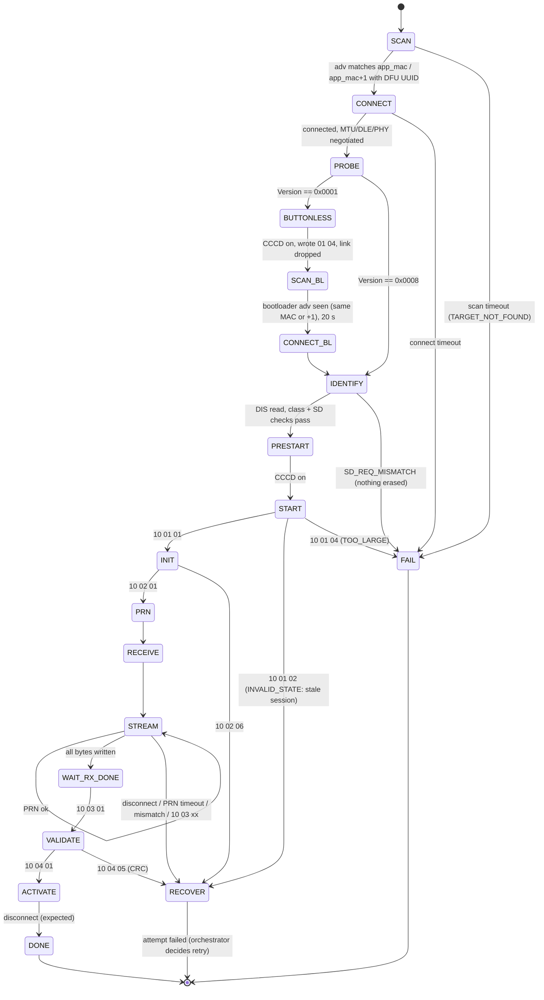
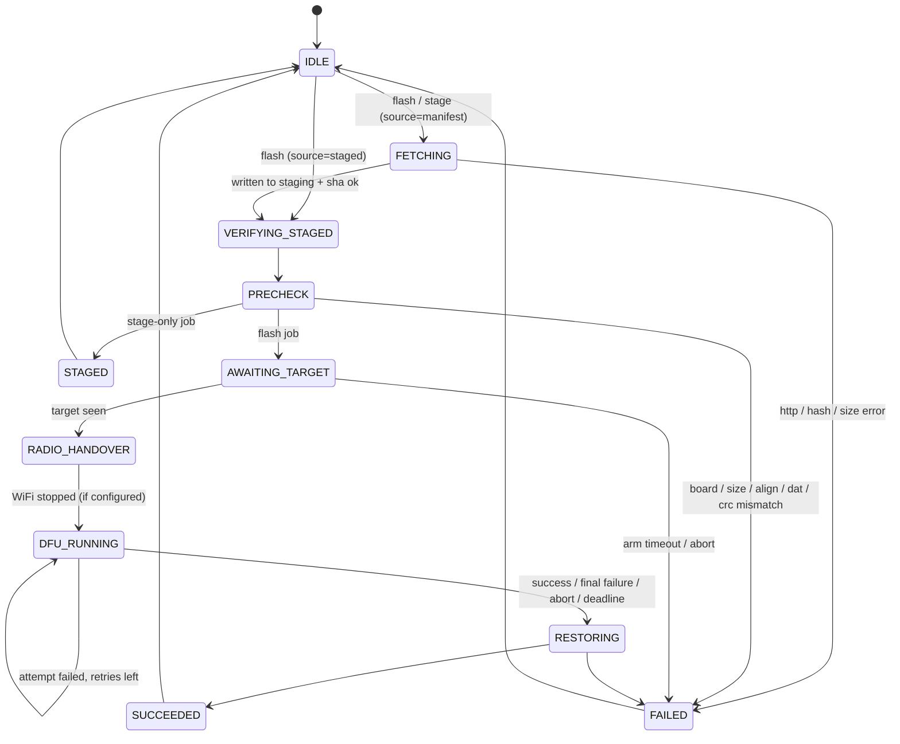

# DFU32 — Specification

**Status:** Draft v0.1 (2026-11-04). No implementation exists yet.
**License:** MIT
**Companion docs:** [`docs/OPEN_QUESTIONS.md`](docs/OPEN_QUESTIONS.md), [`docs/MILESTONES.md`](docs/MILESTONES.md), [`docs/PROTOCOL_NOTES.md`](docs/PROTOCOL_NOTES.md)

DFU32 is ESP-IDF firmware for a small ESP32 device that sits near an nRF52 board. It pulls an application image from a server you control and flashes it into the nRF52 over BLE, using Nordic's **legacy** DFU protocol as implemented by the **Adafruit nRF52 bootloader** and its OTAFIX fork. It replaces the "phone running nRF Device Firmware Update standing next to the repeater" workflow.

The motivating use is MeshCore LoRa repeaters (RAK4631, RAK3401, XIAO nRF52840, Ikoka). DFU32 itself is **firmware-agnostic**: it works with any application on a legacy-DFU Adafruit bootloader. Anything specific to a firmware is either configuration or tooling outside the device.

Statements marked **[verified]** were checked against the source of the reference implementations. Pinned commits and citations are in [`docs/PROTOCOL_NOTES.md`](docs/PROTOCOL_NOTES.md). Statements marked **[bench]** must be confirmed on hardware.

---

## 1. Goals

1. **G1:** Flash an nRF52 application over legacy BLE DFU from an ESP32, with no phone and no PC in the loop.
2. **G2:** Pull artifacts (`firmware.bin`, `firmware.dat`, `manifest.json`) over HTTP, verify them, and stage them in ESP32 flash *before* touching the target.
3. **G3:** Never erase the target's app unless every check that can run before START has passed. These checks are: board match, hashes, size limit, word alignment, `.dat` device type, and the `.dat` CRC16 against the `.bin`.
4. **G4:** Survive failure. A failed or interrupted flash can be retried from the staged image without the network, including after the ESP32 reboots.
5. **G5:** Never leave the network permanently down. Layered timeouts and watchdogs restore WiFi or reboot the ESP32.
6. **G6:** Make it observable. Structured logs, a persisted record per run, live state and progress, and a full browser UI plus a JSON API.
7. **G7:** Make it portable. Run on any ESP32-S3 or classic ESP32 with ≥4 MB flash and **≥2 MB PSRAM**. Boards without PSRAM are not supported.
8. **G8:** Keep it firmware-agnostic. Nothing in the device depends on MeshCore.

## 2. Non-goals (v1)

- Secure DFU (service `FE59`) targets.
- Flashing a SoftDevice or bootloader. DFU32 is application-only: START type `0x04`, with SD and BL sizes both 0.
- ESP32-based MeshCore nodes. They use WiFi OTA.
- Putting the target into OTA mode automatically. The operator runs `start ota` over USB serial or remotely over the mesh. See §5.1.
- MQTT / Home Assistant discovery. This is a later milestone; v1 is HTTP only.
- Accepting the raw DFU `.zip` on the device (miniz extraction). This is a later milestone; `tools/` handles zip extraction server-side.
- On-device Tailscale (MicroLink). Dropped. Reach the device over the LAN or an existing subnet router.
- HTTPS for artifact fetch and TLS for the API. v1 uses plain HTTP with SHA-256 integrity, which is sufficient on a trusted LAN. See §11.
- Resuming a partial transfer. Every attempt restarts from START; the bootloader has no supported resume **[verified]**.
- Fleet management. The data model is keyed by target ID from day one, but v1 caps it at **one target**.

## 3. System overview

```
┌────────────┐   HTTP (LAN)   ┌──────────────────────────── DFU32 (ESP32) ──────────────────────────┐   BLE (legacy DFU)  ┌──────────────┐
│ Artifact   │◀──────────────│ fetcher ─▶ staging partition ─▶ prechecks ─▶ dfu_client (NimBLE)    │────────────────────▶│ nRF52840     │
│ server     │  manifest.json │                                                                     │                     │ Adafruit BL  │
│ (yours)    │  firmware.bin  │ api/web UI ◀─▶ orchestrator ◀─▶ ble_mgr (scan, Improv BLE, central) │                     │ (+ app with  │
└────────────┘  firmware.dat  │ net_mgr (WiFi, Improv, mDNS, SNTP) · config (NVS) · runlog          │                     │  BLEDfu)     │
       ▲                      └─────────────────────────────────────────────────────────────────────┘                     └──────────────┘
       │ HTTP API / UI                         ▲  Improv Serial (USB) / Improv BLE (provisioning)                                   ▲
   Operator / HA ─────────────────────────────┘                                                     Operator: `start ota` (serial / remote over mesh)
```

### 3.1 End-to-end flow ("arm, then wait")

1. Operator: `POST /api/v1/targets/{id}/flash`. The UI has a **Flash** button.
2. DFU32 fetches `manifest.json`. If its image matches what is already staged (same sha256), DFU32 reuses the staging partition. Otherwise it downloads `.bin`/`.dat` straight into the staging partition, streaming the SHA-256 as it goes, and verifies. If the manifest can't be fetched and `source=staged` was requested, DFU32 uses the staged image after re-verifying it.
3. Prechecks run (§7.2). Any failure aborts. Nothing on the target has been touched.
4. State becomes **AWAITING_TARGET**. The UI says "Ready, run `start ota` on the target now". DFU32 scans for up to `arm_timeout_s`, which defaults to 600 s. WiFi stays up during the scan.
5. The operator runs `start ota` on the repeater, over USB serial or remotely over LoRa as admin **[verified: no serial-only guard]**. The app starts advertising buttonless DFU at its own MAC.
6. DFU32 sees the target, **stops WiFi** (configurable), connects, enters the bootloader (§5.2), runs the transfer (§6), and validates/activates.
7. WiFi is restored and a run record is written. State becomes **SUCCEEDED** or **FAILED**. On failure, the staged image stays in place and the target is usually still in BLE DFU mode, so **Flash** can be pressed again offline.

DFU32 can also stage without arming: `POST /targets/{id}/stage`. This lets the operator confirm the image is good on the device before taking the repeater down.

---

## 4. Platform

| Item | Decision |
|---|---|
| Framework | ESP-IDF **v6.1** (in service until about Feb 2029). C++ at IDF's default standard (gnu++2b); C where libraries are C. No exceptions, no RTTI. |
| BLE | NimBLE via `h2zero/esp-nimble-cpp` **pinned `2.6.0`** (master is 3.0.0-dev). Central for DFU, observer for scanning, peripheral only for Improv BLE while unprovisioned. |
| JSON | `espressif/cjson` managed component (IDF 6 removed the built-in `json` component). |
| Hashing | mbedTLS / PSA SHA-256 (built in). CRC16-CCITT implemented locally. |
| Supported SoCs | ESP32-S3 (BLE 5: 2M PHY, DLE) and classic ESP32 (BLE 4.2: DLE, no 2M PHY). |
| Min flash / PSRAM | 4 MB flash, **2 MB PSRAM required**. PSRAM holds the 64 KB log ring, HTTP and JSON buffers, and WiFi/LWIP buffers (`CONFIG_SPIRAM_TRY_ALLOCATE_WIFI_LWIP`). That leaves internal RAM for NimBLE, which stays on internal allocation. Staging stays in flash, for offline retry after a reboot. |
| Bench boards | **Adafruit Feather ESP32-S3** (primary: native USB, NeoPixel, BOOT button) and **Adafruit Feather ESP32 V2** (secondary target, or the fake-bootloader test fixture, §14.3). |
| Also supported | Generic ESP32-S3 N16R8 DevKitC (8/16 MB layout). |

Board profiles live in `boards/<name>/sdkconfig.defaults` and are layered on top of the root `sdkconfig.defaults`. Each profile sets flash size, the partition CSV, the console transport, PSRAM, and pins (LED, button).

| Profile | Flash / PSRAM | Partition CSV | Console | NeoPixel (data / power, active-high) | Red LED | Button |
|---|---|---|---|---|---|---|
| `feather_esp32s3` (Adafruit #5477, **primary bench board**) | 4 MB / 2 MB quad PSRAM | `partitions/4mb.csv` | USB-Serial-JTAG | GPIO33 / GPIO21 | GPIO13 | BOOT GPIO0 |
| `feather_esp32_v2` | 8 MB / 2 MB | `partitions/8mb.csv` | UART0 via USB bridge | GPIO0 / GPIO2 (shared with STEMMA I2C power) | GPIO13 | SW GPIO38 (input-only) |
| `esp32s3_n16r8` | 16 MB / 8 MB | `partitions/8mb.csv` (8 MB is plenty) | USB-Serial-JTAG | GPIO48 / none *(varies by clone, verify)* | none | BOOT GPIO0 |

The Feather pins are verified against Adafruit's board definitions: arduino-esp32 `variants/adafruit_feather_esp32s3/pins_arduino.h` and `variants/adafruit_feather_esp32_v2/pins_arduino.h`, plus CircuitPython `ports/espressif/boards/adafruit_feather_esp32s3_4mbflash_2mbpsram/`. The NeoPixel power pin must be driven HIGH before the LED is used.

Both button pins have quirks:
- Feather S3 BOOT (GPIO0) is a strapping pin. A long-press is only interpreted once the app is running; holding it at reset enters the ROM download mode, as normal.
- Feather V2 GPIO38 is input-only and has no internal pull-up, so the firmware must not rely on one. Whether the board has an external pull-up, and the button polarity, are **[bench]**.

---

## 5. Target model & entering DFU

### 5.1 How the target gets into OTA mode (decided: manual)

DFU32 never triggers OTA itself. The operator does, with whatever mechanism the target firmware provides. For MeshCore that is `start ota`, sent:
- over USB CDC serial (CR line ending, no password), or
- **remotely over LoRa** after an admin login from a companion app. This keeps the flow fully remote: you don't need to be near the repeater, which was the point of the project.

`start ota` replies `OK - mac: XX:XX:XX:XX:XX:XX`, most significant byte first. That address is the one DFU32 needs.

A UART/USB-host trigger may come later as an optional `trigger` plugin. The data model leaves room for it (`target.trigger = "manual"`).

### 5.2 Two entry paths into the bootloader [verified]

| Path | How the target got there | Advertises as | Address | Bootloader GATT | DFU32 action |
|---|---|---|---|---|---|
| **A. Buttonless (app)** | App started Bluefruit `BLEDfu` (MeshCore `start ota`) | `<BOARD>_OTA` (`RAK4631_OTA`, `RAK3401_OTA`, `XIAO_NRF52_OTA`) | **App MAC** | DFU service in the app; Version char = `0x0001` | Connect, enable CP CCCD, write `01 04`, expect disconnect. The app saves peer data, sets GPREGRET=`0xB1`, and **jumps** to the bootloader with no reset. |
| **B1. Bootloader after app jump** | Path A completed | `AdaDFU` (upstream) or `4631_DFU`/`3401_DFU`/`XIAO_DFU`/`T096_DFU` (OTAFIX) | **App MAC if the peer data is accepted, else MAC+1.** Bench: OTAFIX on a Heltec T096 came up at **MAC+1**; the nRF54 port on a XIAO nRF54LM20A at the same MAC. | Version = `0x0008` | Legacy DFU transfer (§6). |
| **B2. Bootloader after reset** | GPREGRET=`0xA8` reset, e.g. OTAFIX after a failed transfer or `SYS_RESET`, or another firmware's own OTA command | as B1 | **App MAC with LSB + 1** (uint8 wrap, no carry) | Version = `0x0008` | Legacy DFU transfer (§6). |

What this means for discovery:
- The configured identity is the **app MAC** plus its address type. Usually that is random static; it is captured from the scan.
- When looking for a target, DFU32 accepts an advertiser **by address alone**: the app MAC, or app MAC LSB + 1. What the advertising contains is informational only:
  - the MeshCore app's `start ota` advertising carries only flags, TX power and the name **[verified: `NRF52Board::startOTAUpdate`]**;
  - on the bench, a Heltec T096's bootloader was not found when the DFU UUID was required.

  After connecting, the DFU service is confirmed by GATT discovery, and the Version characteristic proves which stage it is: `0x0001` is the app, `0x0008` the bootloader. If the re-scan after a buttonless jump fails, DFU32 logs any DFU-looking advertisers it did see: a name containing "DFU", the legacy UUID, or the Secure DFU UUID `FE59`, which is unsupported. Names are never used for matching, because they differ by bootloader variant and board.
- After connecting, DFU32 reads the Version char (`0x1534`). `0x0001` means take path A. `0x0008` means skip straight to the transfer.
- **Bonded-peer whitelist:** if the app handed over a non-zero IRK, the bootloader whitelists only that peer **[verified]**. DFU32 never bonds, so this doesn't arise. If DFU32 sees the target advertising but can't connect, it reports `TARGET_WHITELISTED?` as a hint.

### 5.3 Bootloader identification & policy

After connecting to the bootloader and **before START**, DFU32 reads the Device Information Service:
- **Firmware Revision**, e.g. `"0.9.2-OTAFIX2.3 s140 6.1.1"` or `"0.11.0 s140 7.3.0"`
- **Model Number**, e.g. `"WisBlock RAK4631"`

It then classifies the bootloader:

| Class | Detected by | Failure behaviour [verified] | Policy (decided: warn only) |
|---|---|---|---|
| `otafix` | `OTAFIX` in the firmware revision | After a failure or power cut with no app, it comes back in **BLE OTA indefinitely** at MAC+1. This is the reference target: the operator's repeater reports `0.9.2-OTAFIX2.2-BP1.3`, which has MTU 247, DLE and lazy erase. | proceed |
| `upstream_ge_0_10` | semver ≥ 0.10.0 | `SYS_RESET` mid-transfer returns to BLE OTA. 360 s inactivity timeout. A power cut with no app gives **USB DFU** (BLE lost). | proceed, warn on power-cut risk |
| `upstream_le_0_9` | semver ≤ 0.9.x, no OTAFIX | Any reset with no app gives **USB-only DFU**. A failed transfer needs a cable to recover. | **warn** (`BOOTLOADER_RECOVERY_REQUIRES_USB`) and proceed |
| `unknown` | DIS missing or unparsable | unknown | warn and proceed |
| `nrf54` | SoftDevice `s145` in the firmware revision ([meshtastic/nRF54_Bootloader](https://github.com/meshtastic/nRF54_Bootloader), e.g. `v0.5.0-dev2 s145 10.0.1` on a XIAO nRF54LM20A) | Same legacy DFU, MTU 247, 244-byte packets. The `.dat` **device type must be 0x0054**. RRAM is written without erasing, so the old app **stays bootable until the init packet is accepted**. MAC+1 after a reset. | proceed |

The SoftDevice version is parsed from the same string. If `.dat` `sd_req` contains neither `0xFFFE` nor the FWID of the installed SoftDevice (6.1.1 → `0x00B6`, 7.3.0 → `0x0123`, from a built-in table), DFU32 **aborts before START** with `SD_REQ_MISMATCH`. Otherwise the bootloader would reject INIT *after* erasing the app **[verified]**.

The classification also sets transfer parameters: `upstream_le_0_9` has a 20-byte Packet characteristic and MTU 23 **[verified]**.

It also sets the `.dat` device type the bootloader requires: 0x0052 for every nRF52 variant, 0x0054 for `nrf54`.
- At staging time DFU32 accepts either known type.
- Once the bootloader is identified, still before START, a mismatch aborts with `DEVICE_TYPE_MISMATCH` and sends SYS_RESET.
- The nRF52840 size ceiling (§7.2) applies only to 0x0052 images. The nRF54 bootloader checks the size at START itself.

---

## 6. Legacy DFU client

The byte-level details are in [`docs/PROTOCOL_NOTES.md`](docs/PROTOCOL_NOTES.md). This section is normative.

### 6.1 GATT

| Char | UUID | Props used | Notes |
|---|---|---|---|
| Control Point (CP) | `00001531-1212-EFDE-1523-785FEABCD123` | write **with response**, notify | The CCCD **must** be enabled before any CP write, or the write fails with ATT error `0xFD`. |
| Packet | `00001532-…` | write **without response** | OTAFIX exposes WNR only. |
| Version | `00001534-…` | read | `01 00` = app (buttonless), `08 00` = bootloader |
| DIS (0x180A) | 0x2A26 FW rev, 0x2A24 model | read | Optional. Absence gives class `unknown`. |

### 6.2 Opcodes

| Op | CP write | Payload / follow-up | Expected response | Timeout (default) |
|---|---|---|---|---|
| START_DFU | `01 04` | Wait `start_settle_ms`, default 500 ms (a Packet write before START is processed is **silently dropped**). Then write Packet `00000000 00000000 <app_size u32 LE>` (exactly 12 bytes). | `10 01 01`. Upstream erases the whole image size before replying; OTAFIX erases lazily. | **60 s** |
| INIT_DFU | `02 00`, Packet = entire `.dat` in **one** write (≤ chunk size), then `02 01` | — | `10 02 01` (only after `02 01`) | 30 s |
| PRN_REQ | `08 NN NN` (u16 LE N) | — | none | — |
| RECEIVE_FW | `03` | stream the image (§6.3) | `10 03 01` after the last byte | 60 s after the last byte. The `prn_timeout_ms` window paces streaming. |
| VALIDATE | `04` | — | `10 04 01`. `05` = CRC error. | 30 s |
| ACTIVATE_RESET | `05` | — | none. The link drops. A disconnect within 10 s counts as **success**. | 10 s |
| SYS_RESET | `06` | used for recovery (§6.5) | none | — |
| REPORT_SIZE | `07` | diagnostics only | `10 07 01 <u32>` | 5 s |

Status codes: `01` SUCCESS, `02` INVALID_STATE, `03` NOT_SUPPORTED, `04` DATA_SIZE_EXCEEDS_LIMIT, `05` CRC_ERROR, `06` OPERATION_FAILED. A response whose request opcode doesn't match is a protocol error.

### 6.3 Streaming, PRN and flow control

- **MTU:** request 247 (`CONFIG_BT_NIMBLE_ATT_PREFERRED_MTU=247`). The bootloader never starts the exchange itself.
  - On S3, also request DLE 251 and 2M PHY. On a classic ESP32, request DLE only.
- **Chunk size** = `min(244, floor((mtu − 3) / 4) * 4)`, forced to **20** for `upstream_le_0_9`.
  - Every data write **must be a multiple of 4**, or the bootloader returns `10 03 03` **[verified]**. A non-4n+3 MTU such as 185 must be rounded down.
  - Never pass `len > mtu−3` to esp-nimble-cpp `writeValue(…, false)`. It **silently turns into a long write with response** **[verified]**. The client asserts this.
- **App size** must be a multiple of 4. This is a precheck; DFU32 never pads, because padding would change the CRC.
- **Connection interval:** DFU32 requests a fixed **20 ms** by default (`--interval` overrides it).
  - Bench throughput on OTAFIX with ~1 packet per event: 30 ms 9.2 kB/s, 20 ms 12.4 kB/s, 15 ms 14.8 kB/s.
  - 11.25 ms and 7.5 ms overran the bootloader's lazy-erase buffering.
- **PRN:** default **8** (configurable 1–16). **Bench (OTAFIX 2.3, 7.5 ms interval): PRN 16 overran the bootloader's 8-packet pending-write buffer and failed with `10 03 06`.** Receipts acknowledge arrival, not flash completion. DFU32 caps PRN at 8 for every bootloader (`--force-prn` overrides). A stream-phase `06` or link loss makes the next attempt more conservative (§6.5).
  - ESPHome documents that the bootloader runs out of memory beyond 8 unacknowledged packets.
  - The bootloader RX pool is 16 buffers (OTAFIX/upstream ≥0.10) or 8 (older).
- Flow:
  1. Write N packets without response.
  2. Wait for `11 <u32 bytes>`, within `prn_timeout_ms`, default 5000.
  3. **Check that the reported byte count equals bytes sent.** The reference hosts ignore it; DFU32 treats a mismatch as `PRN_MISMATCH`, which fails the attempt.
  4. The last partial window doesn't wait for a PRN; the RECEIVE response stands in for it.
- **Local back-pressure:** `writeValue` returns `false` on `BLE_HS_ENOMEM` (mbuf pool exhausted) and does **not** set `getLastError()`. On `false`, DFU32 yields 2 ms and retries, up to 50 times, then fails with `BLE_TX_STALL`. The msys pool is sized for PRN × chunk (§12).
- **Expected throughput** (to be measured **[bench]**):
  - 244 B, PRN 8, 15–30 ms interval: about 15–40 kB/s, so about 20–60 s for a 800 kB image.
  - 20 B: about 2–5 kB/s, so 3–7 min.
- Progress is reported as bytes acknowledged (PRN), not bytes written.

### 6.4 Client state machine (one attempt)



### 6.5 Recovery & retries (decided: configurable, default 3 attempts)

The bootloader keeps its half-finished state across a disconnect and keeps re-advertising. A fresh START then returns INVALID_STATE **[verified]**. Recovery for each attempt:

1. If still connected, write `SYS_RESET` (`06`). If disconnected, reconnect first (scan app MAC and MAC+1, 20 s), then write `06`.
2. What happens next depends on the bootloader:
   - OTAFIX and upstream ≥0.10 reboot back into BLE OTA. The address may now be **MAC+1** (path B2).
   - `upstream_le_0_9` with no app lands in **USB DFU** and disappears from BLE. DFU32 records `TARGET_LOST_USB_RECOVERY_REQUIRED` and stops retrying.
3. Back off 3 s → 6 s → 12 s, then go back to SCAN. A retry scans for 30 s, not the full arm timeout, because the target is already in its bootloader.

How each failure is classified (`dfu::classify_transfer_failure`, host-tested):

| Failure | Kind | Next attempt |
|---|---|---|
| Link lost, `06`, receipt timeout or mismatch **while streaming** | LinkOrOverrun | Backoff, then **one step more conservative**: interval up to 30 ms, then PRN halved (min 2). This answers the bench finding that fast intervals overrun OTAFIX's lazy-erase buffer. |
| START → `02` INVALID_STATE (stale session) | StaleSession | SYS_RESET already sent; retry after 1 s. |
| Connect or discovery failure; timeout outside the stream; CRC error at VALIDATE | Transient | Backoff, same parameters. |
| START → `04` too large, INIT → `06` (init packet rejected), stream → `03` (bad length), image read error, device-type or SD mismatch | Fatal | Stop; nothing gets better by retrying. |
| Target not found on attempt 1 (arm timeout) | Fatal | Stop. |
| Target not found on a retry | TargetGone | Stop. With an `upstream_le_0_9` bootloader after START: `TARGET_LOST_USB_RECOVERY_REQUIRED`. |

After `max_attempts` (default 3, range 1–10) the run is **FAILED**. The staged image is kept and WiFi is restored. The record names the last phase reached and the last error. If the target was erased, the UI shows **"target has no application — retry flash"** prominently.

A failure *before* START (scan, connect, buttonless, identify) doesn't touch the target app, and the record says so (`target_erased: false`).

---

## 7. Orchestrator (job state machine)

There is one job at a time, globally. While a job is active, scan, stage and flash requests get `409 Busy`.



### 7.1 Radio handover

- WiFi stays up during FETCHING and AWAITING_TARGET; scanning coexists through software coex.
- **WiFi-off during the transfer is an option.** The device-level default is the `wifi_off_dfu` config value. Any flash request can override it with `"wifi_off": true|false`, and the UI has a checkbox next to **Flash**.
  - The value used is recorded in each run record (`wifi_off`) so that on/off runs can be compared.
  - The shipped default is decided after bench comparison. The nRF52's flash writes are probably the bottleneck, so WiFi on/off may make little difference.
- When the option is on and the target is found, DFU32 calls `esp_wifi_stop()` before connecting. The driver stays initialised, so restoring is just `esp_wifi_start()` plus reconnect.
- While WiFi is off, the HTTP API can't be reached. The LED shows progress, and the run record captures it afterwards.
- With the option off, WiFi stays up for live progress, and the §7.3 deadline/restore layers still apply. On S3 this relies on software coexistence; on a classic ESP32 it's expected to be slower.
- NimBLE stays initialised for the life of the app. `NimBLEDevice::deinit()` is used only for Improv BLE teardown if needed. **`esp_bt_controller_mem_release` is never called**, because it is irreversible.

### 7.2 Prechecks (all run before the target is touched)

| Check | Error |
|---|---|
| `manifest.boards` contains `target.board` (exact, case-insensitive) | `BOARD_MISMATCH` |
| `.bin`/`.dat` SHA-256 and size match the manifest | `HASH_MISMATCH` / `SIZE_MISMATCH` |
| `bin.size % 4 == 0` | `IMAGE_NOT_WORD_ALIGNED` |
| `bin.size ≤ target.max_app_size`. Default 798 720 (S140 7.3.0, the smaller case). Configurable per target, e.g. 802 816 for S140 6.1.1. | `IMAGE_TOO_LARGE` |
| `.dat` parses: `device_type == 0x0052`, `sd_req` non-empty, length 14 + 2·(N−1) | `DAT_INVALID` |
| CRC16-CCITT (init 0xFFFF) of the `.bin` == CRC in the `.dat` | `DAT_CRC_MISMATCH` |
| `.dat` length ≤ chunk size (always true for dfu-ver 0.5; 0.8 signed packets are out of scope) | `DAT_TOO_LONG` |
| Improv BLE is not active (§9.3) | `BLE_BUSY` |
| *(at IDENTIFY, still before START)* SoftDevice FWID ∈ `sd_req` or `0xFFFE` ∈ `sd_req` | `SD_REQ_MISMATCH` |

### 7.3 Never leave the network down (layered)

1. **Per-operation timeouts** in the DFU client (§6.2).
2. **Run deadline:** an `esp_timer` armed when WiFi stops. Deadline = `120 s + attempts × (60 s + bin.size / 2 kB·s)`, capped at `dfu_deadline_max_s` (default 1200 s). When it fires, DFU32 aborts the BLE link, restores WiFi, and records `DEADLINE_EXCEEDED`.
3. **Task watchdog:** the DFU task subscribes to the TWDT (10 s) and feeds it on progress or state change. A wedged NimBLE call triggers a panic and reboot.
4. **Restore verification:** if WiFi isn't connected within 60 s of restore, DFU32 retries once, then calls `esp_restart()`.
5. **Boot invariants:** WiFi always starts at boot. An NVS flag `job_active` is set when a job begins and cleared when it ends. If it's set at boot, the previous run is recorded as `ABORTED_BY_REBOOT`, along with whether START had been reached.

---

## 8. Staging partition

A raw data partition (`type=data, subtype=0x40, label=staging`) accessed with `esp_partition_*`. There is no filesystem. It holds exactly one image.

| Offset | Size | Content |
|---|---|---|
| `0x0000` | 4096 | Header (below). It is written **last**, after the data is verified, so a valid header means a valid image. |
| `0x1000` | `bin.size` | Application image |

Header, little-endian, all fixed-size:

```
0x000  char[8]   magic "DF32STG1"
0x008  u32       header_version = 1
0x00C  u32       bin_size
0x010  u8[32]    bin_sha256
0x030  u16       dat_size (≤ 64)
0x032  u8[64]    dat bytes (the .dat is stored inline)
0x072  u8[32]    dat_sha256
0x092  u16       crc16 (from .dat, cross-checked)
0x094  char[32]  target_id
0x0B4  char[32]  board
0x0D4  char[64]  version (from manifest)
0x114  u8[32]    manifest_sha256
0x134  u64       staged_at (unix s, 0 if no SNTP)
0x13C  char[256] manifest_url
0x23C  u32       header_crc32 (over 0x000..0x23B)
```

Write sequence:
1. Erase the header sector, which invalidates the old image.
2. Erase the data range.
3. Stream the HTTP body into `0x1000+`, hashing as it goes.
4. Read back and re-hash. This catches flash write errors and costs about 1 s for 800 kB.
5. Write the header.

Before use (flash with `source=staged`), DFU32 re-verifies `header_crc32` and the bin SHA-256.

Sizes: **832 KB** on the 4 MB layout (header + 802 816 B max app + slack); **1 MB** on 8 MB+.

---

## 9. Configuration & provisioning

### 9.1 Storage

All configuration lives in NVS namespace `dfu32`, with a `schema_ver` key for migrations. WiFi credentials are held by the IDF WiFi NVS storage, written through Improv.

| Key | Type | Notes |
|---|---|---|
| `hostname` | str | Default `dfu32-XXXX` (last 2 bytes of MAC). Also the mDNS name. |
| `token_sha256` | blob[32] | Only the **hash** of the API token is stored. Empty means unclaimed. |
| `ntp_server` | str | Default `pool.ntp.org` |
| `wifi_off_dfu` | u8 | Default WiFi-off behaviour during the transfer. Provisionally 1; the final default is set after bench comparison. Per-request override: `wifi_off`. |
| `tgt.0.*` | — | Target 0 (v1 cap = 1): |
| ↳ `id` | str ≤ 31 | slug, e.g. `attic-repeater` |
| ↳ `name` | str | display name |
| ↳ `board` | str ≤ 31 | free-form, matched against `manifest.boards` |
| ↳ `mac`, `addr_type` | 6 B, u8 | **app** MAC (§5.2) and address type |
| ↳ `manifest_url` | str ≤ 255 | |
| ↳ `max_app_size` | u32 | default 798 720 |
| ↳ `prn`, `max_attempts`, `arm_timeout_s`, `start_settle_ms`, `prn_timeout_ms` | u16 | tuning knobs, with the defaults above |
| ↳ `last_ok_version`, `last_ok_at` | str, u64 | updated on success |

### 9.2 Provisioning (decided: Improv, both Serial and BLE)

- **Improv Serial** runs on the console port: USB-Serial-JTAG on S3, UART0 on classic. It works with ESP Web Tools, so flashing DFU32 and setting WiFi happen in one browser session. After provisioning, it returns the URL `http://<ip>/`.
- **Improv BLE** runs only while unprovisioned, or for 5 min after a 2 s button press. It uses a NimBLE GATT server and advertising. It is fully torn down when provisioning finishes or the window expires, and a DFU can't start while it is active.
- Everything else (target, manifest URL, tuning) is set in the web UI or with `PUT /api/v1/targets/{id}`.

### 9.3 Token bootstrap (decided: claim on first use)

- While unclaimed, `POST /api/v1/claim` returns a newly generated token **once**: 32 bytes from `esp_fill_random` with the radio on, encoded base64url. DFU32 stores its SHA-256.
- While unclaimed, the mutating endpoints are disabled; only `GET /status`, `GET /`, and `/claim` work.
- **Unclaim:** hold the button 5 s. The LED flashes amber. This clears `token_sha256` without touching anything else.
- **Factory reset:** hold 15 s. This erases the `dfu32` namespace and WiFi credentials. The staging partition and run log are kept.
- On boards with no button, use `POST /api/v1/system/token/rotate` while authenticated, or reflash with an NVS erase.

---

## 10. Control interface

### 10.1 HTTP API

The API is served by `esp_http_server` on port 80, with an mDNS name of `dfu32-XXXX.local`. JSON everywhere. Auth is `Authorization: Bearer <token>`, compared in constant time.

**Unauthenticated:**
- `GET /api/v1/status` (non-sensitive fields only)
- `GET /` and the static UI assets
- `POST /api/v1/claim`, only while unclaimed

**Authenticated:** everything else.

After 5 failed auth attempts, responses are delayed 1 s for 60 s.

| Method & path | Purpose |
|---|---|
| `GET /api/v1/status` | Device state, job state, phase, progress, target summaries, staged image summary, WiFi RSSI, uptime, DFU32 version |
| `POST /api/v1/claim` | → `{"token":"…"}` (once) |
| `GET /api/v1/targets` · `GET /api/v1/targets/{id}` | Target config and the last result |
| `PUT /api/v1/targets/{id}` | Create or update a target. `409` if creating a 2nd target in v1. |
| `DELETE /api/v1/targets/{id}` | |
| `POST /api/v1/targets/{id}/check` | Fetch the manifest; return its version, sizes, board match, whether it equals the staged image, and `last_ok_version`. Writes nothing. |
| `POST /api/v1/targets/{id}/stage` | Fetch, verify and stage without arming. Async; poll status. |
| `POST /api/v1/targets/{id}/flash` | Body `{"source":"manifest"\|"staged","arm_timeout_s":600,"wifi_off":true}`. Every field is optional; `wifi_off` defaults to config `wifi_off_dfu`. Arms the job (§3.1). Async → `202`. |
| `POST /api/v1/jobs/current/abort` | Abort the job. If the transfer has started, this leaves the target erased; the response warns about that. |
| `GET /api/v1/targets/{id}/runs` · `GET /api/v1/runs/{seq}` | Run records (§13.2), including the log tail |
| `GET /api/v1/staging` · `DELETE /api/v1/staging` | Staged image header / invalidate it |
| **`POST /api/v1/ble/scan`** | Body `{"duration_s":10,"dfu_only":false}` → a list of advertisers (below). Refused during a job. |
| `GET /api/v1/logs?since=<seq>` | Log ring entries, newest last |
| `GET /api/v1/config` · `PUT /api/v1/config` | Device-level settings (§9.1) |
| `POST /api/v1/system/ota` | Upload DFU32 firmware (raw body, `esp_ota_*`). Rollback-protected. |
| `POST /api/v1/system/reboot` · `POST /api/v1/system/token/rotate` | |

Scan result entry (this backs the UI's "pick a target" tool):

```json
{
  "addr": "C2:4E:11:9A:03:7F",
  "addr_type": "random",
  "name": "RAK4631_OTA",
  "rssi": -61,
  "services": ["00001530-1212-efde-1523-785feabcd123"],
  "dfu": "app_buttonless",          // app_buttonless | bootloader | null (inferred from name/UUID; confirmed only on connect)
  "matches_target": null             // target id if addr == a target's mac or mac+1
}
```

Results are deduplicated by address and sorted by RSSI. In the UI each row has a **Use as target** button that pre-fills `mac` and `addr_type`. The hint text reads: "Run `start ota` on the repeater first. MeshCore repeaters don't advertise otherwise."

`GET /api/v1/status` example while running:

```json
{
  "device": {"version":"0.3.0","uptime_s":8123,"claimed":true,"wifi":{"connected":true,"rssi":-58}},
  "job": {"state":"DFU_RUNNING","target":"attic-repeater","attempt":1,"max_attempts":3,
          "phase":"STREAM","bytes_acked":412672,"bytes_total":786432,"rate_bps":21400,
          "target_erased":true,"bootloader":"otafix 0.9.2-OTAFIX2.3 s140 6.1.1"},
  "staged": {"target":"attic-repeater","version":"v1.18.0-81dbae5","bin_size":786432,"sha256":"…"}
}
```

(This is visible during the transfer only when the run has `wifi_off: false`.)

### 10.2 Web UI (decided: full config UI)

A single-page app in vanilla JS plus CSS, embedded gzip-compressed with a budget of ≤ 40 KB. It uses the same JSON API. The token is kept in `localStorage`, with a claim screen when the device is unclaimed. Views:

- **Status:** job state, progress bar, phase timeline, target-erased warning, Check / Stage / Flash / Abort.
- **Target:** config form, plus the **BLE scan picker** (scan button, live list, "Use as target").
- **Runs:** history table, with run detail and log tail.
- **Logs:** live tail by polling `/logs?since=`.
- **System:** WiFi info, hostname, DFU32 firmware upload, reboot, token rotate, tuning defaults.

The UI polls `/status` every 1 s while a job is active and every 10 s otherwise.

### 10.3 Home Assistant

v1 has no MQTT. HA can use `rest` sensors on `/api/v1/status` and `rest_command` for check, stage and flash. A later milestone adds MQTT with HA discovery: an `update` entity, a state sensor, a progress sensor, and a Flash button.

---

## 11. Manifest format

There is one manifest per target URL. It describes exactly one image. Channels such as stable or beta are simply different URLs.

```json
{
  "schema": 1,
  "name": "MeshCore repeater",
  "version": "v1.18.0-81dbae5",
  "boards": ["rak4631"],
  "created": "2026-10-15T12:00:00Z",
  "bin": {"url": "firmware.bin", "size": 786432, "sha256": "<64 hex>"},
  "dat": {"url": "firmware.dat", "size": 14,     "sha256": "<64 hex>"},
  "init": {"device_type": 82, "sd_req": [182], "crc16": 4660},
  "notes": "optional free text"
}
```

- `url` values resolve relative to the manifest URL; absolute URLs are allowed.
- `boards` is required and non-empty. DFU32 refuses if `target.board` isn't in it.
- `init` is optional. If present, it is cross-checked against the parsed `.dat` and a mismatch gives `DAT_INVALID`. This catches a server-side mix-up of `.dat` files.
- Unknown keys are ignored. `schema > 1` is refused (`MANIFEST_UNSUPPORTED`).
- Size limits: manifest ≤ 8 KB, `.dat` ≤ 64 B, `.bin` ≤ the staging capacity.
- **Trust model (decided: HTTP + hashes).** Hashes catch corruption, not malicious substitution. Anyone who can spoof the artifact server on your LAN can flash an image that passes the board, `.dat` and CRC checks. This is accepted for v1. An Ed25519-signed manifest is a later, compatible addition (`"sig"` field plus a public key in NVS).

**Server tooling** (`tools/`, Python, MIT):
- `dfu32-pack <dfu.zip> --board rak4631 --version … --out dir/` reads the adafruit-nrfutil `manifest.json` in the zip, extracts `.bin` and `.dat`, validates them (word alignment, dev type, CRC16, max size), and writes `manifest.json`.
- `dfu32-meshcore-fetch --tag repeater-v1.18.0 --env RAK_4631_repeater` resolves the asset through the GitHub API, because asset names carry a SHA suffix and `releases/latest` is shared across firmware types. It then calls `dfu32-pack`. This is MeshCore-specific, so it stays in tooling.
- `dfu32-stage-image` builds a raw staging-partition image for flashing with `parttool.py` (used by Milestone 1).

---

## 12. Partition tables & sdkconfig

### 12.1 `partitions/4mb.csv` (floor)

| Name | Type | SubType | Offset | Size | Notes |
|---|---|---|---|---|---|
| nvs | data | nvs | 0x9000 | 0x6000 | 24 KB |
| otadata | data | ota | 0xF000 | 0x2000 | |
| phy_init | data | phy | 0x11000 | 0x1000 | |
| runlog | data | 0x41 | 0x12000 | 0xE000 | 14 × 4 KB run-record slots |
| ota_0 | app | ota_0 | 0x20000 | 0x170000 | 1.44 MB |
| ota_1 | app | ota_1 | 0x190000 | 0x170000 | 1.44 MB |
| staging | data | 0x40 | 0x300000 | 0xD0000 | 832 KB |
| coredump | data | coredump | 0x3D0000 | 0x10000 | |
| *(free)* | | | 0x3E0000 | 0x20000 | 128 KB headroom |

- **App size budget:** CI fails a build above **1.30 MB**, which is 90% of a slot.
- Estimated footprint: WiFi + NimBLE (central + peripheral) + httpd + http_client (no TLS) + cJSON + mDNS + UI comes to about 1.0–1.2 MB **[bench]**.
- If the budget is blown, the levers are: trim NimBLE roles, drop mDNS, move the UI into its own partition.

### 12.2 `partitions/8mb.csv` (8 MB and 16 MB boards)

nvs 60 KB, otadata, phy, runlog 64 KB (16 slots), ota_0/ota_1 3 MB each, staging 1 MB, coredump 64 KB, and about 768 KB free (more on 16 MB boards). The exact offsets are in `partitions/8mb.csv`. That leaves room for future features such as zip ingestion or a larger log.

### 12.3 sdkconfig requirements (root `sdkconfig.defaults`)

```
# Partitions / app
CONFIG_PARTITION_TABLE_CUSTOM=y                 # CSV chosen by board profile
CONFIG_BOOTLOADER_APP_ROLLBACK_ENABLE=y         # DFU32 self-OTA; mark valid after WiFi+HTTP up
CONFIG_ESP_COREDUMP_ENABLE_TO_FLASH=y
CONFIG_COMPILER_OPTIMIZATION_SIZE=y
CONFIG_COMPILER_CXX_EXCEPTIONS=n
CONFIG_COMPILER_CXX_RTTI=n

# Bluetooth (NimBLE)
CONFIG_BT_ENABLED=y
CONFIG_BT_NIMBLE_ENABLED=y
CONFIG_BT_NIMBLE_ROLE_CENTRAL=y
CONFIG_BT_NIMBLE_ROLE_OBSERVER=y
CONFIG_BT_NIMBLE_ROLE_PERIPHERAL=y              # Improv BLE only
CONFIG_BT_NIMBLE_ROLE_BROADCASTER=y             # Improv BLE only
CONFIG_BT_NIMBLE_MAX_CONNECTIONS=2
CONFIG_BT_NIMBLE_ATT_PREFERRED_MTU=247
CONFIG_BT_NIMBLE_MSYS_1_BLOCK_COUNT=32          # >= PRN(8) x fragments + headroom; tune on bench
CONFIG_BT_NIMBLE_NVS_PERSIST=n                  # never bond
CONFIG_BT_NIMBLE_LOG_LEVEL_WARNING=y
# S3 profile only:
CONFIG_BT_NIMBLE_50_FEATURE_SUPPORT=y
CONFIG_BT_NIMBLE_LL_CFG_FEAT_LE_2M_PHY=y

# Coexistence
CONFIG_ESP_COEX_SW_COEXIST_ENABLE=y

# PSRAM (required; mode is set per profile: quad on Feather S3 / Feather V2, octal on N16R8)
CONFIG_SPIRAM=y
CONFIG_SPIRAM_IGNORE_NOTFOUND=n                 # refuse to boot on a no-PSRAM board
CONFIG_SPIRAM_USE_MALLOC=y
CONFIG_SPIRAM_TRY_ALLOCATE_WIFI_LWIP=y
# NimBLE stays on internal RAM (default BT_NIMBLE_MEM_ALLOC_MODE_INTERNAL)

# Watchdogs
CONFIG_ESP_TASK_WDT_EN=y
CONFIG_ESP_TASK_WDT_TIMEOUT_S=10
CONFIG_ESP_TASK_WDT_PANIC=y

# HTTP
CONFIG_HTTPD_MAX_REQ_HDR_LEN=1024
CONFIG_ESP_HTTP_CLIENT_ENABLE_HTTPS=n           # v1 is HTTP-only; Kconfig DFU32_HTTPS later

# Logging
CONFIG_LOG_DEFAULT_LEVEL_INFO=y
CONFIG_LOG_TIMESTAMP_SOURCE_SYSTEM=y
```

DFU32 Kconfig (`main/Kconfig.projbuild`):
- `DFU32_MAX_TARGETS` (default 1)
- `DFU32_NEOPIXEL_GPIO`, `DFU32_NEOPIXEL_POWER_GPIO`, `DFU32_STATUS_LED_GPIO` (plain red LED), `DFU32_BUTTON_GPIO`. −1 = none; set by the board profile.
- `DFU32_LOG_RING_KB` (default 64, in PSRAM)
- `DFU32_IMPROV_BLE` (y)
- `DFU32_DEBUG_ENDPOINTS` (n): fault injection (§14.2)

Managed components (`main/idf_component.yml`):
- `h2zero/esp-nimble-cpp: "2.6.0"`
- `espressif/cjson`
- `espressif/mdns`
- `espressif/led_strip`

For Improv, a small local implementation of the Improv Serial and BLE protocols is planned (see the open questions on reusing the upstream SDK).

---

## 13. Observability

### 13.1 Logging

- Every module logs through `ESP_LOGx` with a stable tag (`dfu`, `ble`, `fetch`, `stage`, `api`, `net`, `job`).
- An `esp_log_set_vprintf` hook tees output to the console and to a **64 KB ring in PSRAM**. Each line gets a monotonically increasing sequence number and an uptime timestamp.
- DFU phase transitions are logged as one-line `key=value` events, so they can be parsed: `evt=phase run=42 attempt=1 from=START to=INIT dt_ms=17234`.

### 13.2 Run records (persisted)

The `runlog` partition is a ring of 4 KB slots: 14 slots on 4 MB, 16 on 8 MB. A slot is erased and written once per run, at the end of the run or when an abort-by-reboot is detected at boot. Each slot holds:
- A JSON header (≤ 1 KB): `seq`, `target`, `trigger` (`api`/`ui`), `source` (`manifest`/`staged`), `version`, `bin_sha256`, `started_at`, `duration_ms`, `result` (`SUCCEEDED`/`FAILED`/`ABORTED`/`ABORTED_BY_REBOOT`), `error` (code from §13.3), `last_phase`, `attempts`, `target_erased`, `bootloader` (class + DIS string), `wifi_off`, `mtu`, `chunk`, `prn`, `bytes_acked`, `rate_bps`, `warnings[]`.
- The last **≤ 3 KB of log lines** from the run.

Writes are rare (one sector per run), so wear isn't a concern.

### 13.3 Error codes

`HTTP_ERROR`, `MANIFEST_INVALID`, `MANIFEST_UNSUPPORTED`, `HASH_MISMATCH`, `SIZE_MISMATCH`, `BOARD_MISMATCH`, `IMAGE_TOO_LARGE`, `IMAGE_NOT_WORD_ALIGNED`, `DAT_INVALID`, `DAT_CRC_MISMATCH`, `DAT_TOO_LONG`, `STAGING_IO`, `NO_STAGED_IMAGE`, `BLE_BUSY`, `TARGET_NOT_FOUND`, `CONNECT_FAILED`, `TARGET_WHITELISTED`, `BUTTONLESS_FAILED`, `BOOTLOADER_NOT_FOUND`, `SD_REQ_MISMATCH`, `DFU_STATUS_<op>_<code>` (e.g. `DFU_STATUS_START_04`), `RESPONSE_TIMEOUT_<op>`, `PRN_TIMEOUT`, `PRN_MISMATCH`, `BLE_TX_STALL`, `LINK_LOST`, `TARGET_LOST_USB_RECOVERY_REQUIRED`, `DEADLINE_EXCEEDED`, `ABORTED`, `ABORTED_BY_REBOOT`.

### 13.4 LED (NeoPixel)

| Colour | Meaning |
|---|---|
| dim green | idle |
| blue pulse | fetching or staging |
| cyan blink | awaiting target (run `start ota`) |
| magenta fill | transfer progress, brightness tracking percent done |
| solid green, 10 s | success |
| solid red | last run failed |
| red fast blink | target erased and not reflashed |
| amber flash | button-hold feedback |

On the Feathers, the plain red LED (GPIO13) is the **attention** indicator, separate from the NeoPixel. It stays solid while the target is known to be erased and not yet reflashed, so the warning is visible even if the NeoPixel is dimmed or disabled. It blinks during the transfer.

---

## 14. Testing

### 14.1 Host unit tests (`idf.py --preview set-target linux`, or plain CMake + Unity)

The `dfu_proto` component has no IDF or NimBLE dependency, so it can be tested on a host. Tests cover:
- opcode encoders and response/PRN decoders, including malformed input;
- the `.dat` parser, with the dev-type, SD-list and length edge cases;
- CRC16-CCITT against vectors produced by adafruit-nrfutil;
- the chunk planner (MTU 23/185/247 → 20/180/244, and the multiple-of-4 invariant);
- the manifest parser and validation, with every error path;
- staging header encode/decode and CRC32;
- the bootloader-class parser for real DIS strings;
- the client state machine, driven through an `IDfuTransport` interface by a scripted mock. The mock injects: INVALID_STATE on START, disconnect at byte N, PRN timeout, PRN byte mismatch, CRC error, ENOMEM storms, and a missing ACTIVATE disconnect.

### 14.2 On-device fault injection (`CONFIG_DFU32_DEBUG_ENDPOINTS=y`, never in release builds)

`POST /api/v1/debug/fault {"kind":…, "at_bytes":N}` drops the link, stalls the task (to test the watchdog), skips a PRN check, corrupts one chunk (to test the CRC path end to end), or simulates a hang with WiFi off (to test the deadline restore).

### 14.3 Fake bootloader fixture (optional, recommended)

`test/fakeboot/` is a NimBLE **peripheral** app for the spare **Feather ESP32 V2**. It implements the legacy DFU server state machine as verified from bootloader source: buttonless app mode switching to bootloader mode, MAC+1 on "reset", the 12-byte START rule, the multiple-of-4 rule, PRN, CRC16 validate, an INVALID_STATE stale session, and per-test fault scripts. It enables fast, non-destructive regression runs, and none of them risk a real nRF52.

### 14.4 Bench with a real nRF52 (sacrificial board)

The setup:
- a **XIAO nRF52840** (UF2 recovery by double-tapping reset) with the **OTAFIX** bootloader and a MeshCore repeater build;
- optionally a second board on **upstream 0.9.x** to exercise the `upstream_le_0_9` warning and recovery path;
- the nRF52 USB serial connected to a PC for `start ota` and `ver`, and the DFU32 console on another port.

| Test | Method | Expected |
|---|---|---|
| Happy path | stage → flash → `start ota` | SUCCEEDED; `ver` on the target shows the new version |
| Re-flash from staging offline | unplug the AP, flash with `source=staged` | SUCCEEDED |
| Bad hash | corrupt `firmware.bin` on the server | `HASH_MISMATCH`; target never touched |
| Wrong board | manifest `boards:["xiao"]` vs target `rak4631` | `BOARD_MISMATCH` |
| Bad `.dat` | dev-type `0xFFFF` or wrong CRC | `DAT_INVALID` / `DAT_CRC_MISMATCH` before START |
| SD mismatch | `.dat` sd_req `0x00B6` on a S140 7.3.0 XIAO | `SD_REQ_MISMATCH` at IDENTIFY; app intact |
| Oversize | pad the image past the limit | `IMAGE_TOO_LARGE` precheck |
| Link drop mid-transfer | move the board or shield it / debug fault | RECOVER → `SYS_RESET` → retry at MAC+1 → SUCCEEDED |
| **Power cut mid-transfer** | cut nRF power at ~50% | OTAFIX: comes back at MAC+1 in BLE OTA; the next flash succeeds. Upstream: USB-only; record the outcome. |
| DFU32 reboot mid-transfer | press ESP32 reset at ~50% | the next boot records `ABORTED_BY_REBOOT, target_erased=true`; Flash from staging succeeds |
| WiFi-restore watchdog | debug hang fault | WiFi back within the deadline, `DEADLINE_EXCEEDED` recorded |
| Arm timeout | arm and never run `start ota` | `TARGET_NOT_FOUND` after `arm_timeout_s`; WiFi never went down |
| Throughput matrix | PRN 1/4/8/16 × MTU 23/247 × 1M/2M PHY × WiFi off/on | record the rate and failure rate to set defaults |

### 14.5 Recovery plan for a bricked target

1. **Board stuck in BLE OTA** (OTAFIX): simply flash again from DFU32. Nothing else is needed.
2. **Board in USB DFU or with no app:** double-tap reset to get the UF2 drive (a `<BOARD>BOOT` volume) and drag the MeshCore `.uf2` onto it. Alternatively use `adafruit-nrfutil dfu serial --package <zip> -p <port> -b 115200`.
   - RAK4631/RAK3401: the double-tap is on the base board's reset button.
   - XIAO: tap the reset pads twice.
3. **Bootloader damaged:** reflash over SWD (J-Link or Pico debugprobe) with the bootloader hex. Out of scope for DFU32; it is documented in `docs/RECOVERY.md`.
4. To reduce risk: install OTAFIX on every repeater before relying on DFU32. The UI warns on `upstream_le_0_9`.

---

## 15. Repository layout (planned)

```
dfu32/
  CMakeLists.txt, sdkconfig.defaults, partitions/{4mb,8mb}.csv, boards/<profile>/sdkconfig.defaults
  main/                  app_main, orchestrator, Kconfig.projbuild, idf_component.yml
  components/
    dfu_proto/           pure C++: opcodes, codecs, .dat, CRC16, chunk planner, client FSM (transport-agnostic)
    dfu_ble/             IDfuTransport impl on esp-nimble-cpp; scanner
    ble_mgr/             NimBLE lifecycle + role arbitration (scan / central / Improv peripheral)
    staging/             raw partition format
    fetcher/             esp_http_client → staging, SHA-256
    manifest/            cJSON parse + validate
    net_mgr/             WiFi STA, stop/restore, mDNS, SNTP, Improv Serial/BLE
    api/                 esp_http_server routes, auth, embedded UI
    config/              NVS schema + migration
    runlog/              log ring + run-record partition
    indicator/           LED + button
  web/                   UI source → gzipped into api/ at build time
  tools/                 dfu32-pack, dfu32-meshcore-fetch, dfu32-stage-image
  test/host/, test/fakeboot/
  docs/
```

## 16. Licensing notes for porting

| Reference | License | Use |
|---|---|---|
| Adafruit_nRF52_Bootloader / OTAFIX | MIT (SDK11 files carry Nordic headers) | Ground truth for server behaviour; read, don't copy |
| esphome PR 20481 `dfu.py` | MIT | Can be ported |
| wasp-os/ota-dfu-python | Apache-2.0 | Can be ported, with attribution |
| Adafruit_nRF52_nrfutil | BSD-3-Clause | Can be ported (`.dat`/CRC16 for `tools/`) |
| lucidnx/nrf_dfu_py | **No license** | Behavioural reference only; **do not copy code** |
| astronomer80/nrf52_bledfu_win | **No license** | Behavioural reference only |
| esp-nimble-cpp | Apache-2.0 | Dependency |
